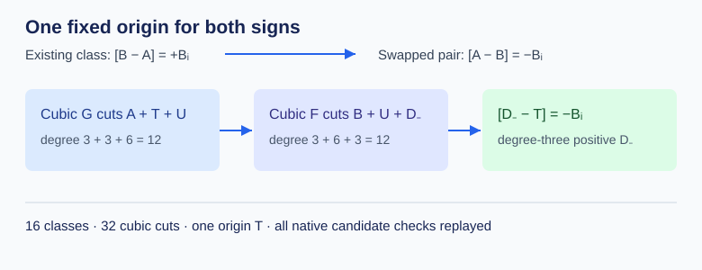

# Fixed-origin degree-three representatives for the negative P-192 Type I classes

**Result.** All 16 negatives of the previously reduced P-192 Type I base classes now have a positive degree-three divisor representative relative to the *same* three-point origin \(T\). Swapping the old degree-three input pair makes its class \([A-B]=-[B-A]\). Native PARI constructs two plane-cubic sections per class, then a separate checker replays all 32 cuts, residual coordinates, curve equations, squarefreeness, disjointness, and rank-nine interpolation. Each class succeeds with the first frozen denominator trial \([1,1,1,1]\). Together with the prior 16 positive reductions, the sign-closed base now has 32 fixed-origin representatives.

Let the prior input pair represent \([B-A]\), and let \(T\) be the existing effective origin of degree three on the smooth plane quartic. For the negative class, set the new denominator input to \(A\) and the new numerator input to \(B\). A cubic section \(G\) cuts \(A+T+U\), where \(\deg U=6\). A second cubic \(F\) cuts \(B+U+D_-\), where \(\deg D_-=3\). Since both cuts are sections of \(\mathcal O_C(3)\), their divisor classes agree and \([D_--T]=[A-B]=-[B-A]\). The pair swap also keeps \(A\) disjoint from \(T\), avoiding a repeated-anchor interpolation condition. [Lean's `negative_fixed_origin_cubic_class_identity`](../../lean/SignedBase.lean) proves the class equality under the two section-divisor hypotheses; the concrete quartic, section, and finite-field obligations are checked by native arithmetic. The original [fixed-origin theorem and proof map](../../BRANCH_CONTINUATION.md) give the positive-side construction.

The [native producer](../../type_i_negative_fixed_origin_produce.gp) reads the existing [frozen decimal input](../../type_i_fixed_origin_native_input.gp), including the exact quartic, origin, and original 16 divisor pairs. It constructs a six-dimensional denominator condition, tests the six fixed coefficient trials in order, factors the degree-twelve resultant, derives the degree-six residual's \(y\)-coordinate by a quotient-ring gcd, solves the rank-nine numerator interpolation, and extracts the final degree-three residual. The [candidate coefficients](../../type_i_negative_fixed_origin_candidates.gp) and equivalent [structured JSON](../../type_i_negative_fixed_origin_reduction.json) retain all 16 cases; JSON serialization quotes the GP decimal coefficients and labels the eight tuple fields without changing their values. The GP candidate file is the verifier's input. The [separate verifier](../../type_i_negative_fixed_origin_verify.gp) recomputes both resultants and residual \(y\)-coordinates from the frozen input and candidate coefficients. Its [log](../../type_i_negative_fixed_origin_verify.log) ends `NEGATIVE_FIXED_ORIGIN_VERIFY_PASS classes=16 cuts=32 prime_bits=192`; the [producer log](../../type_i_negative_fixed_origin_produce.log) records all 16 candidates. A preliminary producer run with a coefficient-serialization error is preserved in the adjacent `failed` log.

This is a correctness run on standard P-192 with \(p=6277101735386680763835789423207666416083908700390324961279\) and \(r=6277101735386680763835789423176059013767194773182842284081\). The previous [signed-base census](../run-20261015T1708Z/REPORT.md) found 1,344 geometry-admitted three-sum targets and zero matches among 64 frozen accepted known-scalar queries. The new reduction changes representation availability; it does not alter that frozen support or query result. A complete genus-three Jacobian relation collector must still measure a larger ordinary-query workload, useful rank, final relation linear algebra, target descent, and the cost of signed-base indexing.

Reproduce from the repository root with `gp -q research/p192_extension_cover_20261012/type_i_negative_fixed_origin_produce.gp` and then `gp -q research/p192_extension_cover_20261012/type_i_negative_fixed_origin_verify.gp`. Require both pass markers and no PARI `***` lines. The [run manifest](RUN.json) records hashes, command boundaries, native versions, and validation status. From `research/p192_extension_cover_20261012/lean`, run `lake build SignedBase && lake env leanchecker --fresh --verbose SignedBase && lake env lean SignedBase.lean`; the [successful build](../../lean/negative-fixed-origin-lean-build-final-20261015.log), [fresh replay](../../lean/negative-fixed-origin-lean-fresh-20261015.log), and [axiom audit](../../lean/negative-fixed-origin-lean-axioms-20261015.log) are retained. The earlier [network](../../lean/negative-fixed-origin-lean-build-20261015.log) and [disk](../../lean/negative-fixed-origin-lean-build-diskfailed-20261015.log) failures remain distinct from the successful check. The figure is editable SVG, and the matching Typst source and inspected PDF are retained here.
