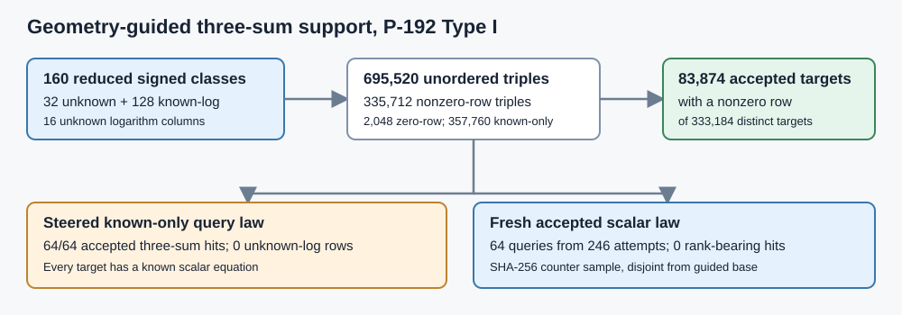

# P-192 Type I fixed-origin mixed-base collector

**Result.** All 160 signed quotient classes in the frozen P-192 Type I base now have verified fixed-origin degree-three genus-three Jacobian representatives: 32 signed unknown-log classes and 128 signed known-log guided classes. The mixed base gives 333,184 distinct nonzero-row three-sum targets, including 83,874 that pass the two-character geometry filter. A steered known-scalar law hit a three-sum on all 64 accepted queries, but each hit used only known-log classes and gave rank 0/16. A disjoint SHA-256-counter law supplied 64 fresh accepted known-scalar queries in 246 attempts and had zero rank-bearing matches.

| Requested step | Status and evidence |
| --- | --- |
| Reduce the exact quotient-coordinate classes | Verified for 160 signed classes. The [original 80 positive representatives](../../type_i_fixed_origin_reduction.json), [16 negative base representatives](../../type_i_negative_fixed_origin_reduction.json), and [64 new negative guided representatives](../../type_i_guided_negative_fixed_origin_reduction.json) share the same three-point origin. The [new GP producer](../../type_i_guided_negative_fixed_origin_produce.gp) and [independent verifier](../../type_i_guided_negative_fixed_origin_verify.gp) replay all 128 new cubic cuts. |
| Change three-sum coverage with a geometry-guided collector | Exact 695,520-triple census in the [native source](../../native_support/src/bin/mixed_known_log.rs) and [receipt](../../type_i_mixed_known_log_support.json). The two query laws and all 128 accepted query scalars are frozen there. |
| Retain a known scalar equation | Every steered target is a sum of three known-log quotient classes, and every fresh target is (q=a(-2G)) with recorded nonzero (a<r). The [Lean mixed-log equations](../../lean/SignedBase.lean) identify when a hit supplies an unknown-log row. |

The quartic is the previously verified P-192 Type I nonhyperelliptic genus-three cover over \(\mathbb F_p\), with \(p=6277101735386680763835789423207666416083908700390324961279\). A fixed-origin class is represented as \([D-T]\), where \(D\) and \(T\) are rational effective degree-three divisors. For the 64 new negative guided classes, the GP producer reverses each existing pair, then constructs cubic sections \(G\) and \(F\) with cuts \(B+T+U\) and \(A+U+D\). Equality of the section classes gives \([D-T]=-[B-A]\). The [verifier log](../../type_i_guided_negative_fixed_origin_verify.log) records 64 successful class replays: both resultants and residual coordinates, curve equations, squarefreeness, disjointness, and rank-nine interpolation. The [JSON converter](../../type_i_guided_negative_fixed_origin_json.sh) retains 192-bit coefficients as decimal strings. Together with the existing 80 positive and 16 negative base replays, this supplies 320 checked cubic cuts. The abstract class identity is proved in `P192ExtensionCover.negative_fixed_origin_cubic_class_identity`; the concrete quartic, section, and divisor hypotheses are checked by GP.

The quotient base contains \(\pm B_i\) for 16 unknown classes and \(\pm a_j(-2G)\) for 64 known scalars. Its 160 signed points are distinct; the known points are not extra unknown columns. Among 695,520 unordered triples, 357,760 are known-only, 2,048 have a zero unknown coefficient row, and 335,712 have a nonzero row. The 335,712 triples map to 333,184 distinct rank-bearing targets; their character cells are `++: 83874`, `+-: 82884`, `-+: 83246`, and `--: 83180`. Known-only triples map to 349,696 distinct targets, disjoint from the rank-bearing target set in this frozen base. The earlier 32-point signed base had 1,344 accepted support targets, so adding the 128 known-log signed classes raises accepted rank-bearing support by exactly \(83874/1344=62.40625\) while retaining 16 unknown columns. The larger base also raises unordered triple work from 5,984 to 695,520.

The steered law takes the first 64 distinct `++` known-only three-sums in lexicographic point-key order, rejecting identity targets. Their scalars are sums of the three stored guided scalars modulo \(r\), so all 64 hits have an explicit known scalar equation. Because the rank-bearing and known-only target sets are disjoint here, those hits yield zero unknown-log rows and rank 0/16. The second law takes SHA-256 counter scalars under the frozen domain tag, rejects zero, values at least \(r\), and the original guided scalars, and accepts only `++` character pairs. It produced 64 accepted queries from 246 attempts, 182 character rejections, and zero rank-bearing hits; its rank is also 0/16. The [independent GP replay](../../type_i_mixed_known_log_independent.gp) verifies all 64 steered point keys, both character conditions for all 128 queries, and 349,696 distinct known-only scalar sums; its [pass log](../../type_i_mixed_known_log_independent.log) records zero fresh known-only hits. Initial parser and stack-size errors remain in separate `failed` logs. These are local correctness and coverage diagnostics. The [formatted-source receipt](../../type_i_mixed_known_log_support.json) records per-phase elapsed times of 16,719 ms setup, 6,163 ms pair indexing, 217,741 ms triple enumeration, 127,820 ms character census, and 2,033 ms fresh-query filtering, on this shared host. Its `time -p` wall interval was 371.03 s; the earlier pre-format run took 235.57 s under a different concurrent load. Neither is an isolated performance comparison.

For an ideal uniform accepted nonzero scalar query, the prior density certificate gives at least \(L=1569275433846670190958947353987675545133315652035359680560\) admissible scalars. Hence this fixed base has hit probability at most \(83874/L<2^{-173}\) for a nonzero row. The SHA-256-counter run is an empirical deterministic sample; that certificate is a bound for the stated uniform law. The Lean module checks the integer inequality in `mixed_p192_hit_integer_certificate`, the general mixed-triple relation equation in `mixed_three_row_equation`, its one-unknown/two-known specialization in `mixed_one_unknown_log_equation`, and the known-only equation in `known_only_three_log_equation`. These theorems assume the additive-group homomorphism and known-log identities; they do not encode the concrete P-192 divisor-to-quotient map.

The [run manifest](RUN.json) records source, binary, input, output, GP, Lean, and host hashes. Reproduce the GP geometry from the repository root with `gp -q research/p192_extension_cover_20261012/type_i_guided_negative_fixed_origin_produce.gp` and `gp -q research/p192_extension_cover_20261012/type_i_guided_negative_fixed_origin_verify.gp`. Build the collector with `CARGO_TARGET_DIR=/private/tmp/p192-mixed-cargo cargo build --release --offline --manifest-path research/p192_extension_cover_20261012/native_support/Cargo.toml --bin mixed_known_log`; run that executable with the three JSON inputs and an output path in the same order documented in the [source](../../native_support/src/bin/mixed_known_log.rs). Replay the independently generated scalar sums and query characters with `gp -s 256000000 -q research/p192_extension_cover_20261012/type_i_mixed_known_log_independent.gp`. The pre-format `time -l` wrapper returned status 1 after its executable printed the pass marker because `sysctl kern.clockrate` was denied by the local sandbox; its [raw log](../../type_i_mixed_known_log_support.preformat.log) is retained. A pre-format direct replay exited 0, [logged separately](../../type_i_mixed_known_log_replay.preformat.log). The final formatted-source run exited 0 under `time -p`. Its result matches the pre-format census byte-for-byte after removing the source-hash and five elapsed-time fields; both normalized files have SHA-256 `7a7ff634aac572e7f3a58ab7ef4354b431dd3869feb2ad197ae8da8e5bd00d40`. The Lean build, fresh checker, and axiom output are retained beside the [module](../../lean/SignedBase.lean).

The [GP input converter](../../type_i_mixed_known_log_gp_input.sh) regenerates the decimal query vectors from the Rust receipt with `sh research/p192_extension_cover_20261012/type_i_mixed_known_log_gp_input.sh`; its output hash is checked in the manifest.

The repository-wide `cargo test --release --lib --offline` run [retains its complete log](root_lib_test.log): 4,071 passed, 12 failed, 117 ignored over 653.29 s. Three `jv_cover` tests timed out or fell below their accepted-run count under parallel load, and nine `pollard_collab` tests failed to create local sockets in the sandbox. The three exact `jv_cover` cases [replayed](jv_replayed_f4_serial.log) [serially](jv_stopped_f4_serial.log) [and passed](jv_no_lost_solution_serial.log) on the same release binary. The [local-socket replay](pollard_collab_local_socket_replay.log) passed all 37 filtered tests with localhost access. The original root-suite result remains failed in the run manifest; all P-192 native, GP, and Lean checks above passed.

The [99-file P-192 artifact manifest](../../ARTIFACTS.sha256) passes its [complete hash check](artifact_hash_check.log). The existing WeakCurves leaderboard manifest also passes after its stale workflow-file hash was corrected; that [check log](leaderboard_hash_check.log) is included here because it explains the prior draft PR CI failure.

The next collector design needs a law that conditions on geometry while reaching a nonzero-row target without using unknown logs to construct the target scalar. It also needs fixed-origin representatives for any new target classes used in Jacobian arithmetic, verified ordinary-query yield, rank growth, final relation solving, unseen-target descent, and a matched single-target cost comparison before assigning a complete `IC1` candidate ID. This run's proposal remains `candidate_id: null`.
