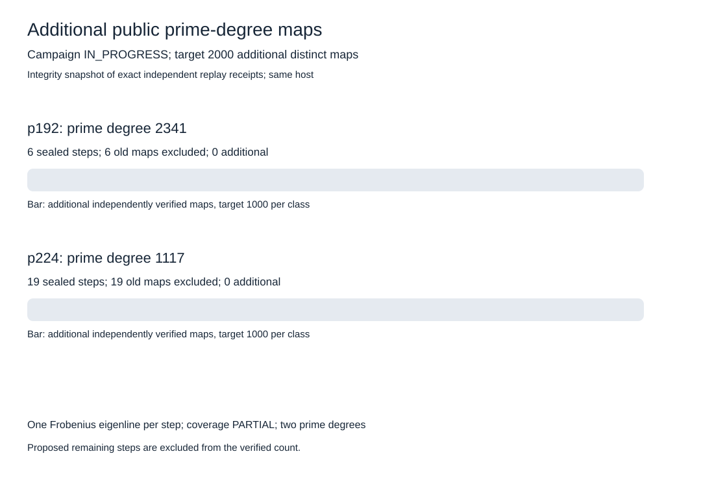

# Additional large prime-degree maps

Campaign status: **IN_PROGRESS**. Independently verified additional maps: **0 / 2000**. Remaining: **2000**. Two distinct prime degrees, with coverage PARTIAL at each step.

| Class | Prime degree | Sealed steps | Prior maps excluded | Additional maps |
|---|---:|---:|---:|---:|
| p192 | 2341 | 6 | 6 | 0 |
| p224 | 1117 | 19 | 19 | 0 |

Each sealed step passed exact independent kernel, codomain, rational curve-equation and subgroup checks and 20 public scalar-transport checks. SUMMARY.json binds all exact ICV1/EC1 identities and normalized map keys. This integrity snapshot checks linked file hashes and replay receipts; algebraic replay occurs inside the dedicated walk executable before advancing. Repeated prefix work is included in phase sums but excluded from new-map yield.

The original hundred-map evidence remains frozen. Raw evidence is in the launch directory until archived and committed. The requested 2000-map outcome remains open while the count is below 2000 or either walk is unfinished. Canonical graphs and models remain at the earlier archived campaign until new results are durably saved. No IC measurement or performance ledger row is promoted.
