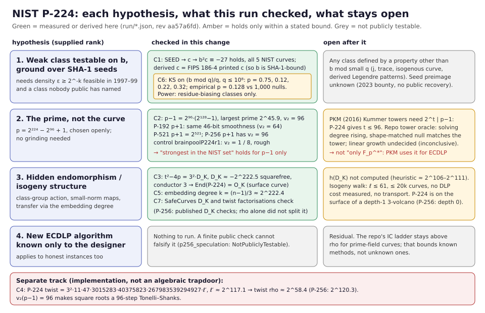

# Status

**Assessment plus one native run; no ECDLP cost measured.** Protocol:
[`PROTOCOL.md`](PROTOCOL.md), frozen in commit `aa57a6fd` before the run. Run:
[`run/`](run/), produced by `target/release/p224_hypotheses` at that commit,
with a clean tree, rustc 1.97.0 and 4 threads, in 122 s of wall time. Every
check finished, no stop condition fired, and the b-residue test raised no flag.

This is not an index-calculus measurement. It has no rho ratio, no phase is
priced, and no scoreboard row is owed (`AGENTS.md` §7a). Under `AGENTS.md`
"Intermediate-cost and asymmetric-access hypotheses", a hypothesis about a
designer's capability is not evidence that a trapdoor exists. A bounded null is
not nonexistence.



Evidence labels used below:

- **MEASURED**: computed by this run (file named).
- **DERIVED**: algebra from stated inputs.
- **VERIFIED-PUBLISHED**: a published factorisation re-checked here by product
  and primality, not found here.
- **PRIOR**: an earlier committed result in this repository.
- **OPEN**: not established.

# The supplied claim

The supplied text ranks four hypotheses "by how compatible each is with the
public evidence and 1999-era compute":

1. a weak class recognisable from `(p, a, b)` without point counting, found by
   grinding SHA-1 seeds. It cites `b_seed_profile` and the Solinas-correlation
   experiment as nulls;
2. the prime, not the curve. It says hidden-SNFS primes (Fried–Gaudry–Heninger–
   Thomé) have no ECDLP analogue. It calls P-224's 46-bit-smooth `p − 1` "the
   strongest structure of this kind in the NIST set", affecting "only DLP in
   F_p^*, not the curve group";
3. hidden endomorphism or isogeny structure. It says all public checks pass
   (embedding degree, anomaly, CM discriminant and class number "enormous")
   and that the isogeny walk found no weak curve at small degree;
4. an unpublished ECDLP algorithm: the unfalsifiable residual.

The ranking itself is an interpretation. This report checks the factual
claims it rests on, for P-224.

# Claim-by-claim

| # | claim in the supplied text | status for P-224 | evidence |
|:--|:--|:--|:--|
| 1a | `b` is bound to a SHA-1 seed, so a grind is the only freedom | **holds.** `SEED → c` (X9.62 A.3.3.1) gives FIPS 186-4's printed `c` and `b²c ≡ −27` for all five NIST curves | MEASURED `run/seeds.json` |
| 1b | the b-residue KS profile came back null | **was P-256 only, at `q ≤ 10⁵`**, not the `10⁶` its module doc describes. P-224 is now null at every bound (table below) | MEASURED `run/b_residues.json` |
| 1c | statistical probes on `b` are the right kind of test | **partly.** The KS test sees only classes that bias `b mod q`. A cheaply testable class defined any other way is invisible to it | DERIVED, PROTOCOL §4 |
| 1d | the Solinas-correlation experiment came back null | **P-256 only; not a test on `b`; miscalibrated.** It tests bit correlations of the P-256 reduction map. Its z uses `√(E(1−E)/n)` with `E = p_r p_c`, not the independence variance `√(p_r(1−p_r)p_c(1−p_c)/n)`. That deflates every `z` by ≈ √3: the recorded max 2.46 over 131,072 pairs sits far below the ≈ 4.5 a calibrated null gives. Rescaled (≈ 4.3) it is still below its 6.1 threshold, so the null probably survives with less power than claimed. Not rerun here | code read `src/cryptanalysis/solinas_correlations.rs`, PRIOR `RESEARCH_P256.md` |
| 2a | hidden-SNFS trapdoor is real for F_p DLP | **holds**, with a date fix: ePrint 2016/961, EUROCRYPT 2017. A Solinas prime is *openly* SNFS-friendly, so no hiding is involved; for P-224 the F_p^* DLP is also trivial by Pohlig–Hellman (largest prime 2^45.9) | literature; MEASURED `run/prime_sides.json` |
| 2b | P-224's `p − 1` is 46-bit smooth | **holds.** `p − 1 = 2⁹⁶·3·5·17·257·641·65537·274177·6700417·67280421310721`, all proved prime, `v₂ = 96` | MEASURED `run/prime_sides.json` |
| 2c | "the strongest structure of this kind in the NIST set" | **true for `p − 1` only.** P-192's `p + 1 = 2⁶⁴(2¹²⁸ − 1)` has the same 46-bit smoothness; P-521's `p + 1 = 2⁵²¹` is 2-smooth; P-256's `p + 1` has `v₂ = 96` and largest prime 2^93.2 | MEASURED `run/prime_sides.json` |
| 2d | it "only affects DLP in F_p^*, not the curve group" | **too strong.** Petit–Kosters–Messeng (PKC 2016), the one published algebraic ECDLP mechanism for prime fields, builds factor bases from towers whose Kummer form needs `2^t \| p − 1`. P-224 supports `t ≤ 96`; every other NIST prime gives 1. Its Dickson-torus form needs `2^t \| p + 1`: P-192 (64), P-256 (96), P-521 (521). Nikolaev (CTCrypt 2024) flags P-224 under the PKM criterion. This repository's tower-oracle rounds measured a rising solving degree, with a shape-matched null matching the tower and linear growth undecided. That is an open lead, not an attack | PRIOR `research/notes/index-calculus/RESEARCH_PKM_TOWER_ORACLE.md`, `research/notes/cm-isogeny/RESEARCH_PKM_CRITERION.md` |
| 3a | huge embedding degree | **holds, exactly.** `k = (n − 1)/3 ≈ 2^222.4`, from a complete factorisation of `n − 1`. P-256: `k = (n − 1)/3` | MEASURED `run/embedding_degree.json` |
| 3b | not anomalous | **holds** (`n ≠ p`) | DERIVED |
| 3c | CM discriminant enormous | **holds, and is now resolved here.** `t² − 4p = −3³·29·79·7523·40927·11549194661·L₁₄₈`, factored completely. So the conductor of `Z[π]` is 3 and `D_K = −3·29·79·7523·40927·11549194661·L₁₄₈ ≈ −2^222.5`, equal to SafeCurves' value. The isogeny walk places P-224 on the 3-volcano's surface, so `End(P-224) = O_K`. That closes the walk README's `End(E) = unk` for P-224. For P-256, rho alone did not split the cofactor; SafeCurves' factorisation checks, giving conductor 1 and `End = O_K` | MEASURED `run/cm_discriminant.json`; VERIFIED-PUBLISHED `run/published_factorizations.json` |
| 3d | class number enormous | **heuristic, not computed.** `h(D_K) = √\|D_K\|·L(1,χ)/π ≈ 2^109.6·L(1,χ)`; a GRH-conditional asymptotic lower bound gives about 2^106 | OPEN |
| 3e | isogeny walk found no weak curve at small degree | **holds only within its bounds**: `ℓ ≤ 61`, 20,000 curves, a fixed trait list, no DLP cost measured, no discrete-log transport. It omits that P-224, unlike P-256, sits on a depth-1 3-volcano | PRIOR `research/isogeny_walk_20261004/README.md` |
| 4 | an unpublished algorithm is not publicly testable | **holds**; nothing was run | PRIOR `src/cryptanalysis/p256_speculation.rs` |

## The b-residue profile (C6)

KS statistic of `(b mod q)/q` against Uniform[0,1) over primes `5 ≤ q ≤ Q`.
The empirical p-value comes from 1,000 SHA-1-derived null coefficients mod the
P-224 prime at `Q = 10⁶` (`run/b_null_panel.json`).

| curve | Q | primes | D | asymptotic p | empirical p |
|:--|--:|--:|--:|--:|--:|
| P-224 | 10⁵ | 9,590 | 0.006894 | 0.752 | — |
| P-224 | 10⁶ | 78,496 | 0.004220 | 0.122 | 0.128 |
| P-224 | 10⁷ | 664,577 | 0.001295 | 0.215 | — |
| P-224 | 10⁸ | 5,761,453 | 0.000400 | 0.315 | — |
| P-256 | 10⁵ | 9,590 | 0.011490 | 0.159 | — |
| P-256 | 10⁶ | 78,496 | 0.002673 | 0.629 | 0.627 |
| P-256 | 10⁷ | 664,577 | 0.001058 | 0.446 | — |
| P-256 | 10⁸ | 5,761,453 | 0.000297 | 0.691 | — |

- **Reproduction.** The P-256 `Q = 10⁵` row reproduces the recorded
  `D = 0.011490`, `p = 0.1589`.
- **Calibration gate (PROTOCOL §4): passes.** 48 of 1,000 null p-values fall
  below 0.05, inside the 30–70 band. 12 fall below 0.01, 2 below 0.001, and
  the mean is 0.498.
- **Flag: none.** No asymptotic `p < 0.001`, and P-224's statistic sits inside
  the null panel.
- **Cost.** `Q = 10⁸` took seconds, not the "hours" the
  `b_seed_profile` module doc predicts (`run/run.json`: 4.4 s for all eight
  rows).

## Separate track: implementation, not an algebraic trapdoor

These do not bear on hypotheses 1–4 and do not refute them (`AGENTS.md`).

- **Twist (C4).** `#E′ = 3²·11·47·3015283·40375823·267983539294927·ℓ′` with
  `ℓ′ ≈ 2^117.1` a probable prime. Expected rho in the largest twist subgroup
  is about 2^58.4, matching SafeCurves. P-256's twist gives about 2^120.3. An
  x-only implementation that skips point validation therefore leaks P-224 keys
  at about 2^58 work. This repository's `research/p224_attack/` demonstrates
  the related invalid-curve route. This closes the walk README's "212-bit
  composite, unfactored" twist cofactor.
- **Square roots.** `v₂(p − 1) = 96` forces a 96-step Tonelli–Shanks (or
  equivalent) for point decompression. P-224 is the only NIST prime with
  `v₂(p − 1) > 1`.

# Interpretation (labelled, not a finding)

The run does not change the supplied ranking's order. It changes two of its
statements:

- hypothesis 2's smooth-prime structure is not unique to P-224's `p − 1`;
- that structure is the stated prerequisite of a published ECDLP approach,
  PKM, whose status in this repository is inconclusive rather than closed.

Hypothesis 2 for P-224 is therefore an open, testable lead, not a dead end.
Its next step is the tower-oracle programme at `2`-power Kummer depth matched
to P-224, with the full-cost and matched-rho gates of `AGENTS.md` §§1–8.

Hypothesis 1's grind bound is a scenario, not evidence. Koblitz–Menezes
(ePrint 2015/1018) argue that a seed-ground weak class large enough to find
would be too large to have escaped public notice. Bernstein et al. (BADA55,
ePrint 2014/571) show how much freedom a seed procedure leaves a designer. The
seed preimages remain unpublished: the 2023 Valsorda bounty reports no recovery
in the sources checked.

# Requirement status

| item | status |
|:--|:--|
| check each factual claim of the supplied ranking for P-224 | verified complete (table above) |
| run P-224 counterparts of the cited P-256 probes | b-residue: complete. Solinas correlation: **not attempted for P-224**; its calibration defect is reported and the module is unchanged |
| close `End(E)` and twist gaps of the isogeny-walk README | complete for P-224; P-256 `End` resolved only via a verified published factorisation |
| class number of `D_K` | open |
| PKM cost at P-224 tower depth | open (not attempted; needs its own protocol) |
| hypothesis 4 | not testable |

# Reproduce

```bash
cargo test --release --lib cryptanalysis::p224_hypotheses
cargo build --release --bin p224_hypotheses
target/release/p224_hypotheses --out /tmp/p224-check   # compare with run/
```

SHA-256 of the committed outputs:

```
0dfebc6b32941387b7978b8c7c11fe1b8f575630c22557e5fe9a928f5b51e712  seeds.json
f9a6d3e006c699a38fcfe79018932b59cc9cf1bc16168eeea844596753444f6b  prime_sides.json
c6d8efa5c9960122501dd38248c149b344d98ae21b1b9f80b13ef751e9147204  cm_discriminant.json
4fa39800f2da9704af99aa2a24099c4344509c74dfe1473d1f72365793b09870  twist.json
796b2251d31082e6f3aafeb136c6bfe6f063593d79921b45693db35b7088210c  embedding_degree.json
bd6d2284fd5a05e4063c5ebf5bb17ed6202afb5ef9cb40b267e46b339542ee4b  published_factorizations.json
d09798a42e36d7cca27cf5647c230920fce9d4032539af3aa18fda20ecd1117d  b_residues.json
6e4dafc81ec747328a67d3ef82d34972e5835193f2b6dea18a8e8e44405b00f5  b_null_panel.json
```

`run.json` holds wall times, so it differs between runs. The other files are
deterministic.

# Sources

- NIST, [FIPS 186-4](https://csrc.nist.gov/pubs/fips/186-4/final), Appendix D:
  seeds, `c`, curve parameters.
- Bernstein and Lange, [SafeCurves](https://safecurves.cr.yp.to/): `disc.html`
  and `twist.html`, fetched 2026-10-08.
- Fried, Gaudry, Heninger and Thomé, [A kilobit hidden SNFS discrete logarithm
  computation](https://eprint.iacr.org/2016/961), EUROCRYPT 2017.
- Koblitz and Menezes, [A Riddle Wrapped in an
  Enigma](https://eprint.iacr.org/2015/1018).
- Bernstein et al., [How to manipulate curve
  standards](https://eprint.iacr.org/2014/571) (BADA55).
- Petit, Kosters and Messeng, *Algebraic approaches for the elliptic curve
  discrete logarithm problem over prime fields*, PKC 2016.
- Nikolaev, *On the correctness of criterion for resistance to
  Petit–Kosters–Messeng method*, CTCrypt 2024.
- Valsorda, [NIST curve seeds bounty](https://words.filippo.io/seeds-bounty/),
  2023.
