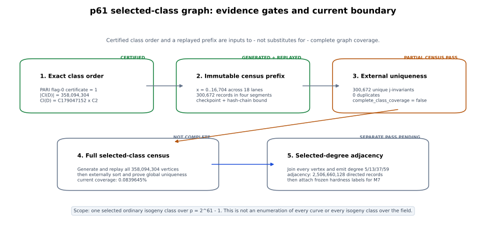
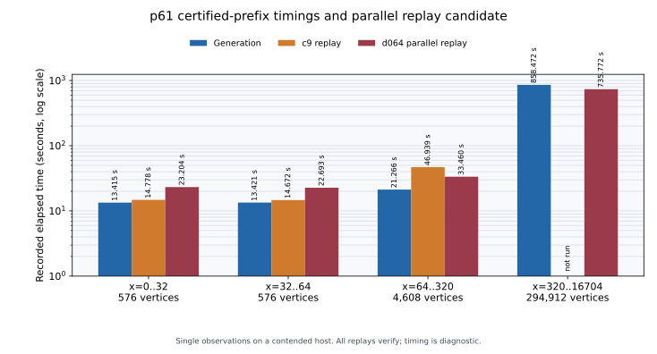

# p61 selected-class isogeny census: certified launch evidence

**Run:** `p61-class-pilot-v2-20261014T0902Z`\
**Evidence date:** 2026-10-14\
**Field:** `p = 2^61 - 1 = 2305843009213693951`\
**Selected root:** `p61-i0025`, trace `-704859453`\
**Scope:** one selected ordinary isogeny class, not every curve or every isogeny class over the field

## Decision

The selected class order is now unconditionally certified. PARI
`bnfcertify(bnf)` with flag 0 returned `1` after 10,365.337 seconds and bound
the fundamental discriminant `-8726545188371316595` to class number
`358094304` with cyclic factors `[179047152, 2]`.

The complete bounded pipeline has been exercised on an immutable 300,672-record
prefix: generation, independent mathematical replay, checkpoint and hash-chain
validation, dual-evidence ledger sealing, external sort, and uniqueness audit.
The certified audit found 300,672 unique j-invariants and zero duplicate records.
Its status is `partial_census_pass`, exactly because
`complete_class_coverage` is false.

The full selected-class graph is not complete. Current coverage is 300,672 of
358,094,304 vertices, or approximately 0.0839645%. The complete selected-degree
adjacency pass is also pending. The present evidence authorizes a resumable
census launch; it does not convert the pilot into complete coverage.

## Requested outcome versus current evidence

| Requested component | Current state | Evidence boundary |
|---|---|---|
| Exact selected-class order | **Certified** | Flag-0 PARI certificate returned `1`; receipt SHA-256 `260382fb...f9643c9` |
| Bounded-memory producer | **Implemented and committed** | [`p61_isogeny_class.rs`](../../../../src/bin/p61_isogeny_class.rs), [`p61_class.rs`](../../../../src/cryptanalysis/isogeny_walk/p61_class.rs) |
| Independent segment replay | **Pass on all four segments** | 300,672 records replayed with distinct audit settings |
| Global uniqueness machinery | **Implemented and exercised** | [`p61_isogeny_audit.rs`](../../../../src/bin/p61_isogeny_audit.rs); external-sort index SHA-256 `055fb9e0...793ad` |
| Full selected-class vertex census | **Incomplete** | 300,672 / 358,094,304 vertices |
| Degree 5/13/37/59 adjacency | **Pending separate pass** | Expected 2,506,660,128 directed records after full vertex join |
| Every curve/class over `F_p` | **Outside this census and not enumerated** | A selected ordinary class is one component of the field-wide curve population |
| p83 and diverse-field transfer tier | **Not generated by this run** | Requires additional certified roots, storage, and frozen label budgets |
| M7 large-field training application | **Not yet admissible** | Graph coverage, attack-context labels, censor masks, and leakage-safe successor protocol remain required |

## Mathematical identity and certification

The frozen parameters are:

| Quantity | Value |
|---|---:|
| Prime `p` | `2305843009213693951` |
| Trace `t` | `-704859453` |
| Frobenius/fundamental discriminant | `-8726545188371316595` |
| Conductor `f_pi` | `1` |
| Class number | `358094304` |
| Cyclic factors | `[179047152, 2]` |
| Certification method | `bnfinit(polynomial, 1)` then `bnfcertify(bnf)` |
| PARI certification flag/result | `0 / 1` |
| PARI version | `2.17.2` |
| Certification wall time | `10365.721123667 s` |

The certification receipt independently agrees across `qfbclassno`,
`quadclassunit`, and `bnfinit`. The dedicated certificate binds the exact
provisional preflight receipt by SHA-256. Existing segments remain bound to
that original preflight hash; the certified v2 ledger adds the certificate as
a second immutable dependency instead of rewriting prior evidence.

The terminal manifest is
[`certification-terminal-manifest.json`](certification-terminal-manifest.json).
Its NAS copy has SHA-256
`372a304bd30be4aa638264edaf84711d374118637343abd758f0cf00b951b0b1`.

## Certified prefix census and replay

The class-group traversal uses 18 lanes over 19,894,128 columns. The current
prefix contains two contiguous 32-column pilot segments, one 256-column
certified expansion, and one 16,384-column certified expansion. Each column
contributes one record per lane.

| Segment | Vertices | Generation | c9 replay | d064 replay | Raw bytes | Stored bytes |
|---|---:|---:|---:|---:|---:|---:|
| `x = 0..32` | 576 | 13.415 s | 14.778 s | 23.204 s | 316,537 | 77,983 |
| `x = 32..64` | 576 | 13.421 s | 14.672 s | 22.693 s | 313,438 | 75,992 |
| `x = 64..320` | 4,608 | 21.266 s | 46.939 s | 33.460 s | 2,504,089 | 585,586 |
| `x = 320..16,704` | 294,912 | 858.472 s | not run | 735.772 s | 161,082,807 | 37,455,603 |
| **Total** | **300,672** | **906.574 s** | **76.389 s**† | **815.129 s** | **164,216,871** | **38,195,164** |

† The c9 replay total covers only `x = 0..320`; no c9 comparison was run on
the 294,912-record expansion.

The committed `d06472954` parallel replay candidate passed all four immutable
segments and reproduced their record-chain, checkpoint, and segment digests.
It recorded 23.204 s and 22.693 s on the two short segments: 1.570x and 1.547x
the earlier replay times. On the 4,608-record expansion, the first sequential
comparison was 33.460 s for d064 versus 46.939 s for c9, a 1.403x c9/d064
ratio. A second c9 control took 215.940 s while several release-test compilers
were active. The identities agree in every arm, but the timing variance is too
large for a general speedup claim. The larger segment establishes that d064's
batching path works and can amortize overhead; controlled isolated ABBA runs
remain required for a performance decision.

On the 294,912-record expansion, generation took 858.472 s and d064 replay took
735.772 s, corresponding to 343.531 and 400.820 records/s respectively. There
is no matched c9 replay for that segment, so these values establish sustained
large-segment operation and correctness, not a comparative speedup.

These are one-observation, startup-inclusive measurements on a shared,
unisolated macOS host. They are diagnostic throughput measurements, not stable
capacity estimates. Linear extrapolation from the 16,384-column expansion gives
about 12.1 days for generation and 10.3 days for d064 replay over all
19,894,128 columns, or 22.4 days for those two phases alone. These are
diagnostic scale projections, not schedule commitments: there is one sustained
segment observation, the host was not isolated, interruptions and audit costs
are excluded, and the adjacency phase is additional work.

The generation and replay receipts bind segment bytes, checkpoints, record
chains, audit settings, source identity, and the preflight class-number receipt.
The upgraded ledger was then replayed by a separately versioned auditor:

| Audit quantity | Result |
|---|---:|
| Ledger range | `x = 0..16,704` |
| Ledger records | 300,672 |
| Unique j-invariants | 300,672 |
| Duplicate records/groups | `0 / 0` |
| Complete class coverage | `false` |
| Auditor status | `partial_census_pass` |
| Sorted-index bytes | 4,810,768 |
| Sorted-index SHA-256 | `055fb9e007b0b7a261f4850b78450d1d8f306ec56e13c316cebf20514d1793ad` |

## Durable evidence index

The active UGREEN SMB export is mounted at `/Volumes/data`; the requested
alias `/Volumes/UgreenNAS` is not currently mounted. Artifacts are stored below
`/Volumes/data/ec-hardness-atlas-20261012/`.

| Artifact | SHA-256 |
|---|---|
| Provisional preflight receipt | `44e202b8eb9cdad3ef09fb50e416cc8bdcf0942a6f140e24db587a3c4d44493f` |
| Unconditional certification receipt | `260382fbce4805ce84ce00fc77baf27c95243220ae88ca7725e31e4f4f9643c9` |
| Certification terminal manifest | `372a304bd30be4aa638264edaf84711d374118637343abd758f0cf00b951b0b1` |
| Producer binary at generation commit `c9bee1b2` | `47fa827fa9877a91f8b6d496f688f1df6fb18fd25a44b303392ba555be79043f` |
| Pilot segment `0..32` | `2a29068d66cee5914a5960bff4a13d55dd97ec80d8b9604e4f82c1a6c9c7ddf7` |
| Pilot segment `32..64` | `70ef588e21200e3c059695ffeae98b29faf0be702b8a01b88b0e12f888bb9fc2` |
| Pilot completion manifest | `84e597f9f07e674c732e39cabd88d47bf8e902cbeb083492a1e7757bcbf06b8c` |
| Dual-evidence auditor binary at `1e9f40817` | `bd99626fb402f0e71587b350912f57df021ee5449791ea91bee0a8d2d3917c05` |
| Parallel replay binary at `d06472954` | `81c1a5b8897bcc39fd20c6427e17eb73d9160d838bb001f82810de4272579e82` |
| Parallel-verifier release manifest | `a875ea679bcf04af623b28790baf8f61f0df1f64da7035506bd51da750562268` |
| Parallel replay receipt `0..32` | `b24697c9e8fbb53e594864406c3f4c98a6aeb5cd2d349b9c3b3951e0e06f79a3` |
| Parallel replay receipt `32..64` | `696d05717de484db6fe2dd92abbf6cf5fd2563e565555d7f560351cb7f5a0a8d` |
| Certified segment `64..320` | `b0e0180043a3b5aff0a22fa9c0a6151cfbaa0a331b62253f9aa49a97161d8852` |
| Generation receipt `64..320` | `d188864b5b69a3b51e3a66856a1db421941ac757a33304dbcfedbd6f1516116f` |
| Admitted d064 replay `64..320` | `2b11175e2cd775cac030fa5e38ef11f67b536a42a69a56bd01c646500f0da8a6` |
| Certified segment `320..16,704` | `514e8b0d6236ab883eb11f4cf24d8aeb66ce2a3ef6efb41652fcdd9a4fa08961` |
| Generation receipt `320..16,704` | `99f09bdad81ff06641063e1cdbc4d3b106622c97d9685b30c218bf873889ea0f` |
| Admitted d064 replay `320..16,704` | `93a36eeccdf6b821d4ffd8bebd552975ea2e0daa826672b2eb0dc88f95751dd8` |
| Expanded certified ledger | `822f6b0908432279351791e717dbc5caaf9600eb58bddc611834c63205dff5c2` |
| Expanded uniqueness receipt | `f014b8202ad435367824a5960387676bb3d568015e5e864f58cdde8c2bc069b1` |
| Expanded sorted index | `055fb9e007b0b7a261f4850b78450d1d8f306ec56e13c316cebf20514d1793ad` |
| Expanded-prefix manifest | `e26e618df5f47feabdf50534eccbe6fec7e1ba2b20581fedffec3f8a5b22a1b4` |
| False-unconditional control | `a8d615a2f5c8a2099d788820780c33531e44b05e8a5a81e8c357d57cf4227417` |

The SMB mount reports `sync_all_unsupported_by_filesystem` for derived ledger,
chunk, index, and receipt files. This limitation is retained in the receipts.
A host `sync` barrier completed, followed by digest replay of the final files.
The certification runner's receipt itself reports `fsync_completed`.

The matching NAS release manifest is
`p61-class-streaming-v1/manifests/parallel-verifier-release-d06472954-20261015T001333Z.json`;
its post-`sync` digest matches the repository copy above.

## Preserved failures and controls

Failures remain first-class evidence:

- The first certification attempt at source commit `90dec4b7` failed during
  `bnfinit` with PARI's low-precision `small_norm` error. Its event log and
  failure receipt remain under `p61-class-certification-v1/failures/`.
- The successful runner retried `bnfinit` at 256 decimal digits and retained the
  original 128-digit error in the terminal receipt.
- A quotient-only flag-1 certification control was interrupted after it failed
  to provide a decisive result; its control receipt remains content-addressed.
- An interrupted debug segment and an SMB per-file-sync failure remain under
  `p61-class-streaming-v1/incomplete/`. Neither is admitted as a segment.
- The first release build of parallel replay commit `d06472954` failed while
  archiving the library because `/System/Volumes/Data` had only 187 MiB free.
  It is classified as `infrastructure_failure` and recorded exactly in
  [`build-attempts.json`](build-attempts.json). After a copied SSD990-2 target
  built successfully, the generated `/private/tmp` target was deleted,
  recovering local headroom from 187 MiB to 5.5 GiB; source and receipts were
  unaffected.
- The auditor rejects an unconditional label without the dedicated flag-0
  certificate. The planted false declaration exited nonzero and created no
  accepted ledger output.
- Two default-parallel whole-library release-test attempts remained non-green in the pre-existing
  `jv_cover` module: `4077 passed / 2 failed / 114 ignored` and
  `4076 passed / 3 failed / 114 ignored`. The three exposed failures each pass
  when replayed exactly in isolation, and the touched p61 auditor gate passes
  `6 / 6`. A complete low-concurrency run with `--test-threads=1` then passed
  `4079 / 4079`, with `114` ignored, in 2,765.68 seconds. The differing default-
  parallel failure sets and one explicit internal timeout remain preserved in
  [`test-results.json`](test-results.json); those attempts are not relabeled as
  passes. The full library is green under the recorded serial execution mode,
  while the default-parallel mode remains non-green on this shared host.
- Report rendering retained one abandoned font-cache session and one explicit
  interrupted attempt before succeeding with a warmed, writable cache; see
  [`render-attempts.json`](render-attempts.json).

## Storage and scale boundary

At the post-expansion observation the UGREEN export reported 7.3 TiB total, 198 GiB used,
and 7.1 TiB available. The preflight estimate for a JSON projection of all
degree-5/13/37/59 directed edges is about 5.14 TB raw, or 6.43 TB with 25%
operational headroom. That means one selected-class raw projection fits only
narrowly and leaves inadequate room for redundancy, intermediate joins,
multiple diverse fields, or a p83 tier.

A petabyte corpus is not physically available on this volume. Petabyte-scale
retention requires separately provisioned object or cold storage, an indexed
packed representation, replication policy, and lifecycle budget. The UGREEN
volume can serve as an active staging tier, not as a petabyte store.

Even a provisioned petabyte would not make a literal field-wide enumeration
feasible. Recording only one packed 64-bit j-invariant for each of the
`2^61 - 1` possible j-values already has a lower bound of
`18,446,744,073,709,551,608` bytes (approximately 18.45 EB, or 16 EiB), before
twists, curve models, edges, labels, indexes, checksums, replicas, or working
space. A petabyte-scale program can be exceptionally broad across selected
classes and fields; it cannot be described as every curve over this field.

The 5.14 TB estimate is dominated by the later adjacency representation. The
current compressed vertex-prefix sample is much smaller, but its byte rate must
not be extrapolated to adjacency records: the schemas and multiplicities differ.

## Relationship to M7

The companion M7 implementation is trained and evaluated with class-held-out
and whole-field-held-out splits and explicit masks for exhausted, skipped,
capped, unverified, and incomplete-walk observations. The frozen
`M7-CONFIRM-V1` run reports a 12.8088% reduction in baseline test SSE, with a
field-bootstrap interval `[11.0459%, 13.9280%]`, but the preregistered
specificity decision fails:

- matched training-geometry permutation improves baseline SSE by 19.8997%;
- typed-edge rewiring retains a 12.5639% improvement;
- node-feature shuffle retains a 6.1334% improvement;
- excluded `log2_q` is recoverable from the incremental block with ridge
  `R2 = 0.860425` in the primary external-field run and median
  `R2 = 0.991419` across the five internal-field seeds.

Therefore, the current M7 evidence establishes a stable predictive correlation
for its measured labels but does not isolate geometry-specific incremental
information from size/ceiling leakage and control behavior. The p61 graph is an
infrastructure and scale-transfer input; it is not evidence that those M7
specificity gates have passed.

Before p61 enters training, the successor protocol must freeze:

1. labels and attack contexts that are meaningful at this field size;
2. explicit censor masks and abstention behavior;
3. a feature block from which `q`, subgroup order, and field identity cannot be
   reconstructed, or a model that conditions them out explicitly;
4. class-held-out and field-held-out evaluation with destructive controls;
5. packed, indexed graph bundles rather than one-file-per-class access.

## What completion requires

Full selected-class completion requires all of the following, with no stage
substituted for another:

1. generate all 19,894,128 traversal columns across 18 lanes;
2. independently replay every admitted segment with distinct audit settings;
3. seal a ledger covering exactly 358,094,304 records;
4. externally sort every invariant and prove global uniqueness and exact count;
5. build and verify the complete degree-5/13/37/59 adjacency join;
6. attach frozen hardness contexts, censor masks, and provenance;
7. train and evaluate the leakage-safe M7 successor on held-out classes and
   fields with the frozen null controls.

Enumerating every curve or every isogeny class over the field is a different,
far larger objective and is not implied by completing this one class.

The remaining operational, implementation, and storage obligations are tracked
as the named problem
[`p61-full-isogeny-class-census.md`](../../../../problems/p61-full-isogeny-class-census.md).
The fail-closed continuation runner has a tested plan beginning at `x = 16,704`;
those future chunks are not represented as generated, replayed, or admitted.

## Reproduction entry points

- Producer protocol: [`docs/p61-isogeny-class-streaming.md`](../../../../docs/p61-isogeny-class-streaming.md)
- Auditor protocol: [`docs/p61-isogeny-audit.md`](../../../../docs/p61-isogeny-audit.md)
- Producer CLI: [`src/bin/p61_isogeny_class.rs`](../../../../src/bin/p61_isogeny_class.rs)
- Traversal implementation: [`src/cryptanalysis/isogeny_walk/p61_class.rs`](../../../../src/cryptanalysis/isogeny_walk/p61_class.rs)
- Auditor CLI: [`src/bin/p61_isogeny_audit.rs`](../../../../src/bin/p61_isogeny_audit.rs)
- Fail-closed continuation runner: [`run_remaining_census.py`](../../run_remaining_census.py)
- Continuation-runner tests: [`test_run_remaining_census.py`](../../test_run_remaining_census.py)
- Recorded timing data: [`timings.json`](timings.json)
- Timing renderer: [`plot_timings.py`](plot_timings.py)
- Evidence diagram renderer: [`plot_evidence_pipeline.py`](plot_evidence_pipeline.py)
- Release build attempts: [`build-attempts.json`](build-attempts.json)
- Release test results: [`test-results.json`](test-results.json)
- Parallel-verifier release manifest: [`parallel-verifier-release-manifest.json`](parallel-verifier-release-manifest.json)
- Certification terminal manifest: [`certification-terminal-manifest.json`](certification-terminal-manifest.json)
- Expanded certified-prefix manifest: [`certified-prefix-x000000000000-x000000016704-manifest.json`](certified-prefix-x000000000000-x000000016704-manifest.json)

Source identities used by the evidence chain are:

- generation producer: `c9bee1b28eda33b643ecf8b9a8b74724267d1cdf`;
- dual-evidence auditor: `1e9f40817f9ff0e37d365b79f9dbcccaf743be1d`;
- parallel replay candidate: `d064729541f9c9cea2dc50b4a36572971cd2b099`;
- class-number certification runner: `d2f5f49ae851141b50400ccffab5ad43347207fa`.
