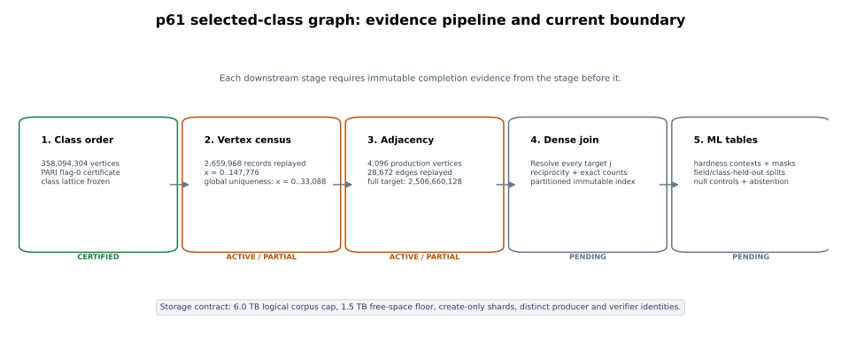
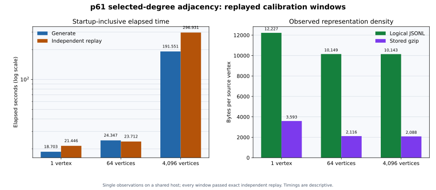

# p61 selected-degree adjacency: replayed production calibration

**Run:** `p61-adjacency-pilot-20261015T0436Z`\
**Evidence interval:** 2026-10-15 04:36:55Z–05:16:38Z\
**Field:** `p = 2^61 - 1 = 2305843009213693951`\
**Selected class:** `p61-i0025`, trace `-704859453`, 358,094,304 vertices\
**Frozen degrees:** `5, 13, 37, 59`\
**Scope:** the complete selected-degree relation on one certified ordinary class

## Decision

The adjacency data path is implemented, independently replayed, and admitted
on a 4,096-vertex production window. That window contains exactly 28,672
directed edges and 471,040 kernel coefficients. The verifier was built from a
different source commit, follows a kernel-first reconstruction path, and
reproduced the complete record chain, source bindings, edge identities, Vélu
codomains, canonical targets, and summary counts.

The fail-closed supervisor also passed a 64-vertex admission window and enforces
create-only paths, source-evidence digest replay, exact edge/kernel counts,
distinct producer and verifier identities, host sync before admission, a 1.5 TB
free-space floor, and a 6.0 TB logical-corpus cap. The observed 4,096-vertex
representation projects to approximately 3.632 TB logical JSONL and 0.748 TB
stored gzip for all 358,094,304 source vertices. Dense target-index joins,
hardness labels, censor masks, and ML-ready partitions are additional products
and can use the remaining approximately 2.368 TB of the logical envelope.

The complete graph is still in progress. Production adjacency coverage at this
snapshot is 4,096 source vertices, or 0.00114383%. Target indices remain
deferred until the vertex census and global uniqueness index are complete.

## Requested outcome versus evidence

| Requirement | State | Evidence boundary |
|---|---|---|
| Certified selected-class size | **Certified** | 358,094,304 vertices; class receipt `44e202b8...444493f` is bound into every shard |
| All four selected degrees | **Pass on admitted windows** | Per vertex: one degree-5 edge and two each at 13, 37, and 59 |
| Complete kernel certificates | **Pass on admitted windows** | 115 coefficients per vertex; 471,040 in the production window |
| Independent mathematical replay | **Pass on admitted windows** | Producer `f9b48fcf...`; verifier `92a62be6...`; different binary digests and construction paths |
| Fail-closed campaign supervisor | **Implemented and tested** | Five unit tests; source/output digest replay; create-only admission; storage guards |
| Full vertex census | **Active / incomplete** | Per-segment replay through `x=147776`: 2,659,968 records |
| Global vertex uniqueness | **Partial** | Last sealed external uniqueness prefix is `x=0..33088`: 595,584 records |
| Complete selected adjacency | **Active / incomplete** | 4,096 / 358,094,304 production vertices; target is 2,506,660,128 directed edges |
| Dense target-index join and reciprocity | **Pending** | Requires the complete, globally unique vertex index |
| 5–6 TB training corpus | **Calibrated and guarded, not yet filled** | Full adjacency projects to 3.632 TB logical; join and ML products remain to be generated |
| M7 successor training on this graph | **Pending** | Frozen labels, masks, partitions, and completed join remain prerequisites |

## Frozen graph arithmetic

The certified class has 358,094,304 vertices. The selected degree behavior is:

| Degree | Behavior | Directed neighbors per vertex | Complete directed edges |
|---:|---|---:|---:|
| 5 | ramified | 1 | 358,094,304 |
| 13 | split | 2 | 716,188,608 |
| 37 | split | 2 | 716,188,608 |
| 59 | split | 2 | 716,188,608 |
| **Total** |  | **7** | **2,506,660,128** |

Every vertex contributes 115 kernel coefficients across those seven edges, so
the terminal certificate count is 41,180,844,960 coefficients. Completeness is
defined against this frozen four-degree relation. Other degrees, other trace
classes, and the field-wide curve population are separate scopes.

## Producer and independent verifier

The release identities are immutable:

| Role | Source commit | Binary SHA-256 |
|---|---|---|
| Producer | `f9b48fcf916bfa2b0b6fbec06e8b7c4137ceef96` | `a69def0c21dc455077abb8bef86d828c13dfcbea8f45382f71614fdf260d7c78` |
| Verifier | `92a62be6471358edb3f9becaeb56c94c24a90b7e` | `85b1265b187ecd2bbd2ff7fd0f7c9608d3ccd2e4a7234f73ee1b2863be599208` |

The producer evaluates the four modular polynomials, sorts every rational root,
constructs and validates the Elkies kernel, applies Vélu arithmetic, canonicalizes
the target, and emits geometry and identity fields. The verifier does not call
the producer's edge constructor. It parses each full kernel, verifies it against
the division polynomial, recomputes the codomain and canonical isomorphism, and
then reconstructs features, identities, chain state, and exact summary counts.

## Real-data calibration

All three measurements consumed independently admitted vertex data from the
active census. The smaller two windows overlap the production population and
are calibration evidence only; they are not added to production coverage.

| Window | Vertices | Edges | Kernel coeffs | Generate | Replay | Logical bytes | Gzip bytes |
|---|---:|---:|---:|---:|---:|---:|---:|
| Path smoke | 1 | 7 | 115 | 18.703 s | 21.446 s | 12,227 | 3,593 |
| Supervisor admission | 64 | 448 | 7,360 | 24.347 s | 23.712 s | 649,507 | 135,394 |
| Production window | 4,096 | 28,672 | 471,040 | 191.551 s | 296.931 s | 41,543,871 | 8,552,556 |

Every row reports zero generation failures and exact agreement on the shard and
record-chain digests. The production admission manifest is
`be33159cc6fb7bc3460c6626c827d2e01ea2cf46ada017fb8acafc19b21e26e8`.

The production window recorded 21.383 generation vertices/s and 13.794 replay
vertices/s. Sequentially, the admitted pipeline produced 8.385 vertices/s.
Those rates linearly extrapolate to approximately 193.8 generation days, 300.5
replay days, and 494.3 sequential days for one worker. This is a capacity
diagnostic, not a schedule commitment: it is one observation on a shared host,
the eight-thread vertex census was active, there was no A/A or isolated ABBA
run, and future optimization or partitioned workers can materially change the
rate. It does establish that a single current worker cannot fill the complete
corpus quickly.

## Storage calibration and 6 TB contract

The production window uses 10,142.547 logical bytes and 2,088.026 stored bytes
per source vertex. A direct projection gives:

| Product | Projected bytes | Decimal TB |
|---|---:|---:|
| Complete adjacency JSONL | 3,631,988,176,565 | 3.632 |
| Complete adjacency gzip | 747,710,348,692 | 0.748 |
| Remaining logical allowance after adjacency | 2,368,011,823,435 | 2.368 |

The logical allowance is for useful derived artifacts: a partitioned dense
target-index join, reciprocal-edge audit tables, frozen attack contexts,
explicit observation masks, class/field split maps, and ML-ready feature tables.
The pipeline will not inflate files merely to reach a nominal byte count.

At production admission the UGREEN mount reported 7,766,315,634,688 free
bytes. The supervisor stops before the mount falls below 1.5 TB free or before
admitting a shard that would cross 6.0 TB of logical adjacency output. Logical
and stored bytes remain separate in every receipt because gzip compression is
substantial.

## Current census and join boundary

At the evidence snapshot, vertex segments were generated and independently
replayed through `x=147776`, yielding 2,659,968 records or 0.742812% of the
class. The latest sealed global uniqueness ledger covers only `x=0..33088`, or
595,584 records and 0.166320% of the class. Later per-segment passes are not
substituted for the pending global external-sort audit.

Adjacency generation records canonical target j-invariants now, but does not
guess dense target indices. Once all 358,094,304 source vertices are present
and globally unique, the join phase must resolve every target and prove:

1. every source vertex occurs exactly once;
2. exactly 2,506,660,128 directed edges exist;
3. the four degree totals equal `h`, `2h`, `2h`, and `2h`;
4. every target j-invariant resolves to one dense index;
5. reciprocal degree and endpoint checks pass;
6. each vertex has one degree-5 partner and two distinct partners at every split degree; and
7. every shard, retry, join partition, and exception remains manifest-bound.

The early `x=0..16704` certified prefix predates the campaign-admission schema
used by the follower. Its four independently replayed source segments require a
normalized source catalog or bounded backfill before terminal coverage can be
claimed.

## Preserved failures and limitations

- An initial attempt to reconstruct the exact f9 producer by extracting the
  entire repository archive under `/private/tmp` exhausted the system data
  volume. The stopped attempt is classified as infrastructure failure. Only
  task-created temporary extraction and target paths were removed; source and
  NAS evidence were unaffected.
- The corrected producer reconstruction used a detached worktree and target on
  `/Volumes/SSD990-2`, completed in 602 seconds, and reproduced the original
  pilot binary SHA-256 exactly.
- The supervisor's first unit-test invocation failed because the dynamically
  loaded module was absent from `sys.modules` during dataclass evaluation. The
  test harness was corrected; four tests then passed, and the final suite passes
  five tests after adding a guard against combining `--follow` and
  `--max-windows`.
- The first persistent launch supplied the full command through Terminal's
  automation interface, which truncated it before the final storage and follow
  arguments. It exited before creating a log or child process. The corrected
  launch uses a committed 38-line wrapper; the supervisor, `caffeinate` guard,
  and second production-window child were all alive at the recorded health
  observation.
- The SMB filesystem reports per-file `sync_all` as unsupported. Receipts retain
  that status; the supervisor performs a host sync barrier and post-write digest
  replay before create-only admission.
- Timing is L0 descriptive evidence from a shared host. It is not a comparative
  speed claim.

Exact records for these outcomes are in
[`build-attempts.json`](build-attempts.json),
[`test-results.json`](test-results.json), and
[`campaign-launch-attempts.json`](campaign-launch-attempts.json), and
[`metrics.json`](metrics.json).

## Relationship to hardness modeling

This run builds structural graph evidence; it does not retrain M7. The dense
target join and frozen attack-context labels are not available yet. When they
are, the training table must retain explicit masks for exhausted, skipped,
capped, unverified, and incomplete-walk observations; class-held-out and
field-held-out partitions; abstention behavior; and the preregistered geometry
null controls. The current M7 result remains evidence of predictive correlation,
not isolated incremental geometric signal.

## Reproduction entry points

- Graph contract: [`docs/p61-isogeny-adjacency.md`](../../../../docs/p61-isogeny-adjacency.md)
- Producer/verifier CLI: [`src/bin/p61_isogeny_adjacency.rs`](../../../../src/bin/p61_isogeny_adjacency.rs)
- Core implementation: [`src/cryptanalysis/isogeny_walk/p61_adjacency.rs`](../../../../src/cryptanalysis/isogeny_walk/p61_adjacency.rs)
- Campaign supervisor: [`run_adjacency_campaign.py`](../../run_adjacency_campaign.py)
- Persistent launcher: [`launch_adjacency_campaign.sh`](../../launch_adjacency_campaign.sh)
- Supervisor tests: [`test_run_adjacency_campaign.py`](../../test_run_adjacency_campaign.py)
- Recorded metrics: [`metrics.json`](metrics.json)
- Metric renderer: [`plot_metrics.py`](plot_metrics.py)
- Evidence renderer: [`plot_pipeline.py`](plot_pipeline.py)
- Build attempts: [`build-attempts.json`](build-attempts.json)
- Test and replay results: [`test-results.json`](test-results.json)
- Campaign launch attempts: [`campaign-launch-attempts.json`](campaign-launch-attempts.json)
- Campaign release manifest: [`campaign-release-manifest.json`](campaign-release-manifest.json)

The durable data root is
`/Volumes/data/ec-hardness-atlas-20261012/p61-selected-adjacency-v1/`.
