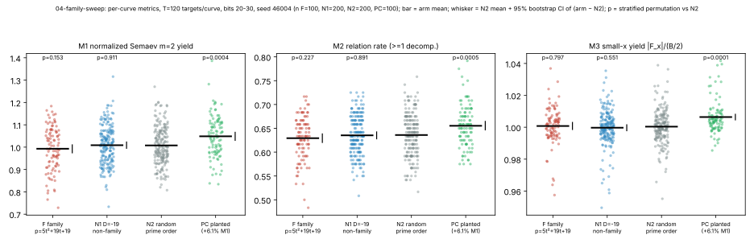
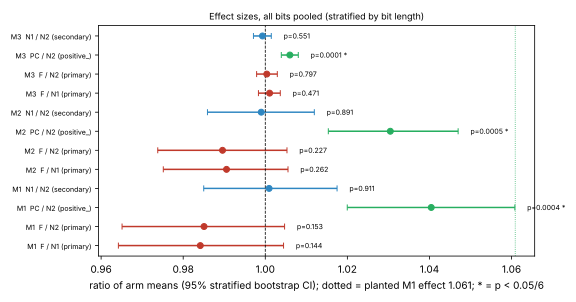
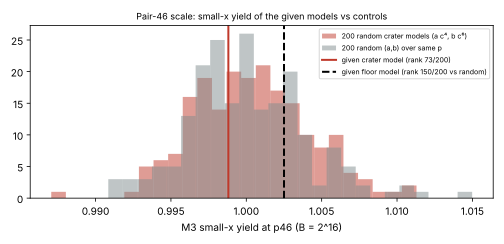

# 04-family-sweep: results

Pair-46 factor-base campaign, item 04. Run 2026-10-15T15:37Z, seed 46004, protocol `PROTOCOL.md`.
The protocol was frozen before data; its sha256 is in `PROTOCOL.sha256`. Raw per-curve rows are in `curves.csv`
(500 curves); tests and the add-on are in `results.json`; the log is `run.log`.

**Verdict: null.** On all three preregistered metrics, the family p = 5t^2+19t+19 is within
the control distribution of both nulls, and all three positive controls were detected. There is no
family-level factor-base advantage at 20-30 bits.

## Primary table (all bits pooled, stratified by bit length; Bonferroni α = 0.05/6)

| metric | F mean | null | null mean | diff [95% CI] | ratio [95% CI] | p (perm.) | positive control detected? | verdict |
|---|---|---|---|---|---|---|---|---|
| M1 normalized Semaev m=2 yield | 0.9928 | N1 D=-19 non-family | 1.0087 | -0.0160 [-0.0364, +0.0045] | 0.984 [0.964, 1.005] | 0.144 | yes (PC/N2 1.040 [1.020, 1.061], p=0.0004) | within control distribution |
| M1 | 0.9928 | N2 random | 1.0078 | -0.0150 [-0.0353, +0.0047] | 0.985 [0.965, 1.005] | 0.153 | yes | within control distribution |
| M2 relation rate | 0.6293 | N1 | 0.6353 | -0.0060 [-0.0159, +0.0035] | 0.991 [0.975, 1.006] | 0.262 | yes (PC/N2 +0.0194 [+0.0098, +0.0297], p=0.0005) | within control distribution |
| M2 | 0.6293 | N2 | 0.6360 | -0.0066 [-0.0167, +0.0033] | 0.990 [0.974, 1.005] | 0.227 | yes | within control distribution |
| M3 small-x yield | 1.00076 | N1 | 0.99971 | +0.00105 [-0.00167, +0.00365] | 1.0011 [0.9983, 1.0037] | 0.472 | yes (PC/N2 +0.0060 [+0.0039, +0.0080], p=0.0001) | within control distribution |
| M3 | 1.00076 | N2 | 1.00039 | +0.00037 [-0.00211, +0.00293] | 1.0004 [0.9979, 1.0029] | 0.797 | yes | within control distribution |

n: F=100 (every family member with p and N=p+1-t prime in 20..30 bits), N1=200, N2=200, PC=100; T=120 random targets per curve.
Secondary: N1 vs N2 (does D=-19 CM matter?) is within the control distribution on all three metrics
(M1 diff +0.0009 [-0.015, +0.017], p=0.91; M2 p=0.89; M3 p=0.55).

Per-band results are descriptive only (all of them are in `results.json`). The smallest p among them is
for M1 F vs N2 in the 25-27 bit band: diff -0.041 [-0.086, -0.0004], p=0.059. That p is uncorrected, and the effect is in the *unfavourable*
direction. No per-band test passes α/6.





## Positive-control note

The planted M1 effect was a 3% wider membership bound (ratio 1.03^2 = 1.061). The PC also used
best-of-2 model selection, which raises the normalizing |F_x| by about 0.6% (the measured PC M3 ratio is 1.006),
so the expected M1 ratio is about 1.061/1.012 = 1.048. The observed ratio is 1.040 [1.020, 1.061], consistent with that.
At this sample size the detector resolves effects of roughly +-2% in M1, +-0.01 in M2 and +-0.0025 in M3 (the CI half-widths).

## Pair-46-scale add-on (M3 only, B = 2^16)

| model | M3 | rank among 200 crater models | rank among 200 random (a,b) |
|---|---|---|---|
| given crater | 0.99881 | 73/200 | 82/200 |
| given floor | 1.00250 | n/a | 150/200 |

Control medians: crater models 1.00031 [0.99365, 1.00812], random 0.99973 [0.99265, 1.00922].
Both given models are within the control distribution.



## Exact vs empirical

- Exact: t^2 - 4p = -19(t+2)^2 for p = 5t^2+19t+19 (algebra; pair 46 is checked in the run). The crater has j = -96^3 and
  #E = N, and the floor has #E = N and j != -96^3 (checked by computation). The S3 summation-polynomial self-test passed.
  For D = -19 the unit group is {±1}, so Aut(E) = {±1} and the small-x factor base gets no extra orbit
  compression (standard theory, not computed here).
- Empirical: every comparison in the tables. These are statements about 20-30-bit curves, the small-x factor base,
  m=2 Semaev decomposition and B = ceil(sqrt(2N)).

## What was cut / scope

- Floor curves (End = Z[pi], conductor t+2) of family members were not generated, because that needs a volcano descent. The family
  arm is crater curves only.
- Semaev M1/M2 at 53 bits (pair 46 itself) was not run, because it needs about 5e7 root-finds per target. Only M3 was measured at pair-46 scale.
- Only m=2 (S3) was run. m >= 3 decompositions, and factor bases other than small-x, are not covered.
- Scope: "within the null on these metrics at 20-30 bits" does not mean that no family property helps, and it
  does not establish anything about 53-bit behaviour beyond the M3 add-on.

## Run facts

The pre-flight estimate was about 850 s of one core. Actual: 612 s user, 749 s wall (`stdout.txt`), pinned to 1 core (taskset -c 3).
All 100 family members and every planned control ran; none failed. Python only lays out the figures and the PDF; every number
comes from the Rust binary.

## Reproduce

```
cd research/pair46_factor_bases_20261015/04-family-sweep
cargo build --release && taskset -c 3 target/release/family_sweep . 120 20 30 9999 2000
python3 plot.py . && python3 make_pdf.py .
```
