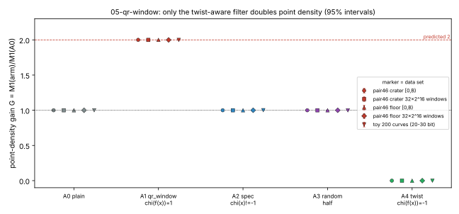
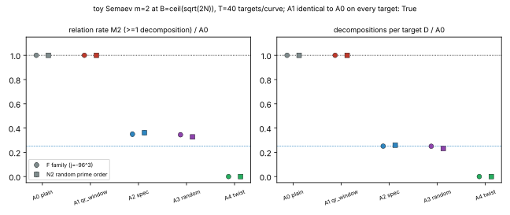

# 05-qr-window: twist-aware quadratic-character factor base (campaign positive control)

Pair-46 factor-base campaign, item 05, run 2026-10-15. Protocol frozen first in `PROTOCOL.md`
(sha256 in `PROTOCOL.sha256`). The run followed it with no amendment and no dry run.
Host: shared 4-CPU container, pinned to 1 core (`taskset -c 3`), wall 135.5 s.

**Verdict: positive control detected, and the effect is exactly the predicted one.** The
qr_window filter chi(f(x)) = 1 doubles point density: G = 2.00004, 95% interval
[1.99967, 2.00042], on the pair-46 crater small-x window [0, B), B = 109,066,017. The floor
curve gives 1.99995 [1.99957, 2.00033]. The filter adds no relations: on every one of 8000
toy targets (200 curves), it finds exactly the same decompositions as the plain window. Both
negative controls have gain 1 (intervals contain 1): the spec-literal chi(x) filter and a
random-half filter. The instrument self-test (twist-only filter) gives 0 E-points and 0
relations, exactly.

## Exact statements (proved; computation only checks them)

- **E1.** When #E is odd, f has no root, so #{x : chi(f(x)) = 1} = (#E-1)/2 and #{x : chi(f(x)) = -1} = (#E'-1)/2,
  where #E + #E' = 2p+2. For pair 46 (crater and floor, both #E = N prime): 2,973,848,998,080,821 liftable x and
  2,973,849,032,570,522 twist x (twist order 5·v^2 = 5,947,698,065,141,045). The global gain is
  2p/(N-1) = 2.0000000116. Full-field enumeration confirmed E1 on all 36 toy curves with p < 2^23 (36/36).
- **E2.** Every E-point with x < B has chi(f(x)) = 1, so the plain window and qr_window admit the same E-points.
  Every relation is therefore identical, target by target. Checked on all 200 toy curves × 40 targets: identical in 8000/8000.
  The filter changes only the candidate count, which is the number of factor-base columns before liftability is applied.
- **E3.** The twist-only filter admits no E-point. M1 = 0 and 0 relations on every curve and window (checked).
- Consequence: qr_window equals the repository's existing small-x factor base, which already keeps only liftable x
  (item 04 tests `jacobi(rhs) == 1`; `factor_base.py` `small_x` keeps x where `lift_x` succeeds). Against that baseline its gain
  is exactly 1. The "2x" is only the gain over a liftability-blind x-window.

## Empirical measurements

Point density M1 = (# of V that are E x-coordinates)/|V|. Gain G = M1(arm)/M1(A0).

| data set | A1 qr_window G [95%] | A2 spec chi(x) G [95%] | A3 random-half G [95%] | A4 twist M1 |
|---|---|---|---|---|
| crater, [0,B), B=109066017 (Wilson) | 2.00004 [1.99967, 2.00042] | 1.00003 [0.99957, 1.00048] | 0.99993 [0.99948, 1.00038] | 0 |
| floor, [0,B) (Wilson) | 1.99995 [1.99957, 2.00033] | 0.99993 [0.99948, 1.00038] | 1.00000 [0.99955, 1.00046] | 0 |
| crater, 32 random 2^16 windows (bootstrap) | 1.99892 [1.99623, 2.00203] | 0.99990 [0.99854, 1.00125] | 0.99973 [0.99845, 1.00083] | 0 |
| floor, 32 random 2^16 windows (bootstrap) | 1.99951 [1.99699, 2.00193] | 1.00022 [0.99901, 1.00141] | 1.00016 [0.99859, 1.00162] | 0 |
| toy, 200 curves 20-30 bit (curve bootstrap) | 1.99900 [1.99530, 2.00280] | 1.00140 [0.99970, 1.00310] | 0.99860 [0.99700, 1.00020] | 0 |

Canonical-window counts (crater): |V| = 109,066,017 / 54,531,876 / 54,530,760 / 54,541,376 / 54,534,141 for
A0..A4. E-points in V: 54,531,876 / 54,531,876 / 27,265,555 / 27,268,237 / 0. chi(f) = 0 never occurs. The A2
window intervals are approximate: the ratio interval combines the two Wilson endpoints.

The toy relations are Semaev m=2 at B = ceil(sqrt(2N)), with T = 40 random targets per curve shared by all arms. M2 is the fraction of targets with at least one decomposition R = ±P1 ± P2. D is the number of decompositions per target.

| arm | M2 pooled (8000 targets) [Wilson 95%] | M2 / A0 [boot 95%] | D / A0 [boot 95%] |
|---|---|---|---|
| A0 plain | 0.6459 | 1 | 1 |
| A1 qr_window | 0.6459 (identical, E2) | 1.0000 [1.0000, 1.0000] | 1.0000 [1.0000, 1.0000] |
| A2 spec chi(x) | 0.2298 | 0.3557 [0.3431, 0.3693] | 0.2548 [0.2443, 0.2649] |
| A3 random-half | 0.2169 | 0.3358 [0.3244, 0.3474] | 0.2405 [0.2319, 0.2494] |
| A4 twist-only | 0 | 0 | 0 |

The per-arm Wilson intervals for M2 are in `results.json`. The F (family, j = -96^3) and N2 (random prime order)
subgroups agree (figure 2). The two halving controls lose about 3/4 of the decompositions, as predicted:
both summands must survive a 1/2 thinning. The success rate falls less than D, because M2 saturates
(Poisson, 1-exp(-lambda)). These controls show that the instrument registers a loss of FB points when it occurs.
The qr_window filter causes no such loss.





## Decision rule outcome (preregistered)

- G(A1) intervals lie inside [1.9, 2.1] and exclude 1: yes, on every data set.
- A2 and A3 intervals contain 1: yes, on every data set. The narrowest margins are toy A3 [0.9970, 1.0002] and toy A2 [0.9997, 1.0031].
- M1(A4) = 0 exactly: yes. E2 holds on every toy target: yes (8000/8000). E1 holds on every checked curve: yes (36/36).
- **The positive control is detected.** "Nothing more": the A1/A0 ratio is 1 exactly for both M2 and D.

## Interpretation and limits

- This is a bookkeeping gain. Discarding twist x-values halves the candidate list but leaves the relation set
  unchanged. Any factor base that already tests liftability, which includes every factor base in this campaign,
  gets nothing from the filter. The instrument resolves a 2x density effect to about ±0.02% at pair-46 size.
  Later items can read a null as a real null with that resolution, provided their instrument is this one.
- The literal formula in `factor_base_lab.md` (FB-QR-WINDOW, `Legendre(x) in {0,1}`) is a character of x itself.
  It is independent of liftability (G = 1.000) and loses about 3/4 of the m=2 decompositions at fixed B. It is not a twist filter.
  The spec line should say `Legendre(f(x))`. This is reported here and not edited, because this item may write only to its own directory.
- Unplanned observation (exploratory, not part of the decision rule): in the N2 subgroup, A2 has a slightly higher
  M2 than A3 (0.235 vs 0.2125). The pooled D intervals of A2 and A3 overlap, and A3 is one fixed hash. No claim is made.
- No interval bound on window density is proved. The Pólya–Vinogradov/Weil bound for incomplete character sums
  (about sqrt(p) log p, roughly 3e9) exceeds B (about 1.1e8). So the window gain of about 2 is empirical; only the
  global gain 2p/(N-1) is exact.
- Nothing was cut: every preregistered arm, size, curve set and seed ran.

## Reproduce

```text
cd research/pair46_factor_bases_20261015/05-qr-window
cargo build --release
taskset -c 3 ./target/release/qr_window . 40 100 100 2000 > stdout.txt   # ~2.3 min, writes run.log, results.json
python3 plot.py . && python3 make_pdf.py .                               # layout only
```

Files: `PROTOCOL.md`, `src/main.rs` (instrument and statistics), `src/common.rs` (arithmetic copied from item 04),
`input_curves_from_04.csv` (copied verbatim from item 04, sha256 88c26329…7c12), `results.json`, `run.log`,
`fig_density_gain.{svg,png}`, `fig_toy_relations.{svg,png}`, `report.pdf`.
