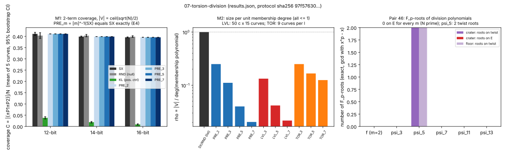

# 07-torsion-division: torsion and division-polynomial factor bases (pair 46)

2026-10-15. Pair-46 factor-base campaign, item 07. Protocol: `PROTOCOL.md` (sha256 97f57630...8f62b6, frozen before data, not edited). Instrument: standalone Rust binary `src/main.rs`, no dependencies, 1 core (`taskset -c 3`), wall time 20.8 s. Source idea: IDEA-20260807-0a3272; prior runs EV-ICINV-6b6264 and EV-ICINV-8afb64.

**Verdict: exact obstruction.** Torsion points and division polynomials give no useful factor base on a prime-order curve. On pair 46, no F_p-root of psi_m lies on E for any m < N. The only roots that exist (2 roots of psi_5) are on the twist. Preimage bases [m]^-1(S) are an exact group-automorphism transport of S: their coverage equals S's on every curve (difference 0, CI [0, 0]). Their membership degree is m^2 |S|, so size/degree = 1/m^2. Level sets psi_m = c hold about 0.6 points for degree (m^2-1)/2 (rho between 0.02 and 0.14). Every arm has size/degree <= 1, the value an explicit list already reaches.

## Backend gate: how it was routed around

EV-ICINV-6b6264 stopped because there was no Groebner backend (SR3). This host has no backend either: `which sage Singular M2 magma gp` returns nothing. The gate turned out not to be needed. For m = 2 the relation ideal I_R = <S_3(x1,x2,x(R)), g(x1), g(x2)> has a univariate g, so its F_p-points can be solved exactly in three steps: take the F_p-roots of g, solve the quadratic S_3(alpha, x2, x(R)) for x2, then test g(x2) = 0.

We built the membership polynomial g = prod_s (phi_m - s psi_m^2) explicitly at 12 bits (degree up to 1421) and solved the ideal. On every one of 5 curves x 4 values of m x 20 targets (400/400), the solution count matched the log-table relation count. The roots of g on E equal the base exactly, and 0 roots fall off E.

**Not measured (cut):** Groebner invariants (regularity, Betti tables, solving degree). They need the missing backend and are not needed for the conclusion, because the degree accounting below is exact.

## Exact statements (proved; checked computationally)

- **E1.** If N = #E(F_p) is prime, then E(F_p)[m] = {O} unless N divides m. Torsion subgroups on E are trivial.
- **E2.** The F_p-roots of psi_m are the x-coordinates of nonzero m-torsion points of E(F_p) or of the twist E^t(F_p). On pair 46, E contributes none (E1). E^t has order 5 v^2 and a cyclic 5-part, so psi_5 has exactly 2 F_p-roots, both on the twist. All other m in {2,3,7,11,13} have 0 roots, since f has no root because both group orders are odd. *Checked* for crater and floor by deg gcd(psi_m, x^p - x) (table below).
- **E3.** A sum of l-torsion points is l-torsion. So a base built from the roots of psi_l covers only {O} inside the prime-order subgroup. *Checked* on 27 curves with N = l q: subgroup coverage = 1/q every time.
- **E4.** For gcd(m, N) = 1, [m] is an automorphism of E(F_p). Let V = [m]^-1 S. Its relation targets are exactly [m]^-1 of S's, so coverage and relation counts are identical. The membership polynomial has degree m^2 |S| and |S| roots on E. *Checked*: `transport_exact` true on all 60 (curve, m) cases, 0 off-E hits, 0 log mismatches.
- **Consequence.** No base defined by torsion or division polynomials has membership degree below its size. The best case is the transported base, at ratio 1/m^2 below an explicit list.

## Pair 46 measurements (exact)

| curve | f (m=2) | psi_3 | psi_5 | psi_7 | psi_11 | psi_13 | twist: 20 pts killed by 5v^2 / 5v / v |
|---|---|---|---|---|---|---|---|
| crater | 0 | 0 | 2 (both twist) | 0 | 0 | 0 | 20 / 20 / 6 |
| floor | 0 | 0 | 2 (both twist) | 0 | 0 | 0 | 20 / 0 / 0 |

Byproduct: this upgrades the derived claim that the crater twist is Z/5v x Z/v and the floor twist is cyclic from unverified to verified with high probability. All 20 crater-twist points are killed by 5v; if the twist were cyclic, a point would be killed by 5v with probability 1/v. On the floor, 0 of 20 points are killed by 5v.

## Toy measurements (empirical; each coverage is exact for its curve, and the intervals run over 5 curves)

Coverage C = |{±P1±P2}|/N with |V| = ceil(sqrt(N)/2). Values are means with 95% bootstrap CIs over 5 curves.

| bits | SX coverage | RND - SX (null) | KL - SX (positive control) | PRE_m - SX, m=2,3,5,7 |
|---|---|---|---|---|
| 12 | 0.411 [0.404, 0.418] | -0.0075 [-0.0206, 0.0056] | -0.373 [-0.378, -0.368] | 0 [0, 0] (all m) |
| 14 | 0.399 [0.397, 0.401] | +0.0041 [-0.0009, 0.0097] | -0.380 [-0.383, -0.377] | 0 [0, 0] |
| 16 | 0.396 [0.394, 0.398] | +0.0029 [-0.0003, 0.0070] | -0.387 [-0.389, -0.384] | 0 [0, 0] |

The positive control detects structure: the known-log progression collapses coverage to about 4B/N. The null control (RND) sits within noise of SX.

Size per unit membership degree, rho = |V|/deg g:

| arm | rho |
|---|---|
| explicit list (SX, RND) | 1 |
| PRE_m | 1/m^2: 0.25, 0.111, 0.04, 0.0204 |
| LVL_3 / LVL_5 / LVL_7 (levels psi_m = c; 50 values of c x 15 curves) | 0.124-0.140 / 0.039-0.044 / 0.021-0.022; mean size 0.58-0.62 points |
| TOR_l (roots of psi_l on curves with l dividing N) | (l-1)/2 roots / ((l^2-1)/2) = 1/(l+1): 0.25, 0.167, 0.125 |

All 27 TOR curves had root count = (#E[l](F_p) - 1)/2, as predicted.



## Effect sizes and scope

- Coverage effect of the division-polynomial preimage transport: exactly 0 (exact, E4).
- Membership-degree penalty: a factor m^2 (exact).
- Level-set rho: at most 0.15 at m = 3 (empirical, toy 12-16 bit).
- Exact statements hold for every prime-order curve, so they hold for pair 46. The empirical rows are toy-scale only. No attack, no speedup; sota_delta zero.

## What was cut

- Groebner/Betti/regularity invariants: no backend, and not needed (see above).
- Explicit g construction and the ideal solve ran at 12 bits only, as preregistered.
- Nothing else was cut. The full preregistered design ran in 20.8 s.

## Reproduce

```
cd research/pair46_factor_bases_20261015/07-torsion-division
cargo build --release && taskset -c 3 ./target/release/torsion_division > results.json
python3 plot.py && python3 make_pdf.py .
```

Files: `PROTOCOL.md`, `PROTOCOL.sha256`, `src/main.rs`, `results.json`, `run.log`, `fig_torsion_division.{svg,png}`, `plot.py`, `make_pdf.py`, `report.pdf`.
