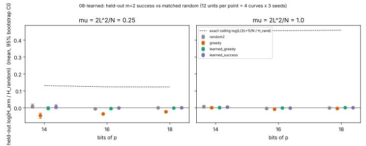
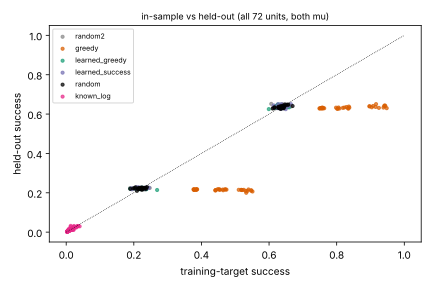

# 08-learned: learned factor-base selector vs greedy and random (held-out targets)

Item 08 of the pair-46 factor-base campaign (family `learned_sparse`, IDEA-20260807-*).
Protocol: `PROTOCOL.md` (frozen before data, sha256 in `PROTOCOL.sha256`, also recorded in `results.json`).
Run: `run_learned.py`, 72 units (3 bit sizes x 4 prime-order curves x 3 seeds x 2 operating points), 129 s wall on 1 process, full preregistered design, nothing cut.

**Verdict.** No learned selector beats random on held-out targets in any cell. Both learned selectors do beat the greedy base, but only because greedy does *worse* than random on held-out targets: it overfits the training targets. The preregistered decision ("learned advances") is **false**. One preregistered control did not pass, so under the protocol's own rule the empirical comparison is formally **inconclusive**: the random-vs-random2 null interval excludes 0 at 16 bits, by -0.6% and -0.4%. Separately from that, an **exact** counting identity caps what any base selector can do, learned or not, at a constant factor that tends to 1.

## Exact statements (proved, and checked on every arm of every unit)

- For any symmetric point set S (|S| = 2L) in a group of prime order N, the number of ordered pairs (s1, s2) in S^2 with s1 + s2 = R, summed over all R, is exactly |S|^2. `results.json` checks this as `sum_count_all_r == S_size^2` on all 72 x 7 arm evaluations, and it holds on every one. So the mean number of m=2 decompositions of a uniform target is 4L^2/N for **every** base of size L. The same argument gives |S|^m/N for m terms. No selector can change the expected relation yield per uniform target.
- The probability that a uniform target decomposes is at most |S+S|/N <= L(2L+1)/N. A random base reaches about 1 - exp(-mu), with mu = 2L^2/N. So the best possible held-out success ratio against random is about mu/(1-exp(-mu)): 1.13 at mu = 0.25 and 1.58 at mu = 1, and it tends to 1 as mu tends to 0, which is the index-calculus operating regime. This is a constant-only ceiling.
- Corollary (zero-sum): whatever a base gains in decompositions on training targets, it loses in total over the other targets. The greedy arm shows this: its held-out mean count is 0.91-0.98x random while its training success rises to 0.38-0.92.

## Instrument and arms

Exact c(r) for every target r, computed by cyclic FFT self-convolution of the indicator of S. Primary metric: held-out success H, the fraction of the non-training targets with c(r) >= 1. Training targets are N/16 uniform r. Arms are matched in size L: `random`, `random2` (null), `greedy` (lazy greedy max-coverage of the training targets), `learned_greedy` (L1 logistic regression on x-features, trained to imitate greedy membership), `learned_success` (L1 logistic regression trained on high training-decomposition participation against a size-4L reference base), `known_log` (PC1, x(kG) for k <= L). PC2 is a planted learnable label, x mod 7 == 3.

## Results (held-out log-ratio vs random; mean [95% bootstrap CI], 12 units per cell)

| mu | bits | random2 | greedy | learned_greedy | learned_success | learned_success vs greedy | known_log (PC1) | exact ceiling |
|---|---|---|---|---|---|---|---|---|
| 0.25 | 14 | +0.010 [-0.002, +0.023] | -0.046 [-0.061, -0.031] | -0.003 [-0.012, +0.007] | +0.006 [-0.006, +0.018] | +0.051 [+0.042, +0.063] | -2.79 | log 1.141 |
| 0.25 | 16 | -0.006 [-0.010, -0.002] | -0.036 [-0.041, -0.031] | -0.004 [-0.009, 0.000] | -0.001 [-0.005, +0.004] | +0.035 [+0.030, +0.040] | -3.49 | log 1.132 |
| 0.25 | 18 | -0.000 [-0.002, +0.002] | -0.023 [-0.027, -0.020] | -0.001 [-0.004, +0.001] | +0.000 [-0.002, +0.002] | +0.024 [+0.021, +0.026] | -4.33 | log 1.132 |
| 1.0 | 14 | +0.006 [-0.002, +0.015] | +0.001 [-0.005, +0.006] | +0.001 [-0.006, +0.007] | +0.004 [-0.001, +0.009] | +0.004 [-0.002, +0.010] | -3.14 | log 1.585 |
| 1.0 | 16 | -0.004 [-0.007, -0.000] | -0.008 [-0.012, -0.004] | -0.001 [-0.004, +0.003] | -0.002 [-0.006, +0.002] | +0.007 [+0.003, +0.010] | -3.85 | log 1.577 |
| 1.0 | 18 | -0.001 [-0.002, +0.001] | -0.004 [-0.006, -0.002] | +0.001 [-0.001, +0.002] | +0.001 [-0.001, +0.003] | +0.005 [+0.004, +0.006] | -4.68 | log 1.582 |

In-sample (training-target) success at mu = 1: random 0.64, greedy 0.92 / 0.82 / 0.76 at 14 / 16 / 18 bits, learned_greedy 0.63. The greedy base wins in-sample and does not carry over to held-out targets. The learned selectors do not even reproduce greedy's in-sample advantage: their training success equals random's.

Learner diagnostics: the test AUC for predicting greedy membership is 0.48-0.55 (cell means), and for the success label 0.50-0.51, which is chance. On the planted mod-7 label (PC2) it is 1.000 in all 72 units. So the learner works when there is something to learn, and x-features carry no signal about decomposition usefulness. The L1 models still keep nonzero weights (`nnz_*` in `results.json`), but those weights fit noise.





## Controls

- PC1 (`known_log`): the upper bound is far below 0 in every cell (log-ratio -2.8 to -4.7), so the detector sees base effects on success rate. Its held-out mean count is about 1.0x random, as the exact identity requires.
- PC2: AUC 1.000 in every unit, so the learner is not broken.
- Null `random2`: the CI covers 0 in 4 of 6 cells. At 16 bits it excludes 0 at both mu (-0.006 [-0.010, -0.002] and -0.004 [-0.007, -0.000]). The two random arms are exchangeable by construction, so this is a small-sample bootstrap miss. It shows the 12-unit percentile interval undercovers at the 0.5% level. Under the preregistered rule this makes the empirical comparison **inconclusive**, not null. Neither learned arm's interval clears 0 against random in any cell, so the failure does not hide a win.

## Exact vs empirical

- Exact: the conservation identity (sum of c(r) = |S|^2, so E[c] = |S|^m/N for every base) and the success ceiling L(2L+1)/N, giving a constant-only maximum advantage that tends to 1 as mu tends to 0. These apply to any selector, learned, greedy or otherwise, for uniform targets in any prime-order group. Pair 46 (prime N) is included.
- Empirical (toy scale, 14-18 bit p, m = 2): the learned selectors match random within about +-0.5% on held-out targets, and greedy is 0.4-4.6% below random on held-out targets. The greedy deficit shrinks with bits because the training fraction is fixed at N/16 while greedy's in-sample excess falls.

## Deviations and caveats

- The numpy FFT may have used more than one thread briefly (user time 149 s against 129 s wall). Total compute was about 2.5 CPU-minutes.
- The bootstrap is over 12 (curve, seed) units per cell. Seeds share a curve, so the intervals are somewhat optimistic, as the random2 miss shows.
- Only m = 2 was measured. The exact identity covers every m.

## Reproduce

```
cd /home/user/crypto/research/pair46_factor_bases_20261015/08-learned
OMP_NUM_THREADS=1 python3 run_learned.py results.json > run.log
python3 analyze.py          # summary.json, fig_heldout.{svg,png}, fig_overfit.{svg,png}
python3 make_pdf.py .       # report.pdf
```
