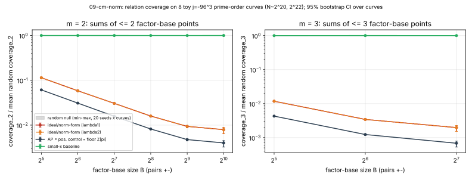

# 09-cm-norm — norm-form / CM-class-ideal factor bases for pair 46

**Verdict: exact obstruction (with a confirming negative toy measurement).** No reading of
"CM ideal factor base" gives a factor base whose relations carry information about
log_P Q beyond what generic (BSGS/rho) search gives. Protocol: `PROTOCOL.md` (sha256 in
`PROTOCOL.sha256`, unchanged after data). Run: 16 s wall, 1 core (`taskset -c 3`), all
preregistered arms and sizes completed; nothing cut.

## 1. What a factor-base element is (settled before data)

- **Reading I (points from endomorphisms / principal ideals).** Element = alpha(P),
  alpha in End(E), small norm. Crater: O_K = Z[w], h(-19) = 1, so every ideal is
  principal and the factor base is {[a + b*lambda]P : a^2 + ab + 5b^2 <= X}, up to sign.
  Floor: End = Z[pi], and pi acts as the identity on E(F_p), so a + b*pi acts as the
  integer a + b.
- **Reading II (non-principal ideals of Z[pi], h ~ v).** An ideal class acts on curves,
  not on points: the element is an isogeny E -> E_a. It never is an element of E(F_p).

## 2. Exact statements (pair 46, computed in `src/main.rs`; proofs below)

| check | result |
|---|---|
| N = p + 1 - t; p = 5t^2+19t+19; 4p = t^2 + 19 v^2; p, N, v prime | all true |
| [N]P = O on a point of crater and of floor | true, true |
| lambda^2 - lambda + 5 = 0 mod N | true |
| v*lambda = 2 mod N | **false**; v*lambda = t and v*(1 - lambda) = 2 are true |
| (-19 / v) | -1 |
| h(Z[pi]) = v - (-19/v) (units +-1) | 34489704 |
| min norm of a non-integer element a + b*pi (b != 0) | >= 19 v^2 / 4 = 5650313161883992 (~0.95 p) |

The v*lambda line corrects the campaign note: with the given lambda, pi + 1 = v * conj(w),
i.e. the given lambda is the eigenvalue of conj(w) relative to that factorisation (or
equivalently pi + 1 = v w holds for the conjugate eigenvalue 1 - lambda = 2973848911856565).
Both are degree-5 endomorphisms; nothing below depends on which.

**E1 (exact, crater, reading I is a 2-D generalized arithmetic progression).** The map
Z[w] -> Z/N, alpha -> alpha mod (the prime above N) is a ring homomorphism, so
F_X = {phi(alpha) : Nm(alpha) <= X}. Since sqrt(Nm) is a norm on Z[w] (x) R,
Nm(alpha + beta) <= (sqrt X + sqrt X)^2 = 4X, so F_X + F_X is contained in F_{4X} and
|F_X + F_X| <= #{Nm <= 4X} ~ 4 |F_X|. In general |m F_X| <= #{Nm <= m^2 X} ~ m^2 |F_X|,
against ~|F_X|^m/m! for a generic set. Relations among factor-base elements are lattice
relations alpha = sum alpha_i, i.e. the decomposition of a target Q as a sum of
factor-base points is a 2-D GLV-style search for (a, b) with Q = [a + b*lambda]P, whose
generic cost is Theta(sqrt N) (2-D BSGS/kangaroo). The structure that makes F_X cheap to
describe is exactly what makes its sumsets small.

**E2 (exact, floor, reading I degenerates).** Nm(a + b*pi) = (a + bt/2)^2 + (19 v^2/4) b^2,
so for X < 19 v^2/4 (about 0.95 p, i.e. every usable size) the factor base is
{[a]P : |a| <= sqrt X}, an arithmetic progression of known integers. It is identical to the
positive control below. More generally every endomorphism of the floor acts on E(F_p) as a
known integer, so it contributes no relation that is not an identity in Z/N.

**E3 (exact, reading II carries no point information).** An ideal a of Z[pi] coprime to N
gives phi_a : E -> E_a with E_a(F_p) ~ Z/N, and phi_a maps the instance (P, Q) to
(phi_a P, phi_a Q) with the same logarithm. A class-group relation prod a_i^{e_i} = (alpha)
returns to E as the endomorphism alpha, which (E2) acts as a known integer. So
class-group relations, which are subexponentially computable (Hafner-McCurley in
imaginary quadratic orders, h = 34489704 here), are relations in Cl(Z[pi]), not in E(F_p):
no point is ever decomposed and log_P Q never enters any relation. On the crater h = 1 and
reading II is empty.

## 3. Toy measurement (claim class C3, empirical)

8 toy curves y^2 = x^3 + 3k x + 2k, k = j/(1728 - j), j = -96^3 (End = O_K, prime-order
twist), N ~ 2^20 (6 curves) and ~2^22 (2 curves); parameters in `results.json`. Instrument
(same on every arm): exact coverage_m = fraction of Z/N that is a sum of <= m elements of
the symmetric factor base (this is exactly the probability a uniform random combination
[r]P + [c]Q is a relation). Ratio to the mean of 20 random symmetric sets of the same
size on the same curve; 95% CI = percentile bootstrap over the 8 curves.



| m, B | ideal/norm-form ratio [95% CI] | AP = positive control = floor | small-x baseline | random null range |
|---|---|---|---|---|
| 2, 256 | 0.0159 [0.0156, 0.0161] | 0.0082 [0.0081, 0.0083] | 0.9992 [0.9986, 0.9997] | [0.996, 1.004] |
| 2, 1024 | 0.0079 [0.0064, 0.0089] | 0.0040 [0.0032, 0.0045] | 1.0000 [0.9997, 1.0002] | [0.998, 1.001] |
| 3, 128 | 0.0020 [0.0015, 0.0023] | 0.0007 [0.0005, 0.0008] | 0.9998 [0.9992, 1.0003] | [0.995, 1.003] |

- Positive control passes: AP coverage_2 ratio <= 0.1 for B >= 256 (0.0082, 0.0048, 0.0040), so the instrument sees additive structure.
- Both roots lambda give identical coverage (exact: conjugation (a, b) -> (a + b, -b) preserves the norm form).
- Preregistered decision rule: upper CI endpoint of the ideal arm's coverage_2 ratio < 1 for all B >= 256 -> **negative** (about 60x-130x fewer relations per trial than a random set of the same size; ~2x the AP). Ratio scales as ~4/B for m = 2 (B pairs, |S| = 2B), matching E1 (|S+S| ~ 4|S| = 8B vs |S|^2/2 = 2B^2).
- Small-x matches the random null, consistent with the prior campaign.

## 4. What is exact vs empirical

- Exact (proved/computed): E1, E2, E3 and the pair-46 table. These are the result.
- Empirical (toy, 8 curves): the coverage ratios; they illustrate E1 numerically and are not needed for the obstruction.
- Not measured: membership-test cost (coverage is an upper bound on usefulness; reading I's membership test has no shortcut better than a table or the 2-D search of E1).

## Reproduce

```
cd research/pair46_factor_bases_20261015/09-cm-norm
cargo build --release && taskset -c 3 ./target/release/cm_norm > run.log   # writes raw.json
python3 analyze.py        # derived ratios -> results.json, fig_coverage.svg/png (layout only)
python3 make_pdf.py .     # report.pdf
```
