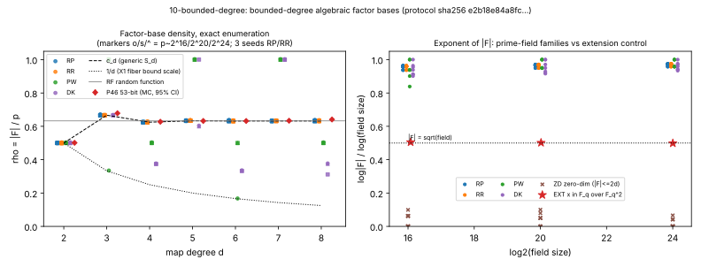
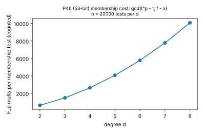

# 10-bounded-degree — results

Item 10 of the pair-46 factor-base campaign (2026-10-15): bounded-degree
algebraic factor bases over prime fields, the repaired form of
`IDEA-20261009-a7733f` / design audit
`ALGEBRAIC-FACTORBASE-DIMENSION-20261010`. Protocol: `PROTOCOL.md`, frozen
before data, sha256 `e2b18e84a8fcf524215dba216814ec4a85f5d80347cf308810d23587e2bcd3a9`
(`PROTOCOL.sha256`, also embedded in `raw.json`).

**Verdict: exact obstruction, confirmed by a finite sanity check.** Every
bounded-degree family (degree 2..8 polynomial and rational x-images, power
and Dickson maps) has `|F|/p >= 0.167` and exponent `log|F|/log p >= 0.839`
at p ~ 2^16..2^24; the extension-field positive control gives exponent
0.499..0.505. Random families sit on the Chebotarev value `c_d` to within
+-0.003. Zero-dimensional conditions give `|F| <= 4`. This closes only the
tested families; it is not a theorem about all subsets of E(F_p).

## 1. Design-audit repair (what changed before data)

| Audit item | Repair |
|---|---|
| `p in {2^16,2^20,2^24}` are not primes | `p_k` = smallest prime `> 2^k`, `= 3 mod 4`: **65539 (17 bits), 1048583 (21 bits), 16777259 (25 bits)**; deterministic MR (12 bases) |
| Extension control undefined | `q` = 263, 1031, 4099 (`= 3 mod 4`), `F_{q^2}=F_q[i]/(i^2+1)`, irreducibility checked; `F = {x in F_q}` |
| "factor base" not a subset of E | every F is a set of affine points of E(F_p), union counted once, O excluded |
| Hasse-Weil hypotheses; "genus p^0.4" | exact bound X2 stated for squarefree `h_f` (all 168 algebraic rows were squarefree; genus computed exactly by Yun decomposition); threshold corrected (X3) |
| Representation size not modelled | dense coefficient bits recorded per row; membership cost counted in F_p mults on the 53-bit pair-46 curve |
| Relation/LA costs | cut (preregistered): X2 already gives `#F >> sqrt(p)` |

## 2. Exact statements (proved, not measured)

- **X1.** A degree-d map `P^1 -> P^1` has `|image(F_p)| >= (p+1)/d`.
- **X2.** `|F_f| >= LB_f = (p + 1 - 2 g_f sqrt(p) - 3 - 2 deg Q)/d`, where `C_f: y^2 = h_f(t)` maps onto `F_f` with fibers `<= d`. Genus: `g = floor((3d-1)/2)` for polynomials, `2d-1` for generic rational maps (measured exactly per row, matches).
- **X3 (corrects the proposal's p^0.4).** With `g <= 2d-1`: `|F| <= sqrt(p)` forces `d >= sqrt(p)/5 (1-o(1))`; `|F| < p^0.9` forces `d >~ p^0.1/5`. For any cover `C -> E` of degree d and genus g, `|F| >= (p+1-2g sqrt p)/d`, so sub-`p^0.9` needs `d >~ p^0.1` or `g >~ sqrt(p)/2`. For pair 46 (`sqrt p = 7.71e7`): `|F| <= sqrt(p)` needs `d >= 1.54e7`, dense size `>= 8.2e8` bits.
- **X4.** `A(x) + yB(x) = 0` (deg A <= d, deg B <= d-2) has `<= 2d` zeros on E.

## 3. Controls

| Control | Result |
|---|---|
| Fields: MR prime, `p = 3 mod 4`, Hasse, `[#E]R = O` for 4 points | pass at all 3 primes (#E = 65736, 1048896, 16776014) |
| Negative (i) identity map d=1 | `#F = #E - 1` exactly at all 3 primes |
| Negative (ii) RF random function (9 rows) | rho = 0.6327, 95% CI [0.6319, 0.6334] (1 - 1/e = 0.6321) |
| Positive (i) EXT x in F_q over F_{q^2} | `#F` = 278, 1058, 4006 for q = 263, 1031, 4099; exponent 0.505, 0.502, 0.499: **valid** |
| Positive (ii) PW image = `(p-1)/gcd(d,p-1)+1`; DK permutation when `gcd(d,p^2-1)=1` | all 42 rows exact |
| X2 lower bound holds (implementation check) | 168/168 rows |
| X4 upper bound holds | 63/63 ZD rows (max `#F` = 4) |

## 4. Measured: random families vs Chebotarev value c_d

n = 9 per cell (3 primes x 3 seeds), 95% t-interval. `Delta = rho - c_d`.

| d | c_d | RP rho [95% CI] | RP Delta [95% CI] | RR rho [95% CI] | RR Delta [95% CI] | genus RP / RR |
|---|---|---|---|---|---|---|
| 2 | 0.5000 | 0.5003 [0.4999, 0.5007] | [-0.0001, 0.0007] | 0.5006 [0.4994, 0.5017] | [-0.0006, 0.0017] | 2 / 3 |
| 3 | 0.6667 | 0.6678 [0.6664, 0.6691] | [-0.0003, 0.0025] | 0.6669 [0.6665, 0.6672] | [-0.0002, 0.0006] | 4 / 5 |
| 4 | 0.6250 | 0.6253 [0.6247, 0.6260] | [-0.0003, 0.0010] | 0.6257 [0.6245, 0.6268] | [-0.0005, 0.0018] | 5 / 7 |
| 5 | 0.6333 | 0.6334 [0.6324, 0.6345] | [-0.0010, 0.0012] | 0.6344 [0.6329, 0.6358] | [-0.0004, 0.0025] | 7 / 9 |
| 6 | 0.6319 | 0.6331 [0.6314, 0.6348] | [-0.0006, 0.0029] | 0.6325 [0.6312, 0.6338] | [-0.0007, 0.0018] | 8 / 11 |
| 7 | 0.6321 | 0.6324 [0.6316, 0.6331] | [-0.0006, 0.0010] | 0.6334 [0.6324, 0.6345] | [0.0002, 0.0023] | 10 / 13 |
| 8 | 0.6321 | 0.6334 [0.6316, 0.6352] | [-0.0005, 0.0031] | 0.6328 [0.6314, 0.6343] | [-0.0008, 0.0022] | 11 / 15 |

13 of 14 Delta intervals contain 0; RR d=7 is +0.0013 [0.0002, 0.0023]
(finite-p fluctuation of order `p^-1/2`; no correction for 14 comparisons).
Special maps reach lower density only through the fiber structure X1: the
minimum over all algebraic rows is PW `t^6` at p = 65539 (`gcd(6,p-1) = 6`),
rho = 0.1673, `|F|` = 10967, exponent 0.839 — X1's `1/d` scale, attained.

## 5. Pair 46 (53-bit crater curve), Monte Carlo

`p = 5947698030651343`, crater `a, b` as in the campaign brief; one random
monic polynomial per d (coefficients in `raw.json`), n = 20000 uniform x,
95% normal interval. Membership = `gcd(t^p - t, f(t) - x) != 1`; cost counted
in F_p multiplications in the instrument.

| d | rho_hat [95% CI] | c_d | F_p mults / membership | dense size (bits) |
|---|---|---|---|---|
| 2 | 0.5012 [0.4892, 0.5132] | 0.5000 | 639 | 159 |
| 3 | 0.6785 [0.6654, 0.6916] | 0.6667 | 1493 | 212 |
| 4 | 0.6276 [0.6147, 0.6405] | 0.6250 | 2634 | 265 |
| 5 | 0.6323 [0.6194, 0.6452] | 0.6333 | 4072 | 318 |
| 6 | 0.6322 [0.6193, 0.6451] | 0.6319 | 5779 | 371 |
| 7 | 0.6336 [0.6207, 0.6465] | 0.6321 | 7780 | 424 |
| 8 | 0.6411 [0.6282, 0.6540] | 0.6321 | 10075 | 477 |

Membership is cheap (about `160 d^2` mults, i.e. `O(d^2 log p)`); the
obstruction is size, not membership: every interval contains `c_d`, so `|F|`
is about `0.63 p = 3.8e15` points against `sqrt(p) = 7.7e7`.





## 6. Exact vs empirical

- Exact: X1-X4; all row counts (`|image|`, `|F|`, `#E`, genus) are exact enumerations, not estimates.
- Empirical: agreement with `c_d` (E1) and the pair-46 densities (E2, Monte Carlo).
- Scope: x-images of degree <= 8 polynomial and rational maps, power and Dickson maps, zero-dimensional `A + yB` conditions, at three toy primes plus pair 46 sampled. Not tested: other covers `C -> E` (their bound is X3, exact), compact high-genus descriptions (not excluded by any finite run).

## 7. Deviations and cuts

- Nothing cut from the preregistered design; wall clock 87.6 s on one core (`taskset -c 3`).
- RF was run once per prime (3 seeds), not once per d, as it has no degree.
- EXT curves were checked by nonsingularity and Hasse only; the `[#E]R = O` check was run only for prime-field curves.
- P46 polynomial seed is derived from 1825564914 mixed with d (see `src/main.rs`, `p46`); the coefficients are recorded.
- Relation generation and linear algebra not run (preregistered cut).

## 8. Files and reproduce

`src/main.rs` (Rust instrument; all counts), `raw.json` (instrument output),
`analyze.py` (summary statistics and plots of recorded values), `results.json`,
`fig_density.{svg,png}`, `fig_membership.{svg,png}`, `make_pdf.py` (layout),
`report.pdf`, `run.log`.

```
cd research/pair46_factor_bases_20261015/10-bounded-degree
cargo build --release && taskset -c 3 ./target/release/bounded_degree 20000 2> run.log
python3 analyze.py . && python3 make_pdf.py .
```
