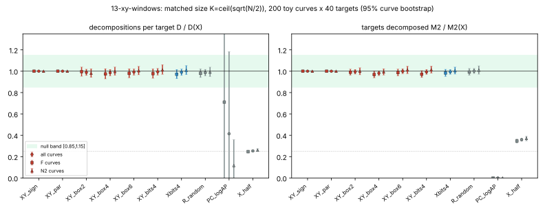
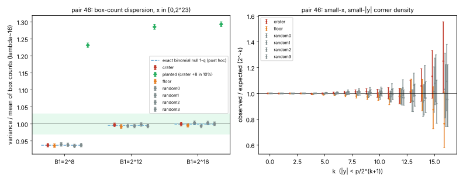

# 13-xy-windows: joint x and y window factor bases vs x-only windows of matched size

Pair-46 factor-base campaign, item 13, run 2026-10-15. The protocol was frozen first in
`PROTOCOL.md` (sha256 `f7224755...f876` in `PROTOCOL.sha256`). The run had one execution and no
dry run. An earlier launch failed before writing any data because `/usr/bin/time` was missing.
Host: shared 4-CPU container, run pinned to 1 core (`taskset -c 3`). Wall time was 364.9 s:
31 s for pair 46 and 334 s for the toy curves. The budget guard did not fire, so nothing was cut.

**Verdict: null, with an exact obstruction for the sign and parity forms.**

- **Coverage.** The existing `bit_window` family does not cover joint windows. It is x-only and
  unimplemented, so this item implemented joint windows.
- **Sign and parity windows (exact).** A y-sign window (y < p/2) or a y-parity window adds nothing:
  its x-set is exactly the x-only window. This was checked on 200/200 curves and 8000/8000 targets.
- **Box and bit windows (empirical).** At matched size, |y|-box windows and y-bit windows give the
  same relation yield as the x-only window. The decompositions-per-target ratio D/D(X) is
  0.9885 [0.9608, 1.0181] for box 1/4, 0.9857 [0.9562, 1.0168] for box 1/16,
  0.9921 [0.9629, 1.0216] for box 1/64 and 0.9946 [0.9631, 1.0257] for y-bits 1/16.
- **Cost.** These windows cost 2^k times more x-candidates to build: 8.00, 31.9, 127.8 and
  32.0 scans per element, against 2.00 for the x-only window.
- **Controls.** Both positive controls fired: PC M2 ratio 0.0004 and X_half D ratio 0.254.
- **Pair 46.** Box counts in (x, |y|) are as random as on 4 random curves over the same p.

## Step 0: is this already covered by bit_window?

No.
- `research/factor_base_lab.md` (crypto-autoresearcher) defines `bit_window` as "fixed high or low radix bits of
  **x**".
- `src/crypto_autoresearcher/index_calculus/factor_base.py` implements small_x, random, subgroup, dickson,
  known_log, planted and small_x_offset, and none of them reads y. Neither `bit_window` nor `qr_window` is
  implemented.
- The ecbench plug-in families in `docs/ecbench/FACTOR_BASE_PROTOCOL.md` are x-only.
- The ledger proposal IDEA-20261015-5888a7 ("joint x-y windows", notes: "nothing measured") records the
  same gap.

This item is the first measurement. Its x-only comparator `Xbits4` is the bit_window family, instantiated
as x = 0 mod 16.

## Exact statements (proved; computation only checks them)

- **X1. Every joint window is an x-predicate.**
  - Statement: for Y a subset of F_p, take the base {P : x(P) in X, y(P) in Y} modulo +-. Its x-set is
    {x in X : f(x) is a nonzero square and {+-sqrt f(x)} meets Y}.
  - Proof: Semaev relations R = sum +-P_i and S_{m+1}(x_1..x_m, x(R)) = 0 depend only on x(P_i). So a
    y-constraint only selects which x enter the base. It is a thinning of the x-line by the predicate
    "a root of y^2 = f(x) lies in Y", and it adds no algebraic relation.
- **X2. Sign and parity windows are no-ops.**
  - Statement: if Y and -Y together cover F_p^*, the x-set equals that of the x-only window, and every
    relation is identical, target by target.
  - The half-plane y < p/2 is such a Y. So is "y even": p is odd, so y -> p - y flips parity, and
    exactly one of +-y is even.
  - Check: the XY_sign and XY_par sets equalled X, and their per-target decomposition counts were
    identical, on 200/200 curves and 8000/8000 targets.
  - Consequence: the "y sign/bit constraint" contributes nothing unless it is a genuine thinning of
    |y| = min(y, p - y).
- **X3. Membership degree is not lowered.**
  - A base of K distinct abscissae has univariate vanishing polynomial degree exactly K. A nonzero
    function on E vanishing at K affine points has pole order >= K, since deg div = 0.
  - A y-window therefore cannot give a membership polynomial of degree far below the base size. This
    is the campaign's standing prime-field obstruction (items 06 and 10, RR), specialised here.
  - Imposing |y| < B2 on a Semaev solve also needs extra variables y_i with y_i^2 = f(x_i) and a
    smallness condition on y_i. That condition is no more algebraic than small-x is.
- **X4. Price.**
  - A box of fraction q of the |y| range keeps q of the liftable x. Building K elements by x-scan
    therefore costs 2/q candidates per element, against 2 for the x-only window.
  - This is the expected value under equidistribution of |y|. Matched-size yield cannot repay it,
    because the yield is conserved (below).
  - A box enumerator cheaper than the x-scan (c_box < B1 in IDEA-20261015-5888a7) is not known. None
    is implemented here; the open number stays open.

## Empirical measurements: toy relation yield at matched size

- Curves: 200 toy curves, 20 to 30 bits. There are 100 family curves (F: p = 5t^2+19t+19, j = -96^3)
  and 100 random prime-order curves (N2).
- Size: every arm holds exactly K = ceil(sqrt(N/2)) +- classes; X_half holds K/2.
- Targets: T = 40 random targets per curve, shared by all arms.
- Relations: Semaev m = 2, R = +-P1 +- P2.
- Ratios: pooled sum over curves of arm / X, with a 95% bootstrap over curves (2000 resamples).
- Baseline: X has M2 = 0.6349 [0.6243, 0.6454] (Wilson) and D = 1.014 decompositions per target.

| arm | predicate | M2 / M2(X) [95%] | D / D(X) [95%] | x scanned per element [95%] |
|---|---|---|---|---|
| X | first K liftable x (x-only window) | 1 | 1 | 1.9995 [1.9959, 2.0031] |
| XY_sign | some root y < p/2 | 1.0000 (identical, X2) | 1.0000 (identical) | 1.9995 |
| XY_par | some root y even | 1.0000 (identical, X2) | 1.0000 (identical) | 1.9995 |
| XY_box2 | abs y < p/8 | 0.9949 [0.9732, 1.0166] | 0.9885 [0.9608, 1.0181] | 7.9969 [7.9796, 8.0149] |
| XY_box4 | abs y < p/32 | 0.9813 [0.9594, 1.0030] | 0.9857 [0.9562, 1.0168] | 31.943 [31.861, 32.026] |
| XY_box6 | abs y < p/128 | 0.9992 [0.9770, 1.0235] | 0.9921 [0.9629, 1.0216] | 127.76 [127.44, 128.07] |
| XY_bits4 | bits 1..4 of abs y zero | 0.9927 [0.9708, 1.0156] | 0.9946 [0.9631, 1.0257] | 32.016 [31.934, 32.100] |
| Xbits4 (x-only bit_window) | x = 0 mod 16 | 0.9941 [0.9717, 1.0163] | 0.9905 [0.9605, 1.0198] | 32.046 [31.987, 32.106] |
| R_random (neg. control) | K random liftable x | 1.0012 [0.9784, 1.0259] | 0.9860 [0.9556, 1.0173] | 2.0010 |
| PC_logAP (pos. control) | {jG : j = 1..K} | 0.0004 [0.0000, 0.0010] | 0.414 [0.000, 1.183] | 1 |
| X_half (size control) | first K/2 of X | 0.3585 [0.3442, 0.3722] | 0.2538 [0.2443, 0.2630] | 1.0006 |

Notes on the table:
- "abs y" is the canonical |y| = min(y, p - y). A box fraction 2^-k means abs y < ((p+1)/2)/2^k.
- PC_logAP's D is dominated by 2 targets whose log fell in [-2K, 2K]. Those targets carried thousands of
  decompositions; every other target had none. That is why its D interval is wide while M2 collapses.

Both the F and the N2 subgroup give the same picture; every joint, Xbits4 and R interval is inside [0.92, 1.07] (`results.json`, groups F and N2).

Against the preregistered decision rule:
- Every joint arm and Xbits4 has both intervals inside [0.85, 1.15]. In fact all lie inside [0.95, 1.03].
- R is inside the band.
- PC M2 is < 0.5 and its interval excludes 1.
- The X_half D interval contains 0.25.

**Null: yield is conserved at matched size.** A y-window thins the x-line like any other predicate, and the base
behaves like a random set of the same size. The effect is the same as for the x-only bit_window. Two joint
arms are at the edge of the band, with upper bounds just above 1.0: XY_box4 at 1.003 for M2, and the F
subgroup at 1.002. No arm shows a gain.



## Empirical measurements: pair 46 box-count statistics

Setup:
- For crater, floor and 4 random curves over the same p, the run scanned x in [0, 2^23).
- 2^22 x were liftable on each (e.g. crater 4,194,446). f(x) = 0 never occurred.
- For crater and floor, N·P = O was checked on 3 random points per curve.

**Dispersion of box counts.** Each box is [x0, x0 + B1) x [c, c + H) in (x, |y|), with lambda ~ 16.

| B1 | crater | floor | random0..3 range | planted crater (+8 in 10% of boxes) | exact null 1 - q (post hoc) |
|---|---|---|---|---|---|
| 2^8 | 0.9375 [0.9324, 0.9427] | 0.9364 [0.9312, 0.9417] | 0.9354 .. 0.9399 | 1.2316 [1.2249, 1.2386] | 0.9375 |
| 2^12 | 0.9973 [0.9920, 1.0026] | 0.9924 [0.9869, 0.9980] | 0.9934 .. 0.9989 | 1.2856 [1.2784, 1.2933] | 0.99609 |
| 2^16 | 1.0001 [0.9945, 1.0054] | 0.9959 [0.9909, 1.0010] | 0.9943 .. 1.0037 | 1.2935 [1.2865, 1.3007] | 0.99976 |

**Deviation from the protocol, reported rather than hidden.** The preregistered null was I = 1, which is
Poisson. That is wrong for this instrument:
- Each x contributes at most one point (one canonical |y|), so a box count is Binomial(B1, q) with q = lambda/B1.
- The exact null is therefore var/mean = 1 - q: 0.9375, 0.99609 and 0.99976.

Effect on the preregistered rule:
- Read literally, the rule fails at B1 = 2^8 for **all six curves, random ones included**. That is a
  misspecified null, not structure.
- Against the exact null (computed post hoc in `posthoc.py`/`posthoc.json` from the recorded values),
  all 18 intervals contain it. Index/null ratios run from 0.9946 to 1.0040.
- The planted control passed at every shape: the interval excludes 1 and lies above 1.2. At B1 = 2^8
  the margin is small (1.2316, from a 0.9375 baseline).

Pair-46 curves are inside the range of the random curves at every shape.

**Corner density.** Within x in [0, 2^23), this is the fraction of liftable x whose |y| < ((p+1)/2)/2^k,
for k = 0..16, as observed/expected.
- All six curves track 1. At k = 16 there are about 64 points, so the spread is ±25%.
- Intervals excluding 1 occur on:
  - floor, k = 4..9 and k = 11, at 0.95 to 0.995.
  - random2, k = 1, 2 and 7..9, at 1.02 to 1.03.
  - crater, k = 16 (1.25).
- The k-levels are nested cumulative counts, so these exclusions are one correlated excursion per curve,
  not independent findings.
- A random curve shows an excursion of the same size in the opposite direction. There is no
  family-specific signal, and these are not corrected for the 6 x 16 comparisons.

The realized pair-46 density of the XY_box_k base is 2^-k of the liftable x. Its x-scan price is
therefore 2^(k+1) candidates per element at pair-46 size too.



## What is exact and what is empirical

**Exact:**
- X1: a joint window is an x-predicate.
- X2: sign and parity windows are identical to the x-only window (checked 8000/8000).
- X3: membership degree >= K.
- X4: the scan price is 2/q per element, given equidistribution. The measured 2^(k+1) scans per element
  confirm it.

**Empirical:**
- Matched-size yield conservation for |y| boxes and y-bit windows (toy, 20 to 30 bits, m = 2).
- Pair-46 equidistribution of (x, |y|) box counts in x < 2^23, at box scales far below the Weil range:
  B1·H ~ 1e17, against p^{3/2} ~ 4.6e23.

**Not measured:**
- m >= 3 relations.
- A cheaper-than-x-scan box enumerator (c_box). No candidate exists to test.

## Files and reproduce

Files:
- Frozen protocol: `PROTOCOL.md`, `PROTOCOL.sha256`.
- Instrument: `src/main.rs` (Rust, single thread) and `src/common.rs` (copied from item 05).
- Input curves: `input_curves_from_04.csv` (sha256 88c26329...7c12).
- Raw outputs: `results.json` (all recorded values, per-curve rows), `run.log`, `stdout.txt`, `time.txt`.
- Post-hoc exact-null comparison: `posthoc.py` → `posthoc.json`.
- Figures: `plot.py` → `fig_yield.{svg,png}`, `fig_pair46.{svg,png}`.
- PDF layout: `make_pdf.py` → `report.pdf`.

```
cd research/pair46_factor_bases_20261015/13-xy-windows
CARGO_TARGET_DIR=/tmp/t13 cargo build --release
taskset -c 3 /tmp/t13/release/xy_windows . 40 100 100 2000 1500   # out_dir T nF nN2 boots toy_budget_s
python3 posthoc.py . && python3 plot.py . && python3 make_pdf.py .
```
