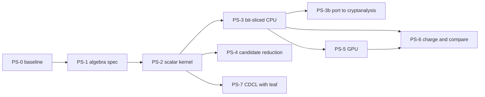

# PDP oracle speedup program: scope, tasks and gates

**Date.** 2026-10-11.  **Status.** Plan; no task below has run.  The only
numbers are the indicative reference in §2 and the arithmetic in §5, both
labelled.  **Class.** Accounting (a plan moves no operation count).
**Conductor task.** T-3.  **Companion.** the `cryptanalysis` repository's
`experiments/pdp-oracle-speedup-20261011/` (the GPU task and the port of the
CPU kernel into its suite).
**Origin.** The SAT/SMT survey ([`RESEARCH_PDP_SAT_SMT_NAGAO_SURVEY.md`](../notes/index-calculus/RESEARCH_PDP_SAT_SMT_NAGAO_SURVEY.md),
#1643) and its follow-ups (#1650, #1653) concluded that every SAT, SMT and
WDSat arm is an enumerator with a large constant and that the oracle that
wins is the pairs-and-solve loop.  This program scopes how far that loop can
be sped up and whether a SAT-shaped wrapper adds anything.  It supersedes
item 7 (GPU leaf) of [`../pdp_followups_20261010/blocked/PROTOCOLS.md`](../pdp_followups_20261010/blocked/PROTOCOLS.md),
which stays as the record of what was blocked.

## 1. Question and boundary

**Question.**  How much can the per-target cost of the point decomposition
oracle be reduced by engineering the pairs-and-solve loop (incremental
Gray-code update of the quartic's coefficients, bit-slicing, GPU, symmetry),
and does a CDCL shell with an algebraic leaf gain anything over the plain
loop?

**Boundary, stated before anything is measured.**

- **Floor.**  Relation collection costs `Θ(2^n)` independent of `ℓ` for any
  oracle that enumerates sub-tuples, and `m·2^n/n` with a Frobenius-stable
  base ([`RESEARCH_ECC2K130_DECOMPOSITION.md`](../notes/ecc2k130/RESEARCH_ECC2K130_DECOMPOSITION.md)
  §5.1).  An oracle that reaches rho on ECC2K-130 must beat exhaustive search
  over its own candidate set by `2^{−(63.2 + log₂ m)}` (same note, §5.3).
  Nothing here can cross that; the whole program is constant-factor work.
- **Reference.**  Pairs-and-solve: loop over `2^{2ℓ−1}` pairs of factor-base
  abscissae, solve the quartic `S₄` in the third, keep roots in the subspace
  by `gcd(q, L_V mod q)`, one-word field
  ([`RESEARCH_SEMAEV_DECOMPOSITION.md`](../notes/index-calculus/RESEARCH_SEMAEV_DECOMPOSITION.md),
  `examples/semaev_decomp_bench.rs`).
- **Unit.**  Per pair, on the oracle's own inputs: counted bit operations
  (gate count of the formula; one 64-bit word XOR is 64 bit operations, the
  convention of [`RESEARCH_ECC2K130_CROSSBRED.md`](../notes/ecc2k130/RESEARCH_ECC2K130_CROSSBRED.md))
  and instructions retired under `callgrind`, with ns per pair on an
  isolated core as the practicality note (`AGENTS.md` §6, §10).
- **Class expected for every task.**  Engineering.  The program is a success
  if a kernel meets its gate with identical outputs; it is a result about
  the floor only if the ratio to it moves, which no task expects.

## 2. Reference numbers (indicative only)

From `research/pdp_followups_20261010/blocked/pairs_and_solve_cpu_l11.txt`:
one refuting target per `ℓ`, unpinned, shared 4-vCPU container, single run.
**Not a baseline** (`AGENTS.md` §10); PS-0 replaces it: the measured baseline is in
[`baseline_v1/README.md`](baseline_v1/README.md) §5 (337.7, 375.4, 393.3, 421.4, 452.3 ns per pair at `l = 8…12`).

| ℓ | n | pairs `2^{2ℓ−1}` | seconds | ns per pair |
|--:|--:|--:|--:|--:|
| 8 | 24 | 32,768 | 0.008 | 244 |
| 9 | 27 | 131,072 | 0.034 | 259 |
| 10 | 30 | 524,288 | 0.186 | 355 |
| 11 | 33 | 2,097,152 | 0.651 | 310 |

## 3. Tasks

Ids are local to this plan.  "Repo" is where the code and evidence land;
"needs" is a hard dependency.  Effort is a planning estimate in person-days,
not a commitment.  Each task has a frozen protocol under [`protocols/`](protocols/)
that is fixed by merging this plan, before any task runs.

| id | task | repo | needs | gate (success) | stop | effort | environment |
|:--|:--|:--|:--|:--|:--|--:|:--|
| [PS-0](protocols/PS-0.md) | Freeze the baseline, host manifest and verdict corpus | crypto | — | A/A spread recorded; verdict digests reproduce in 3 runs | none (cannot fail) | 1 | this container |
| [PS-1](protocols/PS-1.md) | Algebra spec: bit-degree of the quartic's coefficients, root-test formulations, identity certificates | crypto | PS-0 | degrees and formulas certified, exhaustive agreement at `n ≤ 9` | coefficient bit-degree ≥ 5: redesign | 3–4 | this container |
| [PS-2](protocols/PS-2.md) | Scalar reference kernel with incremental updates; gate-count model | crypto | PS-1 | identical outputs on the whole corpus; scalar ns/pair ≤ 0.5× baseline; gate count `G` reported | `G > 1.8·10^5` per pair: bit-slicing cannot reach 5× | 3 | this container |
| [PS-3](protocols/PS-3.md) | Bit-sliced CPU kernel (64, 256, 512 lanes), runtime dispatch, threads | crypto | PS-2 | ≥ 10× baseline per core at `ℓ = 11`, identical outputs | < 5× after tuning at all three widths | 5–8 | AVX-512F/BW host (this one) |
| [PS-3b](protocols/PS-3b.md) | Port PS-3 into the `cryptanalysis` suite (paired PR) | cryptanalysis | PS-3 merged | its tests and the PS-0 corpus pass there; same digests | divergence of the two oracle modules makes a faithful port impossible | 2–3 | this container |
| [PS-4](protocols/PS-4.md) | Candidate reduction: orbit representatives, 2-torsion symmetry | crypto | PS-2 | identical verdicts and solution sets modulo the symmetry; candidate count falls by the predicted factor | weight-base leaf cost eats the gain | 3 | this container |
| [PS-5](protocols/PS-5.md) | GPU kernel from PS-3's straight-line program | cryptanalysis | PS-3, user-approved allocation | ≥ 50× PS-3 on one core in pairs per second, corpus replayed on device | < 20× | 7–10 plus GPU hours | CUDA device (none here) |
| [PS-6](protocols/PS-6.md) | Charge the kernels in the counted unit; paired comparison; scoreboard | crypto | PS-3 (CPU rows), PS-5 (GPU rows) | `S` and ratios to rho and floor reported for each rung, 95% paired interval on timed rows | ratio to the floor changes exponent: report as a finding | 3 | this container |
| [PS-7](protocols/PS-7.md) | CDCL with an algebraic leaf (native solver) and dynamic-branching ablation | crypto | PS-2 | any learned clause that prunes more than one pair on average | no pruning at three rungs: close | 5 | this container |

Critical path: PS-0, PS-1, PS-2, PS-3, PS-5, PS-6; about 20–25 days of
work plus GPU time.  PS-4, PS-7 and PS-3b are off the critical path.

## 4. Landing rules

- **One focused PR per task**, opened ready for review, with its frozen
  protocol cited, raw results committed, and the evidence rules of
  `AGENTS.md` §8 and §10 followed (baseline and host recorded, A/A spread,
  ABAB interleaving at least five rounds, identical-output check, rejected
  attempts kept).  A faster kernel that decides anything differently is a
  different algorithm.
- **Which repo first.**  CPU work (PS-0 to PS-4, PS-6, PS-7) lands in
  `crypto`, where the oracle reference, the evidence rules and the ledger
  live.  GPU work (PS-5) and the port (PS-3b) land in `cryptanalysis`, where
  the C/CUDA core, the cloud runners and the isolated-benchmark service live.
  `src/cryptanalysis/fes_gpu.rs` is byte-identical in both repositories
  today; a change to it lands in `cryptanalysis` first and is mirrored here
  in a paired PR, the convention `AGENTS.md` already states for the curve
  crosswalk.  The two `semaev_decomp.rs` copies have diverged (about 1,500
  diff lines), so PS-3b is a deliberate port with its own tests, not a copy.
  *This split is an assumption of the plan; it is cheap to change before
  PS-3 starts.*
- **Hardware classes.**  Every result names its class (this x86-64 Xeon with
  AVX-512F/BW; a CUDA device) and names the classes it was not measured on
  (Arm64 NEON, Metal, FPGA).  Runtime feature detection with a portable
  fallback; no global `target-cpu`.
- **Spend.**  PS-5 needs a GPU.  This plan authorises none: launching a pod
  or instance needs the owner's explicit approval, a stated cap, and deletion
  of everything started.  Planning cap for PS-5: 8 GPU-hours; no allocation
  has been made.
- **Closeout.**  The program ends when every task is terminal (verified
  complete, closed with a measured negative, or explicitly abandoned) and the
  scoreboard and `docs/ic/progress-timeline.json` carry the rows.  Merging a
  task PR does not complete the program.

## 5. What the gains buy (arithmetic, not measurement)

Each rung of `ℓ` multiplies the pair count by 4, so a speedup `s` buys
`log₄ s` rungs at equal wall time:

| speedup over baseline | rungs of `ℓ` |
|--:|--:|
| 10 | 1.7 |
| 50 | 2.8 |
| 100 | 3.3 |
| 1,000 | 5.0 |

A gate-count model for PS-3 (assumptions, to be replaced by PS-2's count):
512 lanes, two vector-logic issues per cycle on this host, 2.8 GHz.  Then
`ns per pair ≈ G / (512 × 2 × 2.8)`.  To reach 10× over 310 ns the formula
may use at most `G ≈ 9·10^4` gates per pair, and 5× allows `G ≈ 1.8·10^5`.
A bit-sliced field multiplication at `n = 33` is on the order of
10^3 gates, so a root test of 30–60 multiplications sits at 3–6·10^4: the
10× gate is **plausible with a thin margin**, which is why PS-2 measures `G`
before PS-3 is built.

None of this moves ECC2K-130: the oracle would need to be `2^{63}` times
cheaper than enumeration; 1,000× is `2^{10}`.  The results are toy-ladder
reach (new PDP records at `ℓ ≥ 14`) and a smaller oracle constant.  The
`AGENTS.md` §8a gate (m = 83) is **not discharged and not claimed**: at
`m = 3` it would need `ℓ ≈ 28`, beyond any enumerator.

## 6. Scoping host manifest

Recorded 2026-10-11 for planning; PS-0 records the baseline host at run time.

| item | value |
|:--|:--|
| CPU | Intel Xeon @ 2.80 GHz, 4 vCPU, 1 thread per core, L2 4 MiB across the 4 cores (`lscpu`: 1 MiB each; corrected by PS-0), L3 33 MiB |
| features seen in `/proc/cpuinfo` | `avx2`, `avx512f`, `avx512bw`, `bmi2`, `pclmulqdq`; not reported: `avx512vbmi`, `gfni`, `vpclmulqdq` |
| memory, OS | 15 GiB, Linux 6.18.44 |
| toolchain | rustc 1.97.0, cargo 1.97.0, valgrind present |
| GPU | none (`nvidia-smi`, `nvcc` absent) |
| isolation | shared container; `tools/isolated_bench.py` required for any wall number |

## 7. Risks and open questions

1. **Coefficient bit-degree.**  The incremental update is O(1) per Gray step
   only if the quartic's coefficients have low bit-degree in the summand bits
   (the weight bound of Hodges–Petit–Schlatter; `S₄` has degree 4 per
   variable, so monomials such as `x₁³x₂³` have bit-degree 4).  PS-1
   measures it; degree 3 or 4 means higher-order finite-difference tables,
   a larger constant but the same shape.  Degree ≥ 5 stops the design.
2. **The root test dominates.**  If the subspace-membership test, not the
   coefficient update, is most of `G`, bit-slicing buys less than the
   estimate in §5.  PS-1 compares at least two formulations by counted gates.
3. **Weight-base leaf is not the subspace leaf.**  The `gcd(q, L_V)` shortcut
   needs a linear subspace.  A Frobenius-stable weight base needs the roots
   themselves and a popcount test, which costs more per pair.  PS-4 measures
   this and does not assume it away.
4. **Orbit factor is not double-counted.**  The product law already divides
   by `n` for a Frobenius-stable base, so PS-4's gain is a stage constant;
   the whole-method ratio must not claim it twice.
5. **Divergent oracle modules.**  See §4; PS-3b may find a faithful port
   needs the other repository's module refactored first.
6. **Environment.**  Upstream solver sources and `crates.io` are unreachable
   here; this program uses only the in-tree code, `std::arch`, and system
   tools, so it is not blocked by that.  PS-5 is blocked by the absence of a
   GPU, by design.

**Decisions needed from the owner before the named task starts:**
(a) the repo split in §4 (before PS-3); (b) a GPU allocation and cap
(before PS-5); (c) whether PS-7, expected to be negative, is worth its five
days (before PS-7).

## 8. Status of requirements

| item | status |
|:--|:--|
| Scope every task with a frozen protocol | **verified complete** by this PR (§3 and `protocols/`) |
| Baseline recorded | **verified complete** by PS-0 ([`baseline_v1/`](baseline_v1/README.md)): corpus, digests, A/A, counts; supersedes §2 |
| PS-1 to PS-7, PS-3b | **not attempted** (PS-0 only; each updates this row when it lands) |
| Any speedup claim | **none made** |

## 9. Graphs and canonical artifacts checked

`docs/index-calculus-scoreboard.html`, `docs/ic/progress-timeline.json`,
`docs/ic/BOUNDARY_TARGETS.md` and the survey figures are unchanged: this
plan moves no number.  The boundary target "sub-`2^{2ℓ}` oracle at fixed
`ℓ = 8`" remains the yardstick for anything algorithmic rather than
constant-factor; no task here attempts it.
