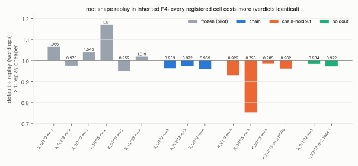
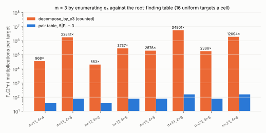

# Prime-degree binary IC, the three survey leads: root shape replay is a recorded negative (0.95–0.98×), block grading was already negative, e₃ enumeration is 553–34,901× the table oracle

2026-10-15. Protocol: [`PROTOCOL.md`](PROTOCOL.md), registered (commit
`d0b27a7f4`) before the claim ladders. Every run is in
[`EXPERIMENTS.md`](EXPERIMENTS.md). Report: [`REPORT.pdf`](REPORT.pdf).
**Class: engineering, a stage diagnostic.** This is the inherited-F4
decomposition stage only, not an end-to-end ECDLP measurement (AGENTS.md
§8).

## Question

This is the follow-up the prime-degree survey ranked first: the one solver
lever from the `k = 4` work (PRs #1863, #1883) that could apply to binary
index calculus over `F_{2^n}`, `n` prime. F4Remake's idea, for the inherited
engine's roots:
- record which Macaulay rows are dependent on earlier rows on the first
  root of a shape (column layout, row count, degree, multiplier policy);
- drop those rows from later roots of the same shape.

A replayed root spans a subspace of the from-scratch one, so its
consequences are sound and the splitting tree still decides every target.
Recording is charged.

## Result

`examples/groebner_stage_bench`, both arms on one binary
(`be69c5ca…`, code `32bf9d358`). Unit: 64-bit word operations in the
eliminations, specialisation included.

| ladder | cells run | default | replay | default ÷ replay | verdicts |
|:--|--:|--:|--:|--:|:--|
| frozen (**pilot**, before the protocol) | 6 | 45,517,794 | 44,815,209 | 1.016 | identical |
| `chain` (registered) | 3 | 7,103,844 | 7,322,495 | **0.970** | identical |
| `chain-holdout` (registered) | 4 | 43,501,345 | 45,579,107 | **0.954** | identical |
| `holdout` (registered) | 2 | 41,414,967 | 42,137,329 | **0.983** | identical |

**Replay costs more on every one of the 9 registered cells: 0.753–0.985×.**
It splits more on 6 of them (e.g. 3,512 against 3,489 splits on
`icv1-f2m15-t275-b7f03703`, `m = 4`). Verdicts, decomposed and exhausted counts are
identical everywhere. The harness skips cofactor-inadmissible cells before
measuring them: `chain` ran 3 of its 5 listed cells, `chain-holdout` 4 of
11.



## Why (diagnostic D1, after the claim runs)

This was a counting build: counters only, with word operations and verdicts
identical to the claim run.

| cell | roots recorded | roots replayed | rows dropped per replay | ratio |
|:--|--:|--:|--:|--:|
| `icv1-f2m9-tm5-4a3ea183`, `m = 4` | 11 | 17 | 5.1 | 0.929 |
| `icv1-f2m15-tm275-2d22ff5d`, `m = 4` | 18 | 6 | 36.3 | 0.753 |
| `icv1-f2m15-t275-b7f03703`, `m = 4` | 81 | 1,832 | 3.8 | 0.985 |
| `icv1-f2m13-t181-515ee569`, `m = 3`, fresh targets | 3 | 13 | 13.9 | 0.962 |

- The large, rank-deficient roots (where `RESEARCH_INHERITED_F4.md` §3.4 saw
  ~40 % deficiency) rarely repeat their exact column layout across targets,
  so they are recorded and not reused.
- The roots that do repeat lose only ~4 rows.
- The subspace root then reads a slightly weaker tail and splits more.

The survey's ceiling (≈ 10 % of the oracle on such cells) is not reached
on any cell.

## Predictions (PROTOCOL.md)

- **R1 (exact): held**, 9/9 cells.
- **R2 (ratio in `[0.95, 1.10]` per ladder): held**, at 0.970, 0.954 and
  0.983.
- **R3 (no cell gains over 1.25×): held**; none gains at all.
- **Decision:** below 1.05 on every ladder, so lead 1 is a **recorded
  null** (a loss). `KIC_F4_ROOT_REPLAY` stays off and is kept as a control;
  the oracle is unchanged.

## Scope

- The inherited-F4 stage only. The algebraic oracle it belongs to is already
  orders of magnitude behind the root-finding table oracle
  (`research/pdp_root_finder_20261012`: 4.1·10⁷ word XORs against 592
  multiplications a target at `(23, 8)`), and that oracle still loses to
  rho on every measured size. No scoreboard row moves.
- The survey's other two leads are settled below, so all three are now
  closed.

## Leads 2 and 3 ([`PROTOCOL-lead3.md`](PROTOCOL-lead3.md), registered before its run)

- **Lead 2 (weighted/block grading of the symmetrised model): already a
  recorded negative, not rerun.** The 2026-09-12 measurement in
  `RESEARCH_KOBLITZ_INDEX_CALCULUS.md` ("The block structure, measured")
  covers it. The systems are multilinear in their blocks, so a per-block
  bound either reproduces the plain matrix (1.00×) or enlarges it (0.21× at
  `n = 15`). Multihomogeneous F5 with Jacobian syzygies is the technique
  that could use the structure; it is a different algorithm and is not
  built.
- **Lead 3 (`decompose_by_e3`, the exact `m = 3` decomposition by
  enumerating `e₃`): a sealed negative at stage level.** It now counts its
  `F_{2^n}` multiplications and word XORs. On 16 uniform targets per cell,
  against the pair-table oracle's `5|F| − 3` multiplications per target
  (the same unit):

| `n`, `ℓ` | `dim W₁, W₂, W₃` | e₃ multiplications / target | table | e₃ ÷ table |
|:--|:--|--:|--:|--:|
| 13, 4 | 4, 7, 10 | 3.58·10⁴ | 37 | 968 |
| 13, 5 | 5, 9, 13 | 1.76·10⁶ | 77 | 22,841 |
| 17, 4 | 4, 7, 10 | 2.05·10⁴ | 37 | 553 |
| 17, 5 | 5, 9, 13 | 2.88·10⁵ | 77 | 3,737 |
| 19, 5 | 5, 9, 13 | 1.98·10⁵ | 77 | 2,576 |
| 19, 6 | 6, 11, 16 | 5.48·10⁶ | 157 | 34,901 |
| 23, 5 | 5, 9, 13 | 1.82·10⁵ | 77 | 2,366 |
| 23, 6 | 6, 11, 16 | 1.90·10⁶ | 157 | 12,094 |

- E1 (at least 100× everywhere): **held**, minimum 553×.
- E2 (at least 4× per unit of `ℓ` at fixed `n`): **held**, 5.1–23.6×.
- At `n = 13` the `6ℓ − 3 = 27` unknowns exceed `n`. About `2^{6ℓ−3−n}`
  roots then each need a splitting test, and those dominate.
- A target stops at its first decomposition, so decomposed targets cost
  less.
- Decision: no ecbench engine is built for it.



## Reproduction

```sh
cargo build --release --example groebner_stage_bench --example pdp_shape_replay_summary
research/pdp_shape_replay_20261015/run.sh
target/release/examples/pdp_shape_replay_summary research/pdp_shape_replay_20261015
cargo run --release --example e3_vs_table -- 16 > research/pdp_shape_replay_20261015/raw/e3_vs_table.jsonl
python3 research/pdp_shape_replay_20261015/figures/plot.py   # layout only
```

Environment: Claude Code cloud container, Xeon @ 2.10 GHz, 4 vCPU, shared
with the characteristic-2 ecbench sessions of #1883. Counts are
deterministic, and wall time is not used. Conductor task T-3.
