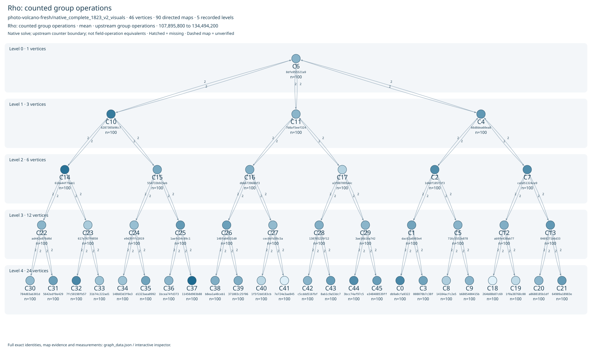
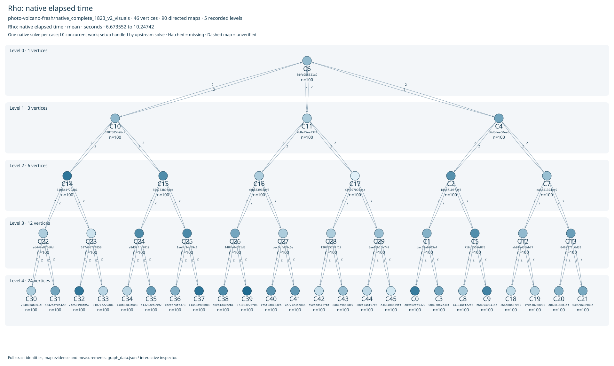
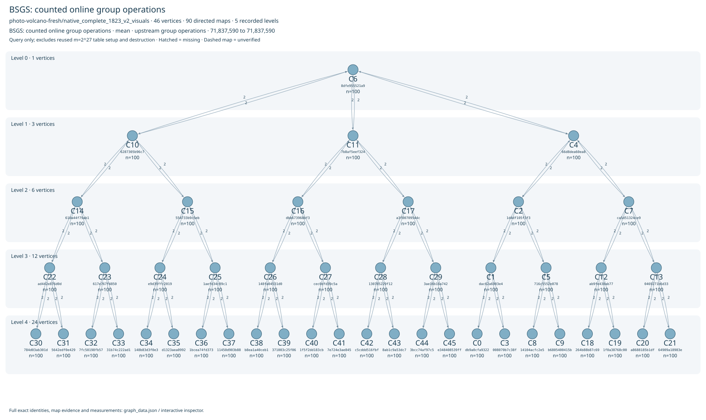
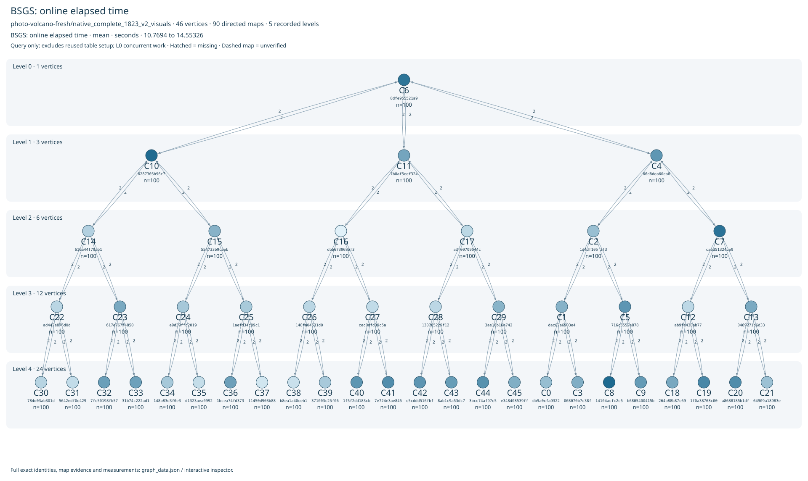
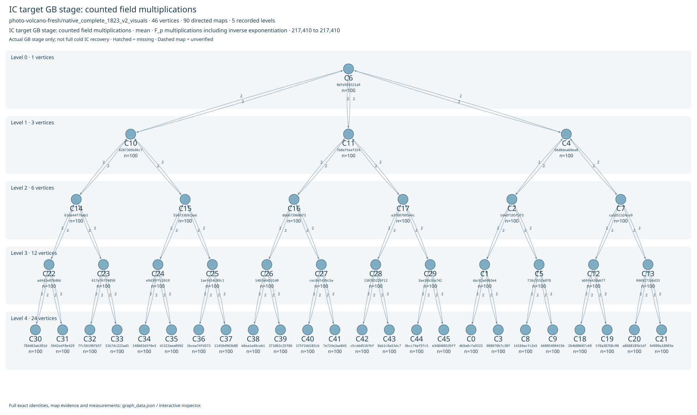
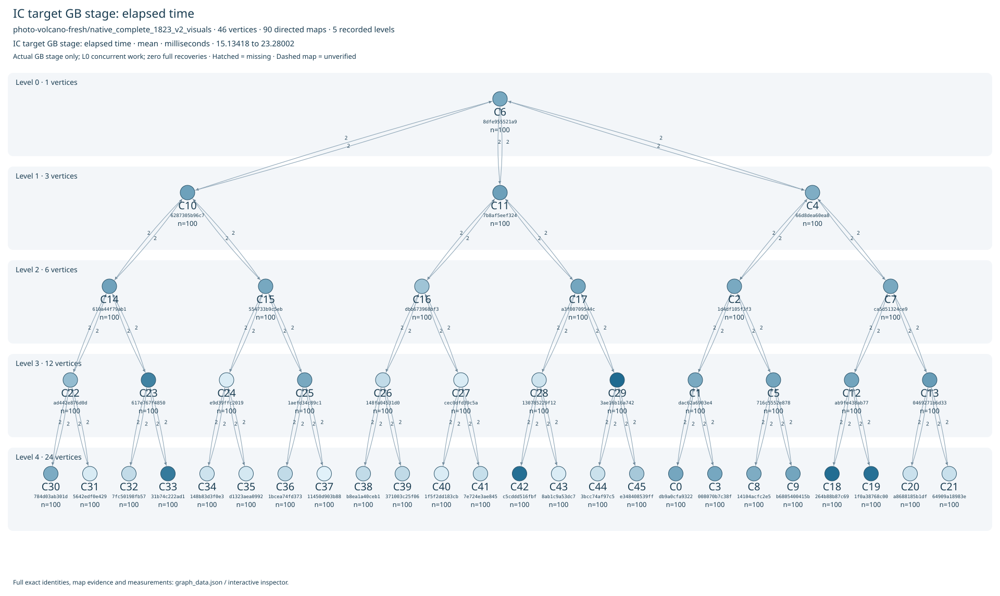
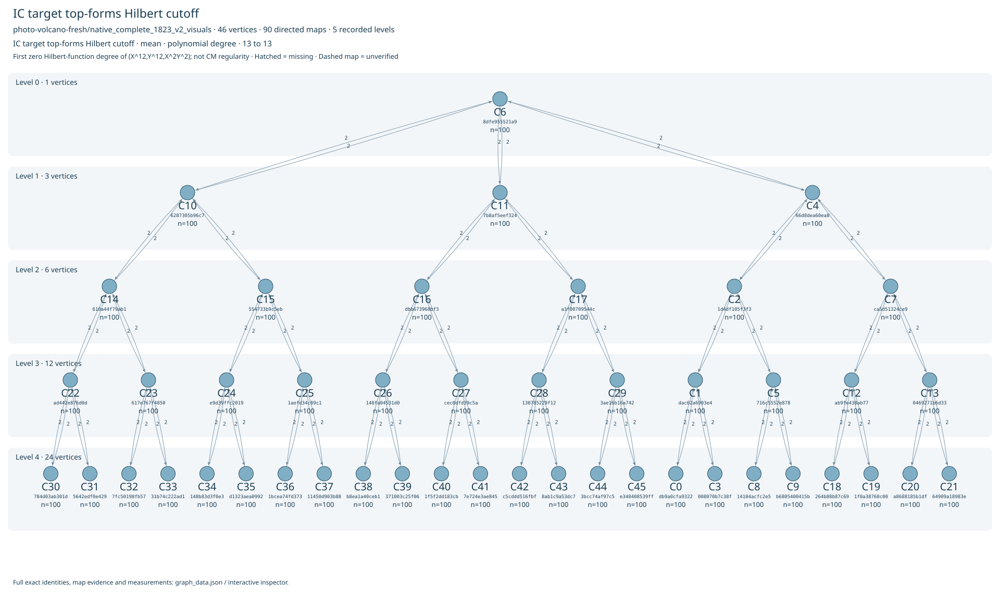

# Photographed-curve restart: measured snapshot

 Photographed-curve restart: measured snapshot  Fresh frozen inputs; no historical results pooled. Snapshot  2026-10-17T18:25:20.093Z . The full selected rational 2-component has 46 curves and 90 directed maps, across five levels (1/3/6/12/24).    Exact field and source model  p=72057980207847001; a=18456521102804593; b=19958176276690439    Curve order / point order  72057979853368804 / 18014494963342201, on every transported fixture    Workload and randomness  10 generators × 10 uniform paired nonzero k values; 100 problems/curve. Linux getrandom, unbiased rejection. Answers are excluded from solver input.    Verified native solves in this snapshot  Rho 4600/4600; BSGS 4600/4600. The complete original native corpus is verified.    IC diagnostics / complete recovery  14720 actual GB systems, including 9200 setup probes, 4600 targets and 920 planted controls; all replayed in Singular. Random setup yield 0/9200; target yield 0/4600; full recoveries 0.    What the measured spread means  All 4600 rho cases are verified. Across individual cases the collision counts vary widely, while the ratio of largest to smallest 100-case curve mean is 1.246519. This descriptive ratio is not a hardness or speedup claim.  All 4600 target GB probes used exactly  217410 counted field multiplications , while elapsed time ranged from 11.5197 to 266.014 ms. All 45000 instrumented map evaluations used 174 multiplications for each P/Q pair. Timing differences with identical arithmetic counts do not establish a hardness difference. This shared four-CPU host ran two rho and two 4-GiB BSGS workers concurrently; no isolation or fastest-reference claim is earned.  For every observed paired key, BSGS online operation counts agree across generators and curves:  verified . The search identity is floor(k/m) online giant steps, with m=2^27; table construction is separate. Rho's coordinate-based partition changes after transport and its collision time is random, so its operation spread does not by itself rank intrinsic group hardness. Every map has degree 2, coprime to the prime subgroup order; every nonzero transported P and Q retains that exact order.  Scope and remaining work  IC uses 12 unknown-log factor-base sign orbits per generator, actual Semaev f3 plus two degree-12 factor polynomials, and 20 random setup trials per generator/curve. Its target Hilbert cutoff is 13, temporary accumulator maximum 23, processed-pair sugar maximum 26; these definitions differ. The audited strict signed two-sum support has only 288 nonzero points per factor base. Transported probes preserve relations and are not independent yield samples. A bounded zero-yield run is not an impossibility proof. A planted full-rank GB-to-linear-algebra control passes separately and adds no random-corpus recoveries.  All original rho and BSGS cases are complete. A separately frozen native arithmetic replay is running; its counters and timings do not replace the original benchmark. Successful random-corpus IC recovery, full event streams, matched isolated repeated timing and an external fastest-tool comparison remain open. Setup/query/verification/destruction and resources are retained privately; these graphs are descriptive stage views, not cold-cost or speed ratios. No complete private archive export is claimed. 

[Run PDF](RUN_REPORT.pdf) · [Results PDF](RESULTS_REPORT.pdf)

Data: per_curve.csv; per_problem.json; ic_per_problem.csv; map_per_edge.json; evidence.json. See report.html for definitions, host and limits.
