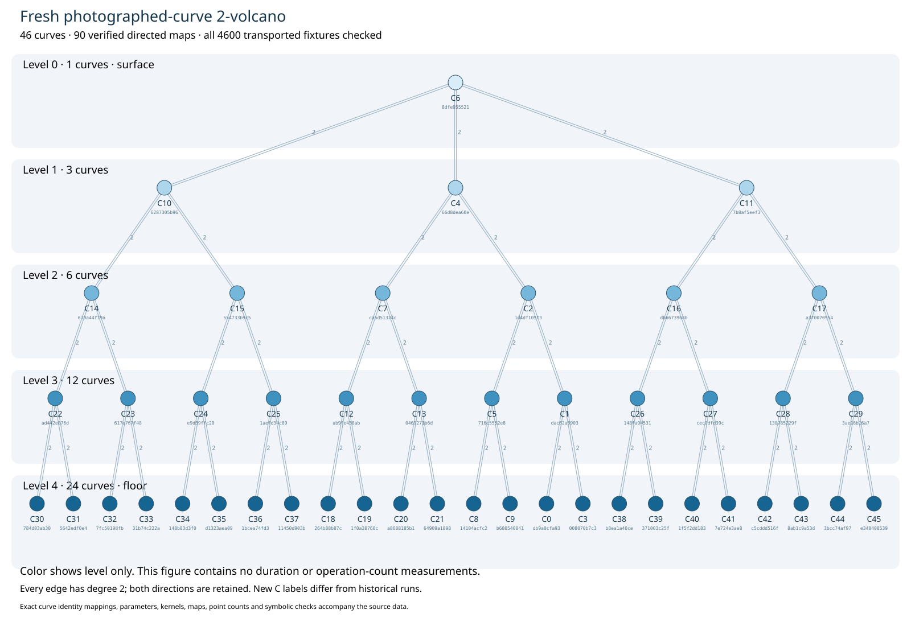

# Fresh photographed-curve restart

The historical artifacts are unavailable. This is a new authorized experiment
on the same photographed source, with freshly generated secure fixtures.
Historical measurements and new measurements are not pooled.

| Reconstruction check | Verified extent |
| --- | --- |
| Selected rational 2-component | 46 curves, 90 directed maps |
| Five level populations | 1 / 3 / 6 / 12 / 24 |
| Exact point counts and group invariants | all 46 curves, PARI/GP |
| Rational curve and dual identities | all 90 directed maps, exact PARI/GP |
| Transported scalar/order fixtures | 4600, native C++ |
| Directed-map fixture checks | 9000 |
| Homomorphism and dual controls | 900 |

The field is `72057980207847001`, source a/b are
`18456521102804593` / `19958176276690439`, and subgroup order is
`18014494963342201`. The source is the broad row of crypto PR #2056 at
commit `ef18058588077ef805c55c5dc25140b6bde2046b`.

Exact curve SHA-256 identities and all kernels/maps are in graph_data.json.
New C labels differ from historical labels. Colors show levels only; this
report contains no duration or operation-count measurements.

Generic evaluated identity certificate `IDC1hc2aee7cc7e845781` is over
`2^61-1` only, not a Lean proof and not a substitute for exact checks over the
actual curve field. Its native issuer/checker passes the repository's worked
example and evaluates 64 sealed plus 32 additional points.

The full rho/BSGS/IC workload remains open. Full IC recovery is separate from
relation and degree diagnostics. Public inputs exclude expected/recovered
scalars and raw randomness; the complete local archives await explicit
publication-destination approval. No complete archive upload is claimed.
