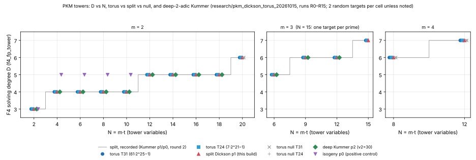
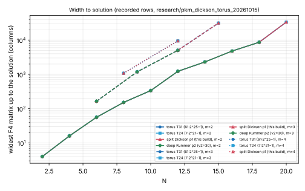

# The Dickson torus tower, and a deeper-2-adic Kummer control (2026-10-15)

This study covers leads 3 and 4 of
[`docs/ic/factor-base-encyclopedia/README.md`](../../docs/ic/factor-base-encyclopedia/README.md)
§8, and derives the cost of lead 1 without running it. Background is the PKM
note,
[`RESEARCH_PKM_TOWER_ORACLE.md`](../notes/index-calculus/RESEARCH_PKM_TOWER_ORACLE.md),
§2.1, §3.4 and §10–§16. Its round section is §17.

- **Protocol.** [`PROTOCOL.md`](PROTOCOL.md) was committed in `9776493c4`
  before any measured cell ran (sha256 `43e0071a…fb39fb`).
- **Runs.** [`run.sh`](run.sh) produced `runs/R*.jsonl` (rows) and
  `runs/R*.log` (stderr). [`progress.txt`](progress.txt) records the start
  and end of each run and its exit status.
- **Tables and graph.** [`tabulate.sh`](tabulate.sh) writes
  [`cells.tsv`](cells.tsv) and [`recorded_split.tsv`](recorded_split.tsv).
  [`plot.py`](plot.py) draws [`d_vs_n.svg`](d_vs_n.svg) and
  [`width_vs_n.svg`](width_vs_n.svg). PNG copies sit beside them.
- **Report.** [`report.typ`](report.typ) builds [`report.pdf`](report.pdf).

**What this is.** A stage diagnostic of the solver axis (`AGENTS.md` §2). It
measures the F4 solving degree `D` of PKM tower systems. It prices no
pipeline, reports no `S` and claims no speed. Wall-clock times are
practicality notes.

**Labels.** *measured* is a value in a committed row. *derived* is a
calculation or argument, and the calculation is shown. *recorded* is a value
from an earlier committed round.

## 0. Answers

| question | answer | status |
|:--|:--|:--|
| Q-A: does the torus Dickson tower give the split `D`? | **H_same.** The torus `D` equals the split `D` in every valued cell at both torus primes: `m = 2`, `N = 2…20`; `m = 3`, `N = 6, 9, 12, 15`; `m = 4`, `N = 8, 12`. Width and step count also equal the split Dickson's at `p₁`, so it is the same F4 computation on different numbers. | measured |
| Q-A∞: is the torus tower degenerate at infinity? | **Yes.** Its equations are the split Dickson polynomials with a different constant `c`, so the leading forms are the same `y_{i,j}²`. §3.4's argument gives a Bardet–Faugère–Salvy degree of regularity of `N + 1`. | derived |
| Q-B: does deeper 2-adicity change Kummer `D`? | **H2_same at `v₂ = 30`.** At `p₂ = 3·2^30 + 1`, `D` and width equal those recorded at `p₀` (`v₂ = 18`) and `p₁` (`v₂ = 27`) at every `(m, N)` measured, and so does the step count wherever the recorded targets were also random. **`v₂ ≥ 40` was not run.** Both F4 engines require `p < 2³²`, and no prime below `2³²` has `v₂(p − 1) > 30`. | measured (`v₂ = 30`); blocked (`v₂ ≥ 40`) |
| Q-C: what would `m = 3, N = 21` and `m = 4, N = 20` need? | About 130–150 GB and 2.5–7.4·10¹⁵ multiply-adds for `m = 3, N = 21`. About 240–380 GB and 0.85–2·10¹⁶ multiply-adds for `m = 4, N = 20`. Each needs a 256 GB or 512 GB host, or a disk-backed `B'`. §5 gives the derivation. | derived |

## 1. What ran

- **Host.** A shared 4-core, 15 GB container. Five lanes ran at once.
- **Run settings.** Each run used one thread (`RAYON_NUM_THREADS=1`) under
  `nice -n 10`, with a 2.5 GB address-space cap.
- **Binary.** Two builds were used; §1.1 covers both.
- **Engine.** `f4_fp_tower` with the reduced presentation, the full-rank exit
  on and degree bound `n + d + 6`. Two random targets per cell unless noted.
  Seed `0x504B4D54`.
- **Check.** `pkm_tower_check verify` recounted every finished tower row by
  exhaustive search over `V^m`, with the torus `V` rebuilt independently in
  `F_{p²}`. `verify.txt`: 127 finished tower rows checked, 127 agree (nulls are not summation systems and are skipped by design).
- **Failures.** No system timed out, ran out of memory or stopped for size.
  `run.sh` itself was stopped at 08:34Z by this session's 2-hour background-task limit during R14's only system, before any row was written. That is an infrastructure stop, not a measurement. R14 was restarted whole with the rebuilt binary (§1.1) at 08:41Z and finished at 09:06Z. R15a and R15b were not started because the protocol's 150-minute deadline (09:04Z) had passed. `progress.txt` records all of this.

| prime | value | `v₂(p − 1)` | `v₂(p + 1)` | arm |
|:--|--:|--:|--:|:--|
| `T24` | 14,680,063 = `7·2^21 − 1` | 1 | 21 | torus |
| `T31` | 2,046,820,351 = `61·2^25 − 1` | 1 | 25 | torus |
| `p₁` | 2,013,265,921 = `15·2^27 + 1` | 27 | 1 | split Dickson (this build); Kummer (recorded) |
| `p₂` | 3,221,225,473 = `3·2^30 + 1` | 30 | 1 | deep-2-adic Kummer |
| `p₀` | 786,433 = `3·2^18 + 1` | 18 | 1 | positive control (isogeny); recorded |

### 1.1 Build provenance and the cross-check

- **First build (A).** `pkm_tower_pilot` sha256 `ed2c6fad…b45293e`, built
  from this worktree in the five lanes' **shared** `CARGO_TARGET_DIR`
  (`/home/user/cargo-target`). The example sources are `9776493c4` before
  `rustfmt`, which changed only line breaks. Runs R0–R13 used build A.
- **The hazard.** Another lane found that, with a shared target directory,
  cargo can treat the release library as fresh from a different worktree's
  build, because its dep-info holds that tree's absolute paths. Build A could
  therefore have linked another lane's library code.
- **Second build (B).** `pkm_tower_pilot` sha256 `a889550a…2937753` and
  `pkm_tower_check` sha256 `7f12ebc7…dbfff35`, built from commit
  `9776493c4` in this lane's own target directory
  (`/home/user/cargo-target-dickson-torus`). R14 (restarted), the
  cross-check and `verify` used build B.
- **Cross-check ([`xcheck.sh`](xcheck.sh), [`xcheck/summary.txt`](xcheck/summary.txt), measured).**
  Build B re-measured one subset of every `(kind, m, control)` series with the
  same flags:
  - the positive control, `N ≤ 10`;
  - torus `T31` and `T24`, and split Dickson `p₁`, at `m = 2`, `N ≤ 18`
    and `N ≤ 16`;
  - the torus null at `m = 2`;
  - torus and split at `m = 3, 4`, `N ≤ 12`;
  - the torus chain null;
  - deep Kummer at `p₂`, `m = 2, 3`, and its null.

  `pkm_tower_check compare-rows` compared 144 rows with the recorded ones on
  every field except `ms` and `wall_s`, including `D`, width, steps and
  multiply-adds, and found **0 differences**. Build A's rows are therefore
  kept as measured. The N = 15 and `m = 2, N = 20` cells were not repeated,
  because their single-thread cost is 4–28 minutes each. They share the
  engine paths the cross-check exercised, and R14 (build B) reproduces the
  multiply-add count of R12 (build A) to the unit at a different prime.
- **Tests.** `cargo test --release --example pkm_tower_pilot --example
  pkm_tower_check` passes in build B's target directory: 5 new pilot tests
  and the checker's 6.

**Positive control (R0, measured): passed.** The isogeny tower at `p₀` gives
`D = 5` on both targets at `N = 4, 6, 8, 10`, where the split towers give 4.
It gives 3 at `N = 2`, matching the recorded values. The instrument separates
tower families whose `D` differ at the same `(m, N)`.

## 2. Task A: torus against split (measured)

`D / width / steps to solution`. Both targets gave identical values in every
cell listed, so each entry stands for two systems unless marked `(1)`.
Recorded entries come from older builds. `a/b` widths are Kummer / split
Dickson where both were recorded. The recorded `p₀` cells at `N ≤ 14` used
planted targets, whose step counts run one lower than random targets at
small `N`.

### `m = 2` (`full`)

| `N` | torus `T31` | torus `T24` | split Dickson `p₁` (this build) | split, recorded (Kummer `p₁`/`p₀`) | torus null `T31` | torus null `T24` |
|--:|:--|:--|:--|:--|:--|:--|
| 2 | 3 / 4 / 2 | 3 / 4 / 2 | 3 / 4 / 2 | 3 / 4 / 1 (round2/XV1) | 3 / 4 / 2 | 3 / 4 / 2 |
| 4 | 4 / 16 / 4 | 4 / 16 / 4 | 4 / 16 / 4 | 4 / 16 / 3 (round2/XV1) | 4 / 16 / 4 | 4 / 16 / 4 |
| 6 | 4 / 56 / 6 | 4 / 56 / 6 | 4 / 56 / 6 | 4 / 56 / 5 (round2/XV1) | 4 / 56 / 6 | 4 / 56 / 6 |
| 8 | 4 / 152 / 8 | 4 / 152 / 8 | 4 / 152 / 8 | 4 / 152 / 7 (round2/XV1) | 4 / 152 / 8 | 4 / 152 / 8 |
| 10 | 4 / 336 / 10 | 4 / 336 / 10 | 4 / 336 / 10 | 4 / 337/336 / 10 (round2/XV1) | 4 / 336 / 10 | 4 / 336 / 10 |
| 12 | 5 / 1223 / 13 | 5 / 1223 / 13 | 5 / 1223 / 13 | 5 / 1231/1223 / 13 (round2/XV1) | 5 / 1223 / 13 | 5 / 1223 / 13 |
| 14 | 5 / 2303 / 15 | 5 / 2303 / 15 | 5 / 2303 / 15 | 5 / 2304/2303 / 15 (round2/XV1) | 5 / 2303 / 15 | 5 / 2303 / 15 |
| 16 | 5 / 4786 / 17 | 5 / 4786 / 17 | 5 / 4786 / 17 | 5 / 4789/4786 / 17 (round2/XV1) | 5 / 4786 / 17 | 5 / 4786 / 17 |
| 18 | 5 / 8639 / 20 | 5 / 8639 / 20 | 5 / 8639 / 20 | 5 / 8644/8639 / 20 (round2/XV1) | 5 / 8639 / 20 | 5 / 8639 / 20 |
| 20 | 6 / 33426 / 24 | 6 / 33426 / 24 | 6 / 33426 / 24 | 6 / 33446 / 24 (round2/K0) | 6 / 33426 / 24 | 6 / 33426 / 24 |

### `m = 3` and `m = 4` (`chain`)

| `m` | `N` | torus `T31` | torus `T24` | split Dickson `p₁` | split, recorded (Kummer) | chain null `T31` | chain null `T24` |
|--:|--:|:--|:--|:--|:--|:--|:--|
| 3 | 6 | 5 / 164 / 10 | 5 / 164 / 10 | 5 / 164 / 10 | 5 / 164 / 10 (round2/XV2) | 5 / 164 / 10 | 5 / 164 / 10 |
| 3 | 9 | 6 / 1184 / 16 | 6 / 1184 / 16 | 6 / 1184 / 16 | 6 / 1186/1184 / 16 (round2/XV2) | 6 / 1184 / 16 | 6 / 1184 / 16 |
| 3 | 12 | 6 / 5018 / 18 | 6 / 5018 / 18 | 6 / 5018 / 18 | 6 / 5019/5018 / 18 (round2/XV2) | 6 / 5066 / 16 | 6 / 5066 / 16 |
| 3 | 15 | 7 / 31378 / 23 (1) | 7 / 31378 / 23 (1) | 7 / 31378 / 23 (1) | 7 / 31397 / 24 (round2/M3) | — | — |
| 4 | 8 | 6 / 1080 / 21 | 6 / 1080 / 21 | 6 / 1080 / 21 | 6 / 1049 / 21 (round2/XV3) | 6 / 952 / 20 | 6 / 952 / 20 |
| 4 | 12 | 7 / 9451 / 29 | 7 / 9451 / 29 | 7 / 9451 / 29 | 7 / 9452 / 29 (round2/XV3) | 7 / 8944 / 33 | 7 / 8944 / 33 |

**Reading under the protocol's rules (§6).**

- **Q-A: H_same.** At every one of the 16 `(m, N)` cells, both torus primes give the split `D`: 10 cells at `m = 2`, 4 at `m = 3` (one target per prime at `N = 15`) and 2 at `m = 4`. No cell is mixed. The split reference is this build's split Dickson at `p₁` in every cell, including `m = 3, N = 15` (R14, one target). It also matches the recorded Kummer `D`. The positive control passed and `verify` agrees on every row.
- **Same computation.** Where the torus and the split Dickson both ran at a
  31-bit prime, the width and step count agree to the column. The
  multiply-adds agree to within a few parts in 10⁹, and exactly on most
  systems. At `m = 2, N = 20`, for example, the count is 478,782,978,864 for
  the split Dickson at `p₁`, for `T31` target 1 and for the null. At the
  24-bit `T24` it differs by at most a few parts in 10⁸, from
  cancellations modulo a smaller prime, as at `p₀` in round 2. Kummer
  differs slightly from both Dickson cases in width at `N ≥ 10` (for example
  33,446 against 33,426 at `m = 2, N = 20`; 1,049 against 1,080 at
  `m = 4, N = 8`), and never in `D`.
- **A1 at `m = 3`.** `pkm_tower_check analyze` mechanically reads the torus
  `m = 3` line 5, 6, 6, 7 (`N = 6…15`) as H0 (`analyze.txt`), as it does the
  split Dickson line. The `N = 15` value rests on one target per prime, and
  the recorded Kummer line with `N = 18` (6, 6, 7, 7) reads inconclusive
  (§16.10). The torus line inherits whichever reading the split line gets.
- **A1 on the torus `m = 2` line.** The sequence is 3 4 4 4 4 5 5 5 5 6
  (`N = 2…20`), with final plateau `L = 0` after the rise at `N = 20`. That
  is inconclusive between H0 and H1a, as for Kummer (§11.8). H1a needs
  `L > 10`, which `N ≤ 20` cannot give, as the protocol said in advance.
- **Null (H1b, gates nothing).** The shape-matched null gives the torus `D`
  in every cell where both ran. At `m = 2` it also gives the same width and
  steps. At `m ≥ 3` the chain null differs in width and steps (for example
  8,944 against 9,451 columns at `m = 4, N = 12`) but not in `D`. As in
  §10.4, the low degree belongs to the tower algebra and the `S₃` support,
  not to the curve, and the torus case does not change that.

## 3. Q-A∞: degeneracy at infinity (derived)

The torus tower's equations are `y_{j+1} − y_j² + 2` and `y_{t−1}² − 2 − c`.
Its `V` and `c = u^{2^t} + u^{−2^t}` come from `F_{p²}`, but the equations
are over `F_p` and identical to the split case's except for the value of `c`.
Their top-degree parts are `−y_{i,j}²`, as for Kummer and split Dickson.
§3.4's argument therefore applies unchanged:

- the top form of `S_{m+1}` is `c(x_R)·∏ x_i^{2^{m−1}} ∈ (y_{i,0}²)` when
  `c(x_R) ≠ 0`;
- the top-part ideal is `(y_{i,j}²)`, with Hilbert series `(1 + t)^N`;
- the Bardet–Faugère–Salvy degree of regularity is `N + 1`, whatever `S`
  and `c` are.

The torus tower is degenerate at infinity, exactly as the split towers are.
The isogeny tower is still the only family that is not (§3.4). The
measurement agrees with this: the torus and split Dickson systems run the
same F4 steps.

## 4. Task B: Kummer at `v₂(p − 1) = 30` (measured)

| `m` | `N` | `p₂` (`v₂ = 30`), this build | `p₁` (`v₂ = 27`), recorded | `p₀` (`v₂ = 18`), recorded | `p₂` null |
|--:|--:|:--|:--|:--|:--|
| 2 | 2 | 3 / 4 / 2 |  | 3 / 4 / 1 (planted) | 3 / 4 / 2 |
| 2 | 4 | 4 / 16 / 4 |  | 4 / 16 / 3 (planted) | 4 / 16 / 4 |
| 2 | 6 | 4 / 56 / 6 |  | 4 / 56 / 5 (planted) | 4 / 56 / 6 |
| 2 | 8 | 4 / 152 / 8 |  | 4 / 152 / 7 (planted) | 4 / 152 / 8 |
| 2 | 10 | 4 / 337 / 10 |  | 4 / 337/336 / 10 (planted) | 4 / 337 / 10 |
| 2 | 12 | 5 / 1231 / 13 | 5 / 1231 / 13 (random) | 5 / 1231/1223 / 13 (planted) | 5 / 1231 / 13 |
| 2 | 14 | 5 / 2304 / 15 | 5 / 2304 / 15 (random) | 5 / 2304/2303 / 15 (planted) | 5 / 2304 / 15 |
| 2 | 16 | 5 / 4789 / 17 | 5 / 4789 / 17 (random) | 5 / 4789/4786 / 17 (random) | 5 / 4789 / 17 |
| 2 | 18 | 5 / 8644 / 20 | 5 / 8644 / 20 (random) | 5 / 8644/8639 / 20 (random) | 5 / 8644 / 20 |
| 3 | 6 | 5 / 164 / 10 |  | 5 / 164 / 10 (planted) | — |
| 3 | 9 | 6 / 1186 / 16 | 6 / 1186 / 16 (random) | 6 / 1186/1184 / 16 (planted) | — |
| 3 | 12 | 6 / 5019 / 18 | 6 / 5019 / 18 (random) | 6 / 5019/5018 / 18 (random) | — |

- **H2_same.** `D` at `p₂` equals the recorded `D` at `p₀` and `p₁` in every
  cell. So does the Kummer width, and so does the step count wherever the
  recorded targets were random too. Planted targets at `N ≤ 8` take one step
  fewer. The multiply-adds at `p₂` equal, to
  the unit, those of the same cells at `p₁` on this build: 45,950,147,498 at
  `m = 2, N = 18` and 10,595,732,141 at `m = 3, N = 12`. Those `p₁` values
  come from the calibration rows disclosed in PROTOCOL §5, which are scratch
  and not committed. Recorded multiply-adds from older builds are not
  compared, because the round-6 full-rank exit changes them. At
  `p₂` the 2-adicity beyond the tower is 21 to 29 levels (`t ≤ 9`), against 9
  to 17 at `p₀`.
- **Why it could not differ (derived).** The Kummer system's coefficients
  are `g`, the curve's `a` and `b`, `x_R`, and the tower constants `1` and
  `y_{t−1}² = 1`. `ζ` enters only through `V`, which the system never
  contains. Nothing in the equations depends on `v₂(p − 1)` beyond the
  condition `2^t | p − 1` that makes the tower split. Deeper 2-adicity can
  enter only through the prime's size, through cancellations modulo `p`.
  That effect was already seen to be absent between `p₀`, `p₁` and
  `3221225473` (§10.2, §11.7).
- **Scope.** This is `v₂ = 30`, not P-224's 96 or the ≥ 40 the lead asked
  for. Both engines store coefficients in 32-bit words and assert
  `p < 2³²` (`f4_fp_tower::Fp::new`, `f4_fp::Barrett::new`), and
  `3·2^30 + 1` is the prime below `2³²` with the largest `v₂(p − 1)`.
  Running at `v₂ ≥ 40` needs a 64-bit-coefficient engine (`u64` entries,
  `u128` products), which does not exist. The requirement stays open,
  blocked by the engine's width, not by mathematics.

## 5. Task C (lead 1): what `m = 3, N = 21` and `m = 4, N = 20` would need — derived, not run

Every number in this section is **derived**. No cell was run. The inputs are
the recorded Kummer rows at `p₁` (requirements README §3.2, lines 238–255;
PKM note §11.7, §12.7, §16.9). They come from the round-2/3/7 builds, before
the round-6 full-rank exit, on the shared 4-core container. Each projection
applies a growth ratio once more. It uses two ratios: the ratio of the last
recorded step, and the geometric mean per step over the whole recorded range.
Both assume `D` does not rise again. If `D` does rise (7 → 8), these
projections are too low.

**Recorded inputs**

| `m` | `N` | `D` | width | peak memory | multiply-adds | F4 time |
|--:|--:|--:|--:|--:|--:|--:|
| 3 | 9 | 6 | 1,186 | 11 MB | 1.59·10⁸ | 0.1 s |
| 3 | 12 | 6 | 5,019 | 64 MB | 1.06·10¹⁰ | 2.0 s |
| 3 | 15 | 7 | 31,397 | 1.1 GB | 3.19·10¹² | 6.0 min |
| 3 | 18 | 7 | 106,288 | 12.7 GB | 8.99·10¹³ | 176 min |
| 4 | 8 | 6 | 1,049 | 9 MB | 4.84·10⁷ | 0.1 s |
| 4 | 12 | 7 | 9,452 | 171 MB | 8.55·10¹⁰ | 9.4 s |
| 4 | 16 | 7 | 76,837 | 8.1 GB | 2.7·10¹³ | 55.5 min |

**Growth per step** (`m = 3`: +3 in `N`; `m = 4`: +4)

| quantity | `m = 3`, ratios 9→12→15→18 | geometric mean | `m = 4`, ratios 8→12→16 | geometric mean |
|:--|:--|--:|:--|--:|
| width | ×4.23, ×6.26, ×3.39 | ×4.47 | ×9.01, ×8.13 | ×8.56 |
| peak memory | ×5.8, ×17.2, ×11.5 | ×10.5 | ×19.0, ×47.4 | ×30.0 |
| multiply-adds | ×66.7, ×301, ×28.2 | ×82.7 | ×1,767, ×316 | ×747 |
| F4 time | ×20, ×180, ×29.3 | ×47.2 | ×94, ×354 | ×182 |

**Projected cell** (derived)

| cell | basis | width | peak memory | multiply-adds | F4 time at the recorded host's rate |
|:--|:--|--:|--:|--:|--:|
| `m = 3, N = 21` | last ratio | ≈ 360,000 | ≈ 146 GB | ≈ 2.5·10¹⁵ | ≈ 86 h |
| `m = 3, N = 21` | geometric mean | ≈ 475,000 | ≈ 133 GB | ≈ 7.4·10¹⁵ | ≈ 138 h |
| `m = 4, N = 20` | last ratio | ≈ 625,000 | ≈ 384 GB | ≈ 8.5·10¹⁵ | ≈ 327 h |
| `m = 4, N = 20` | geometric mean | ≈ 658,000 | ≈ 243 GB | ≈ 2.0·10¹⁶ | ≈ 168 h |

The time column scales the recorded F4 time by the time ratio. The
multiply-add column gives a cross-check. Round 7's `m = 3, N = 18` ran at
about `8.5·10⁹` multiply-adds per second (`8.99·10¹³` in 176 min). At that
rate the multiply-adds project to 82–243 h at `m = 3, N = 21`, and to
280–650 h at `m = 4, N = 20`. This lane measured `2.1–2.4·10⁹`
multiply-adds per second on one thread, about four times slower.

**What it would take** (derived)

- **Memory decides first.** Round 7 found that the dense reducer block `B'`
  holds about 93% of peak memory at `m = 3, N = 18`: 8.9 GB of `B'` entries
  out of a 9.6 GB peak, with a 1.6 GB live heap (PKM note §16.8). On the
  current engine, `m = 3, N = 21` needs a host with about 192–256 GB of RAM,
  and `m = 4, N = 20` needs one with about 512 GB. This container has
  about 14 GB.
- **The round-6 full-rank exit** cuts the multiply-adds by up to 39% (§15)
  and leaves memory unchanged. On its own it fits neither cell into this
  host. It brings the time ranges down to about 0.61× of the values above.
- **A disk-backed echelon.** If `B'` were streamed from NVMe instead of held
  in RAM, resident memory would fall to roughly the basis plus heap, a few
  GB to tens of GB. The disk would have to hold 130–380 GB of `B'`, and the
  run would pay one read of `B'` per pass of S-row reduction. This engine
  change is not built, and its I/O cost is not measured.
- **Time.** On one node at the round-7 rate, either cell takes days to
  weeks. The kernel is already parallel (rayon chunks), so a many-core
  large-memory node shortens it roughly by core count. A GPU or multi-node
  elimination is not available in this engine.
- **What a run would decide.** Under rule A1, `m = 3` has a plateau at `D = 7`
  from `N = 15`. A value at `N = 21` would extend it to `L = 6`, or show a
  rise. Neither gives H1a, which needs `L > 10`, so H1a would still need
  `N ≥ 27` at `m = 3`.

## 6. What this does not show

*Not copied to `benchmarks/`.* This study measures solving degrees. It
reports no speed, speedup or before/after timing comparison, and its wall
times are practicality notes. So the `benchmarks/` rule for performance
results does not apply.

- No statement about P-192, P-224 or P-256 themselves. Every prime here is
  below `2³²`, and `t ≤ 10`.
- "Torus `D` = split `D`" holds at `N ≤ 20` (`m = 2`), `N ≤ 15` (`m = 3`) and
  `N ≤ 12` (`m = 4`), on two random targets per cell (one at `m = 3, N = 15`
  where marked). It is not a theorem. The derivation in §3 explains it: the
  two systems differ only in their constants.
- Equal `D` means the torus tower inherits every open question of the split
  one (lead 1). It is not evidence that `D` is bounded. The `m = 2` line
  rises to 6 at `N = 20` exactly as Kummer's does.
- The `m = 3, N = 15` nulls were not run, by protocol. The second targets at `m = 3, N = 15` (R15a, R15b) were not run, because the protocol deadline had passed.

## 7. Graphs

*`D` against `N` for each arm, two random targets per cell. Points are offset
horizontally so that they do not overlap. The grey step line is the recorded
split value.*

