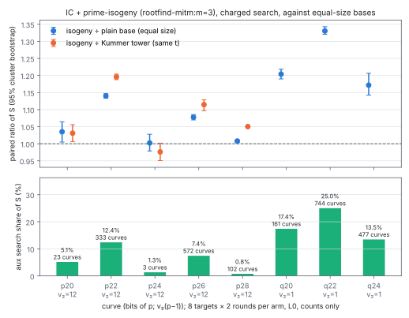
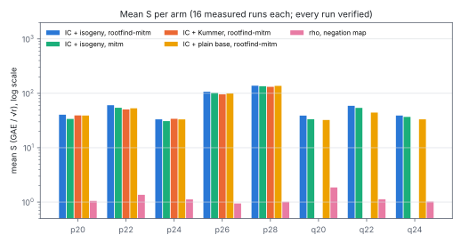
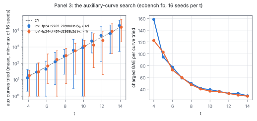

# PKM's isogeny-tower factor base in ecbench, with its auxiliary-curve search charged

2026-10-15.  Protocol: [`PROTOCOL.md`](PROTOCOL.md), committed in
`43986439e` before any measured run.  Factor base: `prime-isogeny:t=T[,seed=S]`
(`src/cryptanalysis/ic_framework/prime_tower.rs`), lead 2 of the factor-base
encyclopedia (`docs/ic/factor-base-encyclopedia/README.md` §8).  Companion
study it extends: [`../pkm_tower_ecbench_20261013/`](../pkm_tower_ecbench_20261013/README.md)
(the Kummer tower).  Report PDF: [`REPORT.pdf`](REPORT.pdf); run report:
[`reports/run-20261015T0758Z/report.pdf`](reports/run-20261015T0758Z/report.pdf).
**Class: accounting** (a cost the pilot left out is now inside `S`).

## Result

The isogeny tower base now exists as an `ic.pipeline` plug-in and an
`ecbench fb` family, with its auxiliary-curve search charged to the
factor-base phase in group-addition equivalents (GAE): a residue-class
baby-step giant-step filter on every curve tried, Mestre's baby-step
giant-step order on the survivors, then `Q`, `⟨Q⟩`, `R'`, `V` and the Vélu
chain.  Every one of the 1,080 runs (720 measured) verified and every replay
audit is `OK` (8 sessions, 720/720 replays identical).

*Measured.*  With the search charged, index calculus on the isogeny base
costs **1.00–1.33× the same index calculus on a plain base of equal size**
(paired `S` ratios, table below); the excess is the search's share of `S`,
0.8 % to 25 %.  The share is set by how many auxiliary curves the public
seed happened to try (3 to 744 at `t = 8…11`), not by the curve size.  On
the three curves with `v₂(p − 1) = 1` (the P-192 shape, no Kummer tower) it
is 13–25 %.  Every IC arm stays 18–136× above rho with the negation map, as
in the Kummer study.

*Measured (panel 3).*  The number of auxiliary curves tried is about `2^t`:
pooled `C = Σ tried / Σ 2^t = 1.05` over 224 builds (`t = 8…14`, 16 seeds, two
24-bit curves), with a spread of two to three orders of magnitude between
seeds at fixed `t`; no difference between `v₂(p − 1) = 12` and `= 1`.  The
charged cost per curve tried falls from 158 to 29 GAE as `t` grows from 4 to
14 at 24 bits (the filter's interval `4√p/2^t` shrinks).

*Derived, not measured.*  At P-192 size (`log₂ p = 192`, PKM's `t = 48` for
`m = 4`) this search would cost about `2^{74}` GAE (`2^{82}` at `t = 64`, `m =
3`), with a `2^{25}`-entry baby-step table, against rho's `√(πr/4) ≈ 2^{95.8}`
(working below).  The code cannot run it: it is `u64` (`p < 2^62`) and
`t ≤ 20`.

## Curves and bases

Panel 1: the five curves of the 2026-10-13 study, same `t`, same targets
(its `target_seed` and measurement `seed`).  Panel 2: `prime_tower_curves
--bits 20,22,24 --two-adicity 1 --seed 20261015 --max-cofactor 4`
(`curves-panel2.jsonl`), registered in `docs/curves/registry.json` in this
change.  Base facts from `sizing.txt` (read before the runs) and the
sealed records (the run's `fb_id` equals the `ecbench fb` dump's on every
curve):

| name | `icv1` slug | `p` | `v₂(p−1)` | `log₂ r` | `t` | isogeny base: abscissae | `fb_id` | aux curves tried | charged search + build, GAE |
|:--|:--|--:|--:|--:|--:|--:|:--|--:|--:|
| p20 | `icv1-fp20-tm728-d215a2a1` | 946,177 | 12 | 18.85 | 8 | 122 | `FB1h6fc61bfeb2a5` | 23 | 1,429 |
| p22 | `icv1-fp22-tm2947-e15fed69` | 2,387,969 | 12 | 21.19 | 9 | 258 | `FB1h319acee697a2` | 333 | 11,594 |
| p24 | `icv1-fp24-t2705-27cbb01b` | 10,940,417 | 12 | 23.38 | 9 | 241 | `FB1h63160e7d2f87` | 3 | 1,468 |
| p26 | `icv1-fp26-t2838-8e779ca8` | 40,857,601 | 12 | 23.28 | 10 | 506 | `FB1he0e38863269a` | 572 | 25,462 |
| p28 | `icv1-fp28-t4155-50f492b1` | 231,657,473 | 12 | 26.20 | 11 | 1,032 | `FB1h1b92e1d1bc87` | 102 | 9,309 |
| q20 | `icv1-fp20-t199-d1684bf5` | 970,267 | 1 | 19.89 | 8 | 145 | `FB1h81dfc9ab0c7f` | 161 | 6,685 |
| q22 | `icv1-fp22-t285-9fc7e3e5` | 3,594,223 | 1 | 21.78 | 9 | 257 | `FB1h5a7ac58298f0` | 744 | 27,950 |
| q24 | `icv1-fp24-t4451-d5368b2d` | 13,136,531 | 1 | 23.65 | 9 | 254 | `FB1h18a55c2597e2` | 477 | 19,005 |

The plain-base control is `prime-abscissa:size=` the isogeny base's abscissa
count.  The Kummer bases (panel 1) have 123, 251, 245, 490 and 1,006
abscissae.

## Tables

Mean `S` per arm (`ecbench table`, `tables/*.table.md`; eight one-target
workloads × two measured rounds = 16 runs an arm; all verified):

| name | rho (negation) | IC + isogeny, `rootfind-mitm` | IC + isogeny, `mitm` | IC + Kummer, `rootfind-mitm` | IC + plain, `rootfind-mitm` |
|:--|--:|--:|--:|--:|--:|
| p20 | 1.051 | 40.45 | 33.82 | 39.23 | 39.08 |
| p22 | 1.362 | 60.50 | 54.27 | 50.59 | 53.07 |
| p24 | 1.121 | 33.22 | 30.82 | 34.03 | 33.14 |
| p26 | 0.944 | 107.12 | 102.59 | 96.09 | 99.39 |
| p28 | 1.013 | 138.24 | 134.93 | 131.61 | 137.15 |
| q20 | 1.860 | 38.99 | 33.39 | — | 32.39 |
| q22 | 1.129 | 58.95 | 54.06 | — | 44.30 |
| q24 | 1.020 | 39.00 | 36.88 | — | 33.29 |

Paired ratios (`ecbench compare`, `Σ S_B / Σ S_A` over 16 pairs, 95 %
cluster-bootstrap interval over the 8 workloads; `tables/summary-ratios.tsv`)
and the search's share of the isogeny arm's `S` (mean over its runs of
factor-base GAE ÷ total GAE, `tables/summary-arms.tsv`):

| name | **isogeny ÷ plain** | **isogeny ÷ Kummer** | aux share of `S` | isogeny ÷ rho | `rootfind` ÷ `mitm` (positive control) | A/A rho |
|:--|--:|--:|--:|--:|--:|--:|
| p20 | 1.035 [1.005, 1.064] | 1.031 [1.006, 1.056] | 5.1 % | 38.5 [31.4, 50.9] | 1.196 [1.184, 1.205] | 1.000 |
| p22 | 1.140 [1.134, 1.147] | 1.196 [1.188, 1.204] | 12.4 % | 44.4 [35.7, 59.0] | 1.115 [1.111, 1.119] | 1.000 |
| p24 | 1.002 [0.979, 1.028] | 0.976 [0.951, 1.002] | 1.3 % | 29.6 [22.5, 41.1] | 1.078 [1.074, 1.082] | 1.000 |
| p26 | 1.078 [1.070, 1.085] | 1.115 [1.097, 1.129] | 7.4 % | 113.5 [88.1, 154.5] | 1.044 [1.040, 1.047] | 1.000 |
| p28 | 1.008 [1.004, 1.011] | 1.050 [1.047, 1.054] | 0.8 % | 136.5 [108.9, 181.2] | 1.025 [1.024, 1.025] | 1.000 |
| q20 | 1.204 [1.190, 1.218] | — | 17.4 % | 21.0 [17.3, 26.3] | 1.168 [1.163, 1.173] | 1.000 |
| q22 | 1.331 [1.321, 1.343] | — | 25.0 % | 52.2 [43.9, 62.8] | 1.090 [1.086, 1.095] | 1.000 |
| q24 | 1.172 [1.142, 1.206] | — | 13.5 % | 38.3 [27.1, 58.3] | 1.058 [1.049, 1.063] | 1.000 |

Every ratio is `bounded` in ecbench's words: the Legendre symbols, square
roots, table lookups and row operations of every prime-curve IC arm are
counted but unpriced (no pinned ratio on these curves), so each `S` is a
lower bound, for the isogeny and the plain arms alike.  The isogeny search
adds Legendre symbols and square roots of its own (point sampling on `E'`),
also unpriced.  No wall-clock figure is reported: the sessions ran at L0
(`--cpus none --allow-busy`, a host shared with four other jobs).







## Panel 3: the search's cost against `t`

`ecbench fb --factor-base prime-isogeny:t=T,seed=S`, 16 seeds per `t`, on
`icv1-fp24-t2705-27cbb01b` and `icv1-fp24-t4451-d5368b2d`
(`tables/panel3.tsv`, `tables/panel3-summary.tsv`):

| `t` | p24: mean tried ÷ `2^t` (min–max tried) | q24: mean tried ÷ `2^t` (min–max) | GAE per curve tried (p24 / q24) |
|--:|:--|:--|:--|
| 4 | 0.84 (2–42) | 1.14 (1–38) | 158 / 122 |
| 6 | 0.70 (1–138) | 1.09 (6–379) | 77 / 72 |
| 8 | 1.11 (22–736) | 1.18 (6–815) | 50 / 47 |
| 9 | 1.23 (3–2,978) | 1.15 (22–1,713) | 41 / 40 |
| 10 | 0.90 (1–3,116) | 1.13 (1–2,513) | 39 / 37 |
| 11 | 1.15 (435–8,220) | 0.64 (55–6,546) | 36 / 36 |
| 12 | 1.25 (133–18,706) | 0.61 (21–9,445) | 33 / 33 |
| 13 | 0.81 (390–22,306) | 1.12 (406–28,896) | 33 / 30 |
| 14 | 1.27 (545–43,881) | 0.99 (2,064–48,959) | 29 / 28 |

Pooled over `t = 8…14` and both curves: `C = 1.05` (`tables/panel3-pooled.txt`).

## Projection to P-192 size (derived; nothing here ran at that size)

Per curve tried, the charged work is the point draw, `[2^t]P` (`t`
doublings), `[i₀]P_m` (about `1.5·(b − t)` operations for `b = log₂ p`), and the
baby-step giant-step over `L = 4√p/2^t` indices (about `2√L`):

```
GAE per curve ≈ 1.5(b − t) + t + 2·2^{(b/2 + 2 − t)/2}
```

This reproduces panel 3 (at `b = 23.4`: 46 predicted against 50 measured at
`t = 8`, 30 against 29 at `t = 14`).  With `C·2^t` curves (`C = 1.05`) and the
survivors' full Mestre counts (`≈ 2·2^{(b/2+2)/2}` each, a handful of them):

| shape | `b` | `t` | curves | GAE per curve | search total | baby table | rho `√(πr/4)` |
|:--|--:|--:|--:|--:|--:|--:|--:|
| P-192, `m = 4` | 192 | 48 | `2^{48.1}` | `2^{26.0}` | **`≈ 2^{74}`** | `2^{25}` entries | `2^{95.8}` |
| P-192, `m = 3` | 192 | 64 | `2^{64.1}` | `2^{18.0}` | `≈ 2^{82}` | `2^{17}` entries | `2^{95.8}` |

So with this algorithm the search would not dominate a P-192 attack; it
would be ``2^{-22}`` of rho at `t = 48`.  That says nothing about the index
calculus it serves, whose relation and linear-algebra phases are what the
PKM solving-degree question (encyclopedia §8 item 1) decides.

## Decision (against PROTOCOL.md)

- **P1** (every run verified, every replay identical): **held**: 1,080/1,080
  verified, 720/720 replays reproduced, 8 audits `OK`.
- **P2** (`V` is the tower's root set, `fb_id` stable): **held**: unit tests
  (`|V| = 2^t`, every element a root of the composed Vélu x-map, exhaustively
  no other root on three small primes, Mestre orders equal to point counts);
  run `fb_id` = dump `fb_id` on all 8 curves.
- **P3** (`tried/2^t` between 0.25 and 8 at every `t`): **failed on single
  draws** (p20 0.09, p24 0.006, p28 0.05), **held for the mean** over 16
  seeds at every `t` (0.61–1.27, panel 3).  One seed is one draw from a
  distribution spanning two to three orders of magnitude.
- **P4** (isogeny ÷ plain above 1, interval excluding 1, on every curve):
  **held on 7 of 8**; p24 not resolved (1.002 [0.979, 1.028]; 3 curves tried,
  1.3 % of `S`).  The ratio matches `1/(1 − share)` within its interval on
  every curve but q24 (1.172 against 1.156).
- **P5** (share falls with `p`): **held by the letter** (5.1 % at p20 to
  0.8 % at p28), **not as a trend**: 5.1, 12.4, 1.3, 7.4, 0.8 % follow the
  seed's draw, not the size.  At fixed `C` the expected share does fall
  (search `≈ C·2^t·(GAE per curve)` against a pair table of `≈ 2^{2t}`).
- **P6** (isogeny ÷ Kummer above 1 by about the share): **held on 4 of 5**;
  on p24 0.976 [0.951, 1.002], because the Kummer base there has 4 more
  abscissae and the share is 1.3 %.  Base size moves `S` by a few per cent in
  either direction (p22: Kummer 251 against isogeny 258 abscissae).
- **P7** (every IC arm above rho): **held**, 17.4–136.5×.
- **Controls**: A/A rho 1.000 on every curve (negative); `rootfind ÷ mitm`
  1.196, 1.115, 1.078, 1.044, 1.025 on panel 1 against 1.212, 1.138, 1.081,
  1.055, 1.026 in the 2026-10-13 study (positive: the instrument resolves a
  2.5 % difference).
- **Class: accounting.**  The isogeny tower buys a table oracle nothing over
  a plain base of the same size, as the Kummer tower did not; what this round
  adds is the price of the construction itself, now inside `S` and recorded
  apart (`aux_curves_tried`, `aux_search_gae`, `aux_count_gae`,
  `aux_tower_build_gae` in the factor-base phase).  No exponent claim (20–28
  bits).

## What is not done

- **Wide integers.** `prime-isogeny` is `u64` like `prime-kummer` (`p < 2^62`)
  and refuses `t > 20`; no NIST prime can be run.
- **SEA, CM construction, 2-Sylow halving.**  Point counting is the
  repository's baby-step giant-step at toy sizes, as the PKM note §2.1
  prescribes; SEA (polynomial per count), a CM construction of `E'` with a
  prescribed 2-power torsion, or computing the 2-Sylow subgroup by
  successive halvings (field operations only) are not implemented, and the
  `2^{74}` above is for the algorithm that is.  Families with rational
  `2^k`-torsion built in (`X_1(8)` is genus 0) would cut the curve count by a
  constant; not tried.
- **Vélu evaluations** (`2t` inversions) are counted as
  `velu_evaluations_uncharged`; point-sampling Legendre symbols and square
  roots are counted with the base's own and unpriced, as for every prime base.
- **Seed variance in the headline.**  Each curve's search is one seeded
  draw; the per-curve intervals resample targets, not seeds.  Panel 3 is
  the seed distribution.
- **Scale-down.** Two measured rounds instead of the earlier study's three
  (to keep each `records.jsonl` under 1 MB); L0 instead of L2.
- **Independent code review (read-only, after the runs).** No high- or
  medium-severity defect was found in the `prime-isogeny` builder or its
  charging. Three low-severity notes stand. Nothing here was changed after
  the measured runs, so the sealed sessions replay as recorded.
  1. **Curves wrongly rejected at the `Q` step.** When `v₂(#E') > t` and
     the 2-Sylow subgroup is not cyclic (e.g. `Z/2 × Z/2^t`), the cofactor
     `[#E'/2^t]P'` never has order `2^t`. Such curves are rejected as
     `two_sylow_rejected` even though they hold a point of order `2^t`.
     With Mestre's lack of a twist step, this inflates `aux_curves_tried`
     and the charged search cost. The bias is against the isogeny base: the
     search shares and isogeny ÷ plain ratios above are upper bounds for a
     builder that accepted those curves. Panel 3's `C ≈ 1.05` carries the
     same bias.
  2. **`t` truncates silently.** `t` is read as `u64` and cast to `u32`, so
     `t = 2^32 + 5` runs as `t = 5`. The same parse in `prime-kummer`
     predates this branch.
  3. **The aux point-sampling Legendre symbols and square roots are
     reported twice**, once in the phase's `legendre_symbols`/`sqrt_solves`
     and once as `aux_legendre_symbols`/`aux_sqrt_solves`. A consumer that
     sums every native counter double-counts them. Both are unpriced, so
     `S` is unaffected.
- **Not updated:** `docs/index-calculus-scoreboard.html` (the 2026-10-13
  tower study added no row either; prime-curve tower IC has no scoreboard
  row) and the encyclopedia's §0.2/§8 entries, left for the coordinating
  change that merges the five lanes.

## Environment

Claude Code cloud container: Intel Xeon @ 2.10 GHz, 4 vCPU, 15 GiB RAM,
virtual; host shared with four other lanes.  `ecbench` built from
`43986439e` (binary SHA-256 `074288d4…13d3`), one thread, `nice -n 10`,
2.5 GB address-space cap.  Conductor's control plane was unreachable
(connection refused): no task card.

Audit receipts (`ecbench verify --replay-all`, SHA-256): p20 `a4f34d14…9d45`,
p22 `827897c3…256b`, p24 `afc37c4e…f6df`, p26 `c44a6d99…66a5`, p28
`7820cd0a…3628`, q20 `71cd7c03…723e`, q22 `591e5a99…4e9b`, q24 `1966ffc7…3c21`
(full values in `audits/*.verify.log`).  The 2026-10-13 Kummer sessions p20
and p28 replay identically (192 + 160 records, 264 replays) under this
binary: sharing the lifting code with `prime-kummer` changed no count.

## Files

`PROTOCOL.md`; `curves-panel1.jsonl`, `curves-panel2.jsonl`,
`curves-panel2.log`; `sizing.txt`; `specs/SPEC-{p20…p28,q20…q24}.json`;
`run_sessions.sh`, `run_panel3.sh`, `summarise.sh` (jq layout of recorded
values); `sessions/*/` (sealed; each `records.jsonl` ≤ 0.87 MB) and
`sessions/*.run.log`; `audits/`; `tables/` (`ecbench table`/`compare`
outputs, resources, `summary-*.tsv`, `panel3*.tsv`); `figures/`
(`plot.py`, `ratios`, `s_by_arm`, `panel3` as SVG and PNG); `REPORT.typ`,
`REPORT.pdf`; `reports/run-20261015T0758Z/`.
