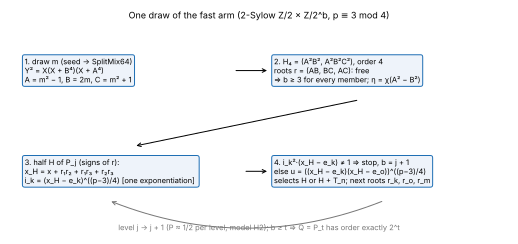
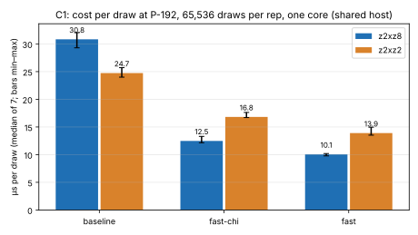
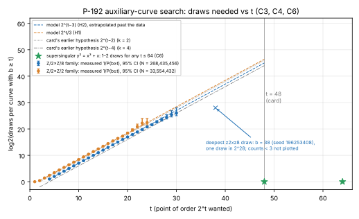
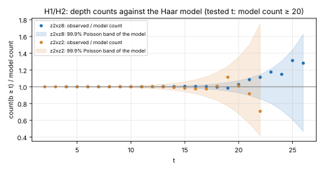

# The PKM isogeny-tower auxiliary curve at the NIST P-192 prime: 2-Sylow halving search

**Date:** 2026-10-15. **Branch:** `claude/isogeny-tower-p192`. **Protocol:**
[`PROTOCOL.md`](PROTOCOL.md), committed (`fc6317e51`) before any measured cell.
**Run id:** `20261015T2010Z` (C1 start, UTC). **Report PDF:**
[`report.pdf`](report.pdf) (source [`report.typ`](report.typ)). **Card:**
[`backlog/XP-20261015-p192-isogeny-aux-search-t48`](../../backlog/XP-20261015-p192-isogeny-aux-search-t48/README.md).

## Summary

- **Built.** `src/cryptanalysis/two_sylow_search.rs` searches for an auxiliary
  curve `E'/F_p` at the P-192 prime that has a rational point of order `2^t`.
  It does not count points. Each draw is a curve with full rational
  2-torsion. Its 2-Sylow subgroup is `Z/2 × Z/2^b`, and x-only point halving
  computes `b`. The binary is `pkm-aux-search` (`src/bin/pkm_aux_search.rs`),
  with the card's flags, checkpoint/resume and BigUint certification. The
  Vélu tower `V = x(R' + ⟨Q⟩)` is built at P-192 on the found curve
  (`build_tower`, `examples/p192_isogeny_tower.rs`).
- **Cost per draw (measured, C1).** On the `X₁(2, 8)` family (`z2xz8`,
  `b ≥ 3` forced), the median is 30.83 µs for the baseline, 12.48 µs for
  `fast-chi` and **10.06 µs** for `fast`. That makes `fast` 0.326× the
  baseline. On `z2xz2` the medians are 24.74, 16.81 and 13.89 µs. All four
  pre-registered speed claims pass (S1–S4, table below).
- **How often a draw succeeds (measured, C3 and C4).** `2^28` `z2xz8` draws ran
  in 45.6 minutes on one core, and `2^25` `z2xz2` draws in 7.9 minutes. Both
  match the pre-registered Haar-model predictions at every tested `t`:
  `P(b ≥ t) = 2^(3−t)` for `z2xz8` (H2) and `3·2^(−t)` for `z2xz2` (H1),
  with `P(b = 1) = 1/4` (8,387,239 observed against 8,388,608 predicted).
  Draws to success are 8,161 ± 45 at `t = 16` (model 8,192) and
  1.82·10⁶ ± 0.16·10⁶ at `t = 24` (model 2.10·10⁶).
- **Curves found and checked.** Ordinary curves with points of order `2^16`,
  `2^24`, `2^28` and `2^38` were found. The `2^38` curve is the deepest of the
  `2^28` draws: seed 196253408, a 1-in-128 upper-tail event under H2.
  `backlog_check_aux2t --expect-t t` accepts each one and rejects `t + 1` (C5).
  On that curve the tower has `|V| = 2^T` distinct abscissae for
  `T = 8, 12, 16`, and `L(x) = c` holds on all of `V`, both in the field
  backend and over `BigUint`. None of 4096 random abscissae outside `V` maps
  to `c` (C7).
- **`t = 48` (derived).** The card needs about `2^45` `z2xz8` draws × 10.06 µs,
  which is **98,352 core-hours ≈ 11.2 core-years** (range 95,617–99,624).
  On `z2xz2` it would be 362,005 core-hours. The card's earlier estimate
  (39,094 core-hours) assumed `2^46` draws at 2 µs. The measured draw cost is
  5× that, and the draw count is 2× lower than the card's `k = 2` row.
  `Z/2 × Z/8` buys 3 bits, not the card's 4, because `v₂(p − 1) = 1` limits
  the non-cyclic part to `Z/2`.
- **The shortcut (measured, C6).** Over this prime, `y² = x³ + x` is
  supersingular. Its group is cyclic of order `p + 1`, and
  `v₂(p + 1) = 64`. `pkm-aux-search --family supersingular-j1728 --t 48`
  returns a point of order exactly `2^48` from the first draw in 7 ms, and
  likewise for `t = 64`. The checker accepts both, and the tower builds on
  that curve (`T = 8, 16`, C7). For P-192 this makes the card's 11-core-year
  search unnecessary *if* a supersingular `E'` is acceptable to PKM's relation
  phase. That is not tested here and is the open question this hands over.
  The same holds for any prime with large `v₂(p + 1)` (P-256: 96; P-521: 521).

## Method

The base prime is `p = 2^192 − 2^64 − 1`, and `p ≡ 3 (mod 4)`. A curve
`y² = (x − e₁)(x − e₂)(x − e₃)` has 2-Sylow `Z/2 × Z/2^b`; `Z/4 × Z/4` is
impossible because `μ₄ ⊄ F_p`. A point `P` lies in `2E` exactly when every
`x − eᵢ` is a square. The four halves have
`x_H = x + r₁r₂ + r₁r₃ + r₂r₃`, with `rᵢ = ±√(x − eᵢ)`, and
`x_H − eᵢ = (rᵢ + rⱼ)(rᵢ + r_k)`. Negating `r_n` gives `H + T_n`.
The 2-descent map `δ: E/2E → {±1}²` decides with one symbol `χ(x_H − e_k)`
whether some half can be halved again. It is fixed per curve by the
2-torsion point outside `2E` (see the module documentation).
The `fast` arm takes that symbol from the exponentiation the next level needs
anyway, `i_k = (x_H − e_k)^((p−3)/4)`, through a 189-squaring addition chain.
A second exponentiation `u` picks `H` or `H + T_n` and gives the next roots
without inversions (`r_o = h_o·u·r_k`, `r_m = y_H·u`). Measured per `z2xz8`
draw: 4.0 exponentiations, 1.0 Legendre symbol and 1.0 halving (C4 counters).



## Results

### C1: cost per draw (µs, P-192, 65,536 draws × 7 interleaved repetitions, `taskset -c 2`)

| family | arm | median | min | max | Legendre/draw | exps/draw |
|:--|:--|--:|--:|--:|--:|--:|
| z2xz8 | baseline | 30.83 | 29.30 | 32.05 | 8.49 | 6.00 (sqrt) |
| z2xz8 | fast-chi | 12.48 | 12.15 | 13.30 | 4.00 | 2.00 |
| z2xz8 | **fast** | **10.06** | 9.78 | 10.19 | 1.00 | 4.00 |
| z2xz2 | baseline | 24.74 | 24.00 | 25.72 | 9.15 | 4.49 (sqrt) |
| z2xz2 | fast-chi | 16.81 | 16.70 | 17.63 | 5.24 | 2.99 |
| z2xz2 | fast | 13.89 | 13.52 | 14.96 | 3.00 | 3.93 |

Pre-registered claims ([`derived.json`](derived.json) `claims`): **S1**
`z2xz8` fast/baseline = 0.326 ≤ 0.40, pass. **S2** fast/fast-chi = 0.806 ≤
0.85, pass. **S3** 10.06 ≤ 12 µs, pass. **S4** `z2xz2` fast/baseline =
0.561 ≤ 0.65, pass. In no comparison do the min–max spreads overlap. The
host is shared with another lane (load average 2.3–3.5 during C1), so the
timings are noisy.



### C2: primitives (ns per call, median of 11 over 4096 inputs; [`data/c2/components.txt`](data/c2/components.txt))

| op | median ns |
|:--|--:|
| mul (FpP192, Solinas) | 10.6 |
| sqr (new dedicated squaring) | 5.1 (throughput) |
| `(p−3)/4` addition chain | 1,808 |
| `PrimeField::sqrt` (window) | 2,185 |
| Legendre, binary Jacobi (`jacobi_limbs`) | 1,793 |
| Legendre, posdivsteps Jacobi (this branch) | 1,952 |
| inversion (bingcd) | 2,153 |
| draw (`m` from seed) | 146 |

**A negative result.** The posdivsteps Jacobi (libsecp256k1-style, exact,
tested against Euler's criterion on 20,000 values) is *not* faster than the
existing binary one at 192 bits: about 180 inner iterations of about 30
cycles each. A branch-free swap and a table-driven inverse did not help. The
frozen `fast` arm uses it once per draw. Switching to `jacobi_limbs` would
save about 0.16 µs per draw. That change is not made here, because the
instrument was frozen.

The exponentiation chain is latency-bound: about 9.5 ns per dependent
squaring against 5.1 ns of throughput. Interleaving two chains was tried
before the protocol and was slower (register pressure), so it was dropped.

### C3, C4: depth distribution against the Haar model

| | draws | elapsed | max `b` | model consistent (99.9 % Poisson, every `t` with model count ≥ 20) |
|:--|--:|--:|--:|:--|
| C3 `z2xz2` | 33,554,432 | 476.6 s | 25 | **H1 yes** (t = 2…22) |
| C4 `z2xz8` | 268,435,456 | 2,738.6 s | 38 | **H2 yes** (t = 4…26) |

| `t` | `z2xz8` count `b ≥ t` | model | ratio | mean draws to success (± s.e.) | model |
|--:|--:|--:|--:|--:|--:|
| 16 | 32,894 | 32,768 | 1.004 | 8,161 ± 45 | 8,192 |
| 20 | 2,103 | 2,048 | 1.027 | 127,621 ± 2,772 | 131,072 |
| 24 | 147 | 128 | 1.148 | 1,822,411 ± 157,208 | 2,097,152 |
| 26 | 41 | 32 | 1.281 | | |
| 28 | 12 | 8 | 1.5 (not tested, model count < 20) | 22.6·10⁶ ± 5.2·10⁶ | 33.6·10⁶ |

The ratio drifts upward for `t ≥ 21`: 1.09, 1.11, 1.18, 1.15, 1.31, 1.28.
Every tested `t` stays inside its band. The counts `b ≥ t` are cumulative,
so neighbouring ratios are not independent. This is recorded as an
observation, not a finding. A run 4–16× longer would test whether the deep
tail is heavier than `2^(3−t)`.




### C5, C6: artifacts and the checker (`backlog_check_aux2t`, unmodified from `main`)

| artifact | family | seed | `--expect-t t` | `--expect-t t+1` |
|:--|:--|--:|:--|:--|
| [`data/c5/artifact-t16.json`](data/c5/artifact-t16.json) | z2xz8 | 999 | accept | reject |
| [`data/c5/artifact-t24.json`](data/c5/artifact-t24.json) | z2xz8 | 634230 | accept | reject |
| [`data/c5/artifact-t28.json`](data/c5/artifact-t28.json) | z2xz8 | 14661491 | accept | reject |
| [`data/c5/artifact-t38.json`](data/c5/artifact-t38.json) | z2xz8 | 196253408 | accept | reject |
| [`data/c6/artifact-t48.json`](data/c6/artifact-t48.json) | supersingular `y² = x³ + x` | 0 | accept | — |
| [`data/c6/artifact-t64.json`](data/c6/artifact-t64.json) | supersingular `y² = x³ + x` | 0 | accept | — |

### C7: the tower `V = x(R' + ⟨Q⟩)` at P-192 ([`data/c7/`](data/c7/))

| curve | `T` | `|V|` distinct | `L(V) = c` (Fp, BigUint) | hits outside `V` / 4096 | `V` lifting to P-192 | build s |
|:--|--:|--:|:--|--:|--:|--:|
| ordinary `b = 38` | 8 | 256 | yes, yes | 0 | 127 | 0.001 |
| ordinary `b = 38` | 12 | 4,096 | yes, yes | 0 | 2,056 | 0.019 |
| ordinary `b = 38` | 16 | 65,536 | yes, yes | 0 | 32,609 | 0.32 |
| supersingular | 8 | 256 | yes, yes | 0 | 118 | 0.001 |
| supersingular | 16 | 65,536 | yes, yes | 0 | 32,689 | 0.33 |

## Correctness evidence (before any measurement)

`cargo test --release --lib two_sylow_search`: 8 tests.

- `b` from halving equals `b` from exhaustive point orders on more than 250
  curves over every prime `p ≡ 3 (mod 4)` in 103…359, in all three arms. The
  test also checks `v₂(#E) = b + 1`.
- The `z2xz8` family forces `b ≥ 3`. Its `H₄` and roots are verified, and
  exhaustion agrees on 7 primes.
- The posdivsteps Jacobi agrees with the binary Jacobi and with Euler's
  criterion over `BigUint` on 20,000 random values plus limb-boundary edge
  cases, with zero fallbacks. The addition chain agrees with `BigUint`
  `modpow`.
- Positive control at full size: `y² = x³ − x` gives `b = 63 = v₂(p + 1) − 1`
  in all arms, and the point certifies.
- At P-192, all arms agree on 3,000 draws per family, and every point with
  `b ≥ 6` certifies over `BigUint`.
- The tower test at P-192 and at `p = 10,007` (exhaustive: `L(x) = c` has
  exactly `2^t` roots).
- `fp_backend` tests still pass with the new `FpP192::sqr`, which is checked
  against `BigUint` on edge cases and random inputs by `check_field`.

## Reproduce

```sh
export CARGO_TARGET_DIR=…; cargo build --release --bin pkm-aux-search --bin backlog_check_aux2t \
  --example two_sylow_bench --example p192_isogeny_tower --example two_sylow_study_stats
# cells: see PROTOCOL.md; data/run_c3_c4.sh ran C3 and C4
target/release/examples/two_sylow_study_stats research/pkm_isogeny_tower_p192_20261015/data > derived.json
python figures/plot.py   # lays out derived.json only
```

## Scope and limits

- One prime, P-192. The family draws are pseudo-random from SplitMix64 seeds.
  The Haar model is a heuristic that the data agree with; no theorem covers a
  single prime.
- The `t = 48` figure is derived. It extrapolates H2 seventeen bits beyond
  the deepest tested `t`. Wall time on a shared host is noisy.
- Nothing here says whether a long tower helps PKM (encyclopedia lead 1,
  solving degree), or whether a supersingular `E'` is admissible there.
- `data/c3` and `data/c4` hold the full histograms and every draw with
  `b ≥ 16` as `[seed, b]`. The runs' checkpoint files were removed because
  they duplicate the summaries.
