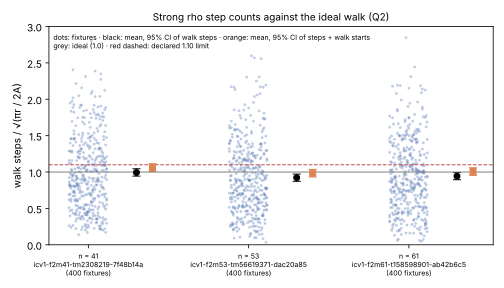
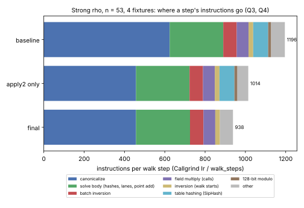
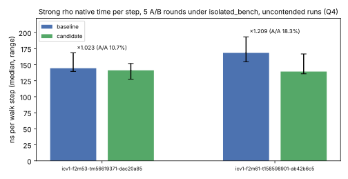

# Strong-rho assurance round: result

[`PROTOCOL.md`](PROTOCOL.md) was declared on 2026-10-16 before any evidence.
Its two Q4 addenda were each written before the code they describe.

The round asks whether the strong rho (`src/cryptanalysis/koblitz_strong_rho.rs`),
the reference every Koblitz `vs_rho` comparison prices index calculus against,
is correct, takes the steps it should, and pays a fair price per step. Report
PDF: [`report/report.pdf`](report/report.pdf).

**Class: engineering and assurance.** Every walk, step count and recovered
logarithm is unchanged. Counted-unit (GAE) records do not change.

## Answers

| question | answer | evidence |
|:--|:--|:--|
| Q1: is it correct? | **Yes, on everything checked.** Lean proves the lemmas; TLC finds no violation; mutants fail. No bug changes an answer. | `lean/`, `tla/`, Rust tests |
| Q2: does it take the steps it should? | **Yes.** Mean steps/ideal 0.99, 0.92 and 0.94 at n = 41, 53 and 61. | `runs/q2/` |
| Q3: does it pay a fair price per step? | **No, it overpaid.** 1,196 instructions per step, about 57 field multiplications, against a floor near 6–7. Half was canonicalization. | `runs/q3/` |
| Q4: can that be cut with identical walks? | **Yes: −21.5% instructions (1,196 → 938 per step).** Native time: 1.02× at n = 53, not established; 1.21× at n = 61, just outside its spread. | `runs/q4/` |

## Q1. Correctness

- **Lean 4.** Core Lean v4.34.1, no Mathlib. `lean/check.sh` builds it and
  audits the axioms.
  - 34 theorems; no `sorry`, `admit` or `native_decide`. They use only
    `propext`, `Classical.choice` and `Quot.sound`.
  - **Least rotation.** Every least rotation has the maximal leading-zero
    count, so it starts at a longest cyclic zero run. The Rust's zero-run mask
    yields exactly the candidate set, and its tie flag is exact. Bridges to the
    integer order and to the Rust `rotate` expression are included.
  - **Batch inversion.** Montgomery batch inversion, one-accumulator and
    four-accumulator variants, is correct over any field, for any length, with
    zero entries.
  - **Walk algebra.** Starts, jumps, canonicalization (any multiplier) and
    escapes preserve `P = a·G + b·Q`. The code's collision formula
    `(hit_a − a)·(b − hit_b)⁻¹` returns d whenever b ≠ b'.
  - **Gaps** ([`lean/PROOF_MAP.md`](lean/PROOF_MAP.md)):
    - the curve group is modelled as the scalar field;
    - the GF(2^m) arithmetic, the basis maps and `choice_exhaustive` are not
      verified;
    - machine-word overflow in `rotate` is argued, not proved.
- **TLA+.** [`tla/StrongRho.tla`](tla/StrongRho.tla) models `solve` over `Z_R`:
  lanes in lockstep, cursor-strided starts, canonicalization, distinguished
  points, the table, collisions with the `[d]G = Q` check, both fruitless
  modes, and the walk and step caps. TLC (v1.7.4, pinned by SHA-256) meets
  all 41 configs' declared verdicts:

  | configs | what | result |
  |:--|:--|:--|
  | 18 models | R = 31 (λ = 2, 5), 61 (λ = 13), 113 (λ = 16); 1–3 lanes; abandon and escape; index-order and any-order lanes | `RepInv`, `CanonInv`, `NoFailedCollision`, `SolvedCorrect`, no deadlock: all hold |
  | 2 liveness | weak fairness | every run terminates (solved or capped) |
  | 7 mutants | b not multiplied in canonicalization; escape not doubling b; wrong collision sign, with and without verification | each fails the property that should catch it |
  | 12 witnesses | each branch: solve, wasted merge, start on infinity, both caps, fruitless, escape, 5-cycle, … | every branch is reached |

  States, depths and the line-by-line map to the Rust are in
  [`tla/README.md`](tla/README.md).
- **Rust.**
  - `least_rotation_is_exact_on_every_word_up_to_16_bits`: every word of every
    width up to 16 bits, at `u64` and `u128`.
  - Debug builds now check `P = a·G + b·Q` in `solve`. The check runs at
    stored distinguished points, at power-of-two table sizes, and at both
    states of any failed collision. This is the TLA+ `RepInv` on the running
    code.
  - All 12 strong-rho tests pass with the checks on. Release builds are
    unchanged.
- **Findings** (none changes an answer):
  1. **Infinity is the `previous` sentinel.** A step onto infinity within four
     steps of a start or an escape counts as fruitless. The chance is about 1/r
     per step.
  2. **Escape skips the walk cap.** With `escape_fruitless` on, an escape step
     skips the `walk_cap` check, so an escaping walk can run past it (TLC
     `diag_walkcap_escape`). The committed reference has escape off.
  3. **Cycle-length doc.** The doc said fruitless cycles have length ≤ 4; the
     check catches 1–5. **Fixed** in this PR.
  4. **Merged walks can escape apart.** Merged walks keep their own
     `previous` for up to four steps, so they can flag the same cycle at
     different points and escape apart. This costs efficiency, not
     correctness, and was reasoned, not model-checked.

## Q2. Step counts (counted units)

`koblitz_rho_fixture n 0 signed_frobenius 400 strong`, 400 published
synthetic fixtures per size, each solved and verified.

| curve | mean steps / √(πr/2A) | 95% CI | sd | counting walk starts too |
|:--|--:|:--|--:|--:|
| `icv1-f2m41-tm2308219-7f48b14a` | 0.994 | 0.944–1.044 | 0.513 | 1.061 |
| `icv1-f2m53-tm56619371-dac20a85` | 0.922 | 0.873–0.971 | 0.504 | 0.984 |
| `icv1-f2m61-t158598901-ab42b6c5` | 0.943 | 0.894–0.993 | 0.500 | 1.007 |

- **Against the declared rule.** Every upper end lies below 1.10: consistent
  with an efficient walk.
- **The spread** (sd ≈ 0.5) matches an ideal random mapping's 0.52.
- **Ratios below 1 (hypothesis, not tested).** `walk_steps` does not count the
  point each walk starts on, about one in 15 visited points. Counting it
  brings the ratios to 0.98–1.06.
- **Deviation from the protocol.** It named n = 47 (a = 1), which the fixture
  on `main` no longer accepts
  (`runs/q2/fixture-n47-unsupported-on-main.stderr`). n = 61 replaced it.



## Q3. Cost per step (Callgrind, n = 53, 4 fixtures)

- **A step costs 1,196 instructions** (3,628,439,869 / 3,034,474 walk steps).
- **Field operations.** One `Gf2::mul`, called as the rho calls it, is
  21 instructions; a squaring is also 21. These come from two runs of
  `examples/gf2_mul_cost.rs` differing only in the count.
- **In M units, a step costs about 57 M.** The floor of an affine batched step
  is derived, not measured: 1 slope multiplication, 1 squaring and 1
  multiplication for y, 3 multiplications for the batch inversion, and one
  inversion per 32 lanes. That is about 5M + 1S + I/32, roughly 6–7 M.
- **Where the instructions went.**
  - Canonicalization was 52% of instructions, about 585 per call. A
    line-table build (`runs/q3/fixture-n53-1-lines.top60.txt`) traced most
    of it to the four byte-table basis conversions: about 14 instructions per
    table lookup, from a variable shift, a generic XOR and a slice iterator.
  - The table's SipHash was about 6%.
  - A 128-bit `%` in `add_mod` was about 15 instructions per step.

## Q4. A faster reference, identical walks

The three changes:
1. `Linear::apply2` converts x and y in one pass over the tables, shifting the
   word down a byte per table.
2. The one-word `add_mod` uses one conditional subtraction, because every
   caller's operands are already reduced; a `debug_assert` pins that.
3. The distinguished-point table uses a fixed 64-bit mixer instead of SipHash.

**Identity.** Every fixture output line at n = 53 and n = 61 is identical,
timing aside. All three arms give one digest.

| arm | instructions (n53, 4 fixtures) | per walk step |
|:--|--:|--:|
| baseline (`d5382a530`) | 3,628,440,819 | 1,196 |
| `apply2` only | 3,077,470,177 | 1,014 |
| final | 2,847,167,115 | **938** |



**Native time.** ns per walk step, with an A/A pass (the baseline × 6) then 5
interleaved A/B rounds. All 32 processes ran under `isolated_bench --cpus 3
--max-other-cpu 0.3` with `RAYON_NUM_THREADS=1`, none exited nonzero, and 2
were contended. Medians over uncontended runs:

| curve | baseline ns/step | candidate ns/step | ratio | A/A spread | verdict |
|:--|--:|--:|--:|--:|:--|
| `icv1-f2m53-tm56619371-dac20a85` | 144.4 (n = 4) | 141.2 (n = 5) | 1.023 | 10.7% | not established |
| `icv1-f2m61-t158598901-ab42b6c5` | 168.4 (n = 5) | 139.2 (n = 4) | 1.209 | 18.3% | outside the spread, barely |



- **This VM is noisy.** A/A spreads of 11–18% are wider than §10's expected
  5–10%. The instruction count is the result.
- **No IPC.** This VM exposes no hardware PMU, so `tools/perf_ipc.sh` records
  `unsupported` and no cycles or IPC are claimed.

## What changes downstream

- **Counted units.** GAE records and frontiers count group operations. They do
  not change, and Q2 shows the rho's step count is not inflated.
- **Wall time and instructions.** Future index-calculus/rho ratios measured
  against `koblitz_rho_fixture … strong` price rho at about 22% fewer
  instructions per step. That makes them harder for index calculus. Committed
  rows measured before this change keep their numbers and priced rho higher;
  none is re-measured here.
- **The remaining gap.** The reference still spends about 45 M per step
  against a floor near 6–7 M. Canonicalization is still 49% of it, and the
  `solve` body's bookkeeping, hashes and point addition 28%. A per-step
  comparison against this rho is therefore still generous to index calculus,
  by an amount this round does not measure. Possible next steps, none
  attempted here:
  - normal-basis arithmetic throughout;
  - a cheaper sign rule;
  - SIMD lanes.

  All three would change the walk definition, and committed replays pin the
  current walk.

## Limits

- **Formal scope.**
  - TLC checks small instances of a model, not every r.
  - Lean models words as bit lists and the subgroup as a field.
  - Neither is a refinement proof of the Rust. The bridges are the exhaustive
    and debug-assert tests.
- **Sizes.** Three fixture sizes (n = 41, 53, 61); m = 83 shares the code but
  is not measured.
- **Host.** One x86-64 cloud VM with AVX-512, 4 logical CPUs and no hardware
  counters. No Arm64 or AMD host was measured.

## Reproduce

```sh
lean/check.sh                                  # Lean proofs and axiom audit
tla/run_tlc.sh                                 # TLC, every config
cargo test --lib -- cryptanalysis::koblitz_strong_rho
cargo build --release --example koblitz_rho_fixture --example gf2_mul_cost --bin isolated_bench
for n in 41 53 61; do target/release/examples/koblitz_rho_fixture $n 0 signed_frobenius 400 strong; done   # Q2
valgrind --tool=callgrind target/release/examples/koblitz_rho_fixture 53 0 signed_frobenius 4 strong     # Q3/Q4
valgrind --tool=callgrind target/release/examples/gf2_mul_cost 53 1000000 1000000                     # and 2000000 for each count
BIN=<dir with koblitz_rho_fixture-{baseline,candidate}> BENCH=target/release/isolated_bench \
  MAX_OTHER_CPU=0.3 bash run_time.sh                                                                     # Q4 native time
bash summarise.sh && report/plots.py                                                                     # summary.json and graphs
```

The binary hashes are in [`runs/host.json`](runs/host.json).
