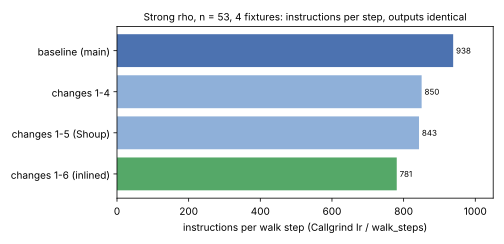
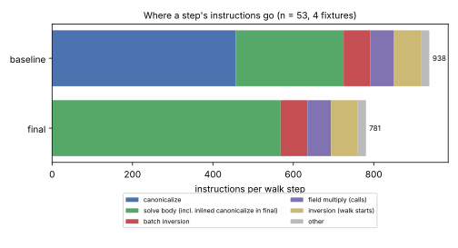
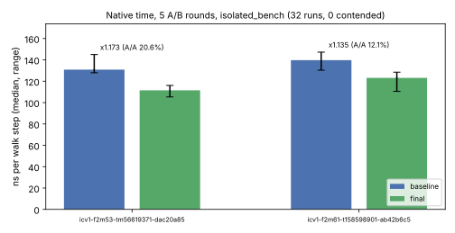

# Strong-rho canonicalization, round 2: result

[`PROTOCOL.md`](PROTOCOL.md) was declared before any change in this round, and
its two addenda before the changes they add. Addendum 2 records one deviation:
change 6 was counted once before it was declared. Parent: `72843c83a`
(`main`, carrying #1999). Report PDF: [`report/report.pdf`](report/report.pdf).

**Class: engineering.** Every walk, step count and recovered logarithm is
unchanged. The reference rho gets cheaper per step, which makes every future
index-calculus/rho wall or instruction comparison harder for index calculus.
Counted-unit (GAE) records do not change.

## Result

| arm | instructions (n53, 4 fixtures) | per walk step | output digest |
|:--|--:|--:|:--|
| baseline (`72843c83a`) | 2,847,169,163 | 938 | `50acd17588d6deba` |
| changes 1–4 | 2,580,125,642 | 850 | same |
| changes 1–5 | 2,557,912,731 | 843 | same |
| **final, changes 1–6** | **2,369,298,800** | **781** | same |

The final build runs **16.8% fewer instructions per step** (1.20×).
`canonicalize`'s own share fell from 1,387 M to 1,100 M instructions before
the inlining folded it into `solve`.




**Identity.** Every output line of `koblitz_rho_fixture n 0 signed_frobenius 4
strong` at n = 41, 53 and 61 is identical to the baseline's, timing aside.
All 13 strong-rho unit tests pass with debug assertions on. They include the
new `fixed_multipliers_match_the_plain_product` and the wide field's
step-for-step test, which covers the `u128` path.

## The changes

All of them are in `src/cryptanalysis/koblitz_strong_rho.rs`.

1. **`MulMod::mul` casts through `i64`.** The operands and quotient are below
   2^50. Rust lowers `u64`↔`f64` to multi-instruction sequences on baseline
   x86-64, and `i64` casts are one instruction each. The profile had put about
   27 instructions per call on that one line.
2. **`NormalBasis::rotate` has no `k == 0` branch.** For `v < 2^n` and
   `k ≤ n`, the general expression is already right. A `debug_assert` pins the
   precondition, and every caller meets it.
3. **`canonicalize` reuses the rotations.** Outside a tie, it reuses the least
   rotation and the y rotation the sign test computed, instead of rotating
   twice more.
4. **Precomputed multipliers.** The orbit multipliers `±λ^k` are precomputed
   with their signs: no `0 − λ^k` per negated step.
5. **Shoup's fixed-operand product for `a·(±λ^k)` and `b·(±λ^k)`.**
   - With `w' = ⌊w·2^64/m⌋` stored per multiplier, `a·w mod m` is one high
     product, two low products and at most one subtraction.
   - It is exact for `a, w < m < 2^63`. Larger moduli keep the old path, and
     the `u128` scalar is unchanged.
   - It saves few instructions, about 7 per step, but replaces a float
     dependency chain that the time profile still showed at about 9% of
     `canonicalize`.
6. **`canonicalize` is `#[inline(always)]`.** That removes six register
   saves, six restores and a 40-byte memory round trip per call: −7.4%
   instructions on its own.

## Native time

The protocol's run: A/A baseline × 6, then 5 interleaved A/B rounds. All 32
processes ran under `isolated_bench run --cpus 3 --max-other-cpu 0.3` with
`RAYON_NUM_THREADS=1`. None was contended, none exited nonzero, and outputs
are identical.

| curve | baseline ns/step [range] | final ns/step [range] | ratio | A/A spread | verdict |
|:--|--:|--:|--:|--:|:--|
| `icv1-f2m53-tm56619371-dac20a85` | 130.8 [127.9–145.0] | 111.5 [105.3–116.1] | 1.173 | 20.6% | not established (inside the A/A spread; the ranges do not overlap) |
| `icv1-f2m61-t158598901-ab42b6c5` | 139.7 [130.3–147.3] | 123.1 [110.5–128.5] | 1.135 | 12.1% | outside the A/A spread |



**IPC.** `tools/perf_ipc.sh` recorded `unsupported` for this host
(`runs/perf/final-n53.jsonl`): the VM exposes no hardware PMU. No cycle or IPC
figure is claimed. The time profile in `runs/profile/` used
`perf record -e cpu-clock`, a software event.

## Where it stands

The reference's step is now 781 instructions: about 37 field multiplications'
worth at 21 instructions each, against an affine-batched floor near 6–7.
What remains:
- **Basis conversions.** Four byte-table conversions per canonicalization, 28
  lookups. The walk definition needs both coordinates in both bases.
- **The least-rotation search.**
- **The `solve` body:** hashes, lane bookkeeping and the point addition.
- **The walk-start inversions:** a full Itoh–Tsujii inversion per walk, about
  one in 15 steps.

None of these can drop further without changing the walk definition, which
committed replays pin, or wider tables, whose cache cost this host cannot
measure reliably.

## Limits

- **Host.** One x86-64 cloud VM with AVX-512, 4 logical CPUs and no hardware
  counters. No Arm64 or AMD host was measured.
- **Arms.** Only n53 was counted under Callgrind per arm; n41 and n61 were
  checked for identity only. The m = 83 wide instantiation (`u128`) gets
  changes 2, 3, 4 and 6, but not 1 or 5, which are one-word only. It was not
  timed.

## Reproduce

```sh
cargo build --release --example koblitz_rho_fixture --bin isolated_bench   # at 72843c83a and at this PR
valgrind --tool=callgrind target/release/examples/koblitz_rho_fixture 53 0 signed_frobenius 4 strong
BIN=<dir with koblitz_rho_fixture-{baseline,candidate}> BENCH=target/release/isolated_bench \
  MAX_OTHER_CPU=0.3 bash research/rho_canon2_20261016/run_time.sh
bash research/rho_canon2_20261016/summarise.sh && research/rho_canon2_20261016/report/plots.py
```
