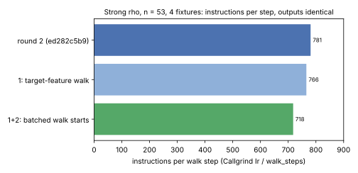
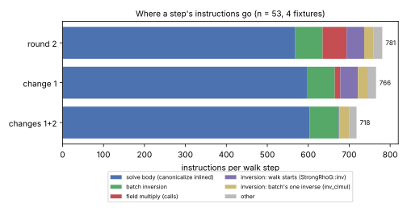
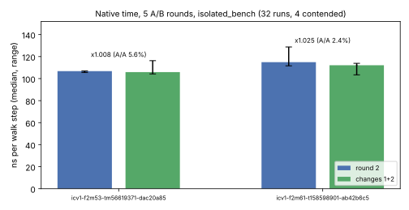

# Strong rho, round 3 (the walk step): result

[`PROTOCOL.md`](PROTOCOL.md) was declared before any change in this round.
Its addendum records the one deviation, before any timing: change 1 is built
as a target-feature method rather than the declared closure, which did not
inline. Parent: `ed282c5b9` (round 2, #2019). Report PDF:
[`report/report.pdf`](report/report.pdf).

**Class: engineering.** Every walk, step count and recovered logarithm is
unchanged. The reference rho gets cheaper per step, which makes every future
index-calculus/rho wall or instruction comparison harder for index calculus.
Counted-unit (GAE) records do not change.

## Result

| arm | instructions (n53, 4 fixtures) | per walk step | output digest |
|:--|--:|--:|:--|
| round 2 (`ed282c5b9`) | 2,369,297,848 | 781 | `50acd17588d6deba` |
| change 1: target-feature walk | 2,323,045,147 | 766 | same |
| **changes 1+2: batched walk starts** | **2,178,454,252** | **718** | same |

The final build runs **8.1% fewer instructions per step** (1.09×) than
round 2, and 23.5% fewer than the round-1 baseline's 938.




**Identity.** Every output line of `koblitz_rho_fixture n 0 signed_frobenius 4
strong` at n = 41, 53 and 61 is identical to round 2's, timing aside. All 14
strong-rho unit tests pass with debug assertions on, including the new
`batched_starts_match_the_sequential_chain`.

## The changes

Both are in `src/cryptanalysis/koblitz_strong_rho.rs`.

1. **The walk runs where the field arithmetic inlines.**
   - `Gf2::mul_fold` is a `pclmulqdq` target-feature function, so in round 2
     every field product in the walk was a call: 18.5% of the time profile.
   - `solve` now calls `solve_clmul`, a `#[target_feature(enable =
     "pclmulqdq")]` method, when `RhoField::clmul_walk()` holds: a `Gf2` that
     folds, on x86-64. Its body is the `#[inline(always)]` `solve_impl`, which
     every other field still runs directly.
   - The products inline into the step. `mul_fold`'s own instructions fall
     from 178 M to 41 M, all of them in the walk-start inversions, which are
     not compiled with the feature; after change 2 it no longer appears in
     the profile.
   - The declared form, a closure passed through a target-feature trampoline,
     compiled the closure as its own function without the feature, and the
     count rose to 2,474 M. The addendum records the switch.
2. **Walk starts share one inversion per batch.**
   - Starts are `cursor`, `cursor + stride`, `cursor + 2·stride`, …, one per
     new walk (203,197 walks in 3,034,474 steps, one in 15). Each was a full
     Itoh–Tsujii inversion, about 640 instructions (130 M in all).
   - `starts_ahead` now forms `base + (j+1)·stride` for the next `lanes`
     starts at once, with one batched (Montgomery) inversion. The multiples
     `(j+1)·stride` are formed once per solve. Infinity and equal x fall back
     to the group law.
   - The same points come out in the same order, and the same group additions
     are charged per walk start.

## Native time

The protocol's run: A/A round 2 × 6, then 5 interleaved A/B rounds. All 32
processes ran under `isolated_bench run --cpus 3 --max-other-cpu 0.3` with
`RAYON_NUM_THREADS=1`; none exited nonzero, and outputs are identical. Four
were contended and are excluded: A/A r5 and r6 at n61, and A/B round-2 r4
and r5 at n53.

| curve | round 2 ns/step [range] | final ns/step [range] | ratio | A/A spread | verdict |
|:--|--:|--:|--:|--:|:--|
| `icv1-f2m53-tm56619371-dac20a85` | 106.8 [105.5–107.0] | 105.9 [104.3–116.3] | 1.008 | 5.6% | not established |
| `icv1-f2m61-t158598901-ab42b6c5` | 115.0 [111.6–128.7] | 112.1 [103.4–113.9] | 1.025 | 2.4% (4 runs) | marginal: 0.1 points outside a 4-run spread; not claimed |



The 8.1% instruction cut does not show as a clear time gain on this host:
the calls and walk-start inversions it removes cost less time than their
instruction share. The instruction count is the result of this round.

**IPC.** `tools/perf_ipc.sh` recorded `unsupported` for this host
(`runs/perf/final-n53.jsonl`): the VM exposes no hardware PMU.

## Merged with main's parallel optimization (2026-10-17)

`main` gained a separate strong-rho canonicalization change while this PR
was open (`2fd065a6c`, "perf: optimize strong rho canonicalization"): paired,
unrolled normal-basis table lookups (`apply_pair`), a paired multiply, and the
original canonicalization kept as `canonicalize_legacy`/`solve_legacy`, a
performance control that ecbench runs as a method arm.

- **How they were combined.** `canonicalize` is this PR's round-2 body with
  main's `apply_pair` for both basis conversions. `canonicalize_legacy` is
  main's original body, unchanged. `solve` and `solve_legacy` both take the
  target-feature walk and the batched starts, so the two arms still differ
  only in canonicalization. Shared helpers (`MulMod::mul`, `rotate`) carry
  the round-2 changes in both arms.
- **Identity.** The merged build's fixture outputs at n = 41, 53 and 61 match
  this round's final build (digests `81d42835…`, `50acd175…`, `cf6d8810…`),
  and main's `optimized_and_legacy_solvers_follow_the_same_trajectory` test
  passes with the other 102 strong-rho and ecbench unit tests.
- **Count.** Callgrind, n53, 4 fixtures: **2,145,912,235 instructions, 707
  per walk step**, against this round's 718 (`runs/merge/`). Not timed.

## Where it stands

The step is now 718 instructions. What remains, by function in the final
build: the `solve` body with canonicalization inlined (about 600 per step),
the walk's batched inversion (about 71) and its single inverse (about 25).
The remaining large costs are the four basis conversions per
canonicalization and the least-rotation search; neither can drop further
without changing the walk definition, which committed replays pin, or wider
tables.

## Limits

- **Host.** One x86-64 cloud VM with AVX-512, 4 logical CPUs and no hardware
  counters. No Arm64 or AMD host was measured.
- **Arms.** Only n53 was counted under Callgrind per arm; n41 and n61 were
  checked for identity only.
- **Other fields.** The m = 83 wide instantiation (`WideGf2`) gets change 2
  but not change 1, and was not timed. Off x86-64, or for a `Gf2` that does
  not fold, the walk runs as before.

## Reproduce

```sh
cargo build --release --example koblitz_rho_fixture --bin isolated_bench   # at ed282c5b9 and at this PR
valgrind --tool=callgrind target/release/examples/koblitz_rho_fixture 53 0 signed_frobenius 4 strong
BIN=<dir with koblitz_rho_fixture-{baseline,candidate}> BENCH=target/release/isolated_bench \
  MAX_OTHER_CPU=0.3 bash research/rho_step3_20261016/run_time.sh
bash research/rho_step3_20261016/summarise.sh && research/rho_step3_20261016/report/plots.py
```
