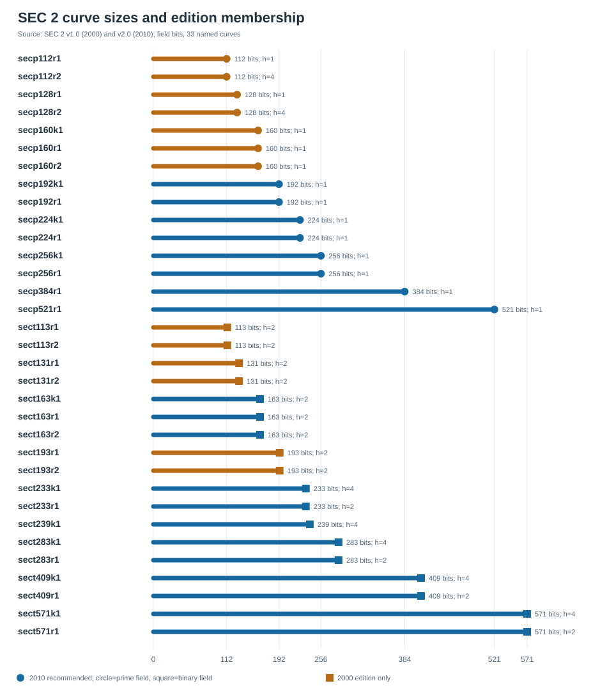

# SEC 2 curve inventory and structural traits (2026-10-12)

## Question and scope

Inventory every named curve in SEC 2 v2.0 (2010), retain SEC 2 v1.0 (2000) entries omitted from v2.0, and bind each name to the `crypto` repository's exact curve identity and complete trait record. This is a catalog and arithmetic check, not an implementation or attack-cost measurement.

## Sources and method

- **Primary:** [SEC 2 v1.0](https://www.secg.org/SEC2-Ver-1.0.pdf) (`d1b16728ad83888fd656d16b99dc71bcd5541d42d848ffd0de7c62c19010d8c3`) and [SEC 2 v2.0](https://www.secg.org/sec2-v2.pdf) (`87b8f3703364ed5b21ba8582e411cc0cbf477bcaa3f4f45e0d6580d1c00d9952`). Immutable PDF copies are in `sources/`.
- **Catalog:** `docs/curves/registry.json` SHA-256 `9e420a7f2e69a1d72a2590899e6bffb8b3d45eff0f197c5c898ee66c1219e872`; `docs/curves/traits.json` SHA-256 `b8c40a17ccde06cc37534a67b779437ad3efb01a8e6675153f093d05aba70513`. `docs/curves/covers.json` SHA-256 `baac4c80f89e3cd9c8ef14421b600cce98c9a642b54ed1f182e8dcc8a2928324`; `docs/curves/jacobian-transfers.json` SHA-256 `aec6338011158c8c1aaddb829d4e90fb96eebc43cd4027d1067979bba3e6ca40`. The source section pointers, curve identities, primary parameter checks, catalog traits, cover records, and transfer screening records are in `inventory.json`.
- **Snapshot alignment:** `covers.json` is pinned to the current registry. `traits.json` and `jacobian-transfers.json` carry older whole-registry hashes, but all 33 selected rows match the current exact slug and order/trace or ICV1, respectively. This report does not claim global freshness for those two derived files.
- **Derived check:** `build.py` reads both PDFs through `pdftotext -layout`, compares field prime or reduction polynomial, coefficients, uncompressed base point, prime subgroup order, and cofactor with the exact registry representation, and refuses a mismatch. It extracts each stated seed without independently re-running the ANSI X9.62 seed-to-curve procedure. The existing `curve_traits` engine supplies CM, conductor, endomorphism bounds, subfields, embedding degree, twist, and small-isogeny local data, with each status preserved.
- **Bounded SEC 1 check:** trial division by every prime up to 100,000 on `n−1` and `n+1`. If the remaining cofactor is at most `n^(19/20)`, no prime factor can satisfy the later [SEC 1 v2.0](https://www.secg.org/sec1-v2.pdf) advisory threshold. Other rows stay `undetermined`; the residual is not declared prime.

## Results

- **Primary match:** 33 distinct v1.0 names and 20 v2.0 names; all 53 name-by-edition core parameter blocks agree with their catalog entry. There are 15 prime-field and 18 binary-field names in v1.0; 8 prime-field and 12 binary-field names in v2.0.
- **Historical entries:** `secp112r1`, `secp112r2`, `secp128r1`, `secp128r2`, `secp160k1`, `secp160r1`, `secp160r2`, `sect113r1`, `sect113r2`, `sect131r1`, `sect131r2`, `sect193r1`, `sect193r2`.
- **Trait status:** subgroup-order certificates {'probable': 27, 'proved': 6}; CM/conductor {'probable': 15, 'bounded': 10, 'proved': 8}; twist factorization {'proved': 5, 'probable': 13, 'unknown': 15}. Statuses are the catalog's and are not upgraded by this report.
- **Covers and transfer screening:** all 33 curves have a matched `verified_over_declared_field` cover record and a matched Jacobian-transfer screening row. The cover records mark subgroup transport `not_tested` on all 33. The transfer rows all have verdict `boundary`: their formulas are screening models, not measured ECDLP gains.
- **SEC 1 n±1 advisory:** the bounded scan establishes failure of the 19/20-factor recommendation for 25 of 33 `n−1` values and 19 of 33 `n+1` values. The rest are undetermined under this trial limit. This is conditional Diffie–Hellman-oracle guidance, not a generic discrete-log cost result. The bounded check also finds 15 `n−1` and 10 `n+1` failures among the 20 curves retained in 2010; failure of this advisory condition alone cannot account for the 193-bit omission.

### Curve-by-curve index

`F/F` in the last column means the bounded scan established failure of the SEC 1 recommendation for both `n−1` and `n+1`; `?` means undetermined. All exact integers, small-prime splitting, volcano depths, generator coordinates, seed bytes, and status-bearing trait objects are in `inventory.json`.

| Curve | SEC 2 | Field | h | CM | End(E) | Subfield | Embedding | Twist | n−1/n+1 |
| --- | --- | ---: | ---: | --- | --- | --- | --- | --- | --- |
| `secp112r1` | 2000 only | Fp/112 | 1 | probable | probable | n/a | probable | proved | F/? |
| `secp112r2` | 2000 only | Fp/112 | 4 | probable | bounded | n/a | probable | proved | F/? |
| `secp128r1` | 2000 only | Fp/128 | 1 | bounded | unknown | n/a | k>1000 | proved | F/F |
| `secp128r2` | 2000 only | Fp/128 | 4 | probable | bounded | n/a | probable | probable | F/F |
| `secp160k1` | 2000 only | Fp/160 | 1 | -3 (proved) | proved | n/a | k>1000 | probable | F/F |
| `secp160r1` | 2000 only | Fp/160 | 1 | probable | probable | n/a | probable | probable | ?/F |
| `secp160r2` | 2000 only | Fp/160 | 1 | probable | probable | n/a | k>1000 | probable | F/F |
| `secp192k1` | 2010 | Fp/192 | 1 | -3 (proved) | proved | n/a | probable | probable | F/F |
| `secp192r1` | 2010 | Fp/192 | 1 | probable | probable | n/a | k>1000 | unknown | F/? |
| `secp224k1` | 2010 | Fp/224 | 1 | -3 (proved) | proved | n/a | probable | unknown | ?/F |
| `secp224r1` | 2010 | Fp/224 | 1 | probable | bounded | n/a | probable | unknown | F/? |
| `secp256k1` | 2010 | Fp/256 | 1 | -3 (probable) | probable | n/a | k>1000 | probable | F/F |
| `secp256r1` | 2010 | Fp/256 | 1 | bounded | unknown | n/a | k>1000 | probable | F/F |
| `secp384r1` | 2010 | Fp/384 | 1 | bounded | unknown | n/a | k>1000 | probable | ?/F |
| `secp521r1` | 2010 | Fp/521 | 1 | bounded | unknown | n/a | k>1000 | probable | ?/? |
| `sect113r1` | 2000 only | F2m/113 | 2 | proved | proved | full | probable | proved | F/F |
| `sect113r2` | 2000 only | F2m/113 | 2 | probable | probable | full | probable | proved | F/F |
| `sect131r1` | 2000 only | F2m/131 | 2 | probable | probable | full | probable | probable | F/? |
| `sect131r2` | 2000 only | F2m/131 | 2 | probable | probable | full | probable | probable | ?/F |
| `sect163k1` | 2010 | F2m/163 | 2 | -7 (proved) | proved | 2^1 | k>1000 | unknown | F/F |
| `sect163r1` | 2010 | F2m/163 | 2 | bounded | unknown | full | k>1000 | unknown | F/F |
| `sect163r2` | 2010 | F2m/163 | 2 | bounded | unknown | full | probable | probable | F/? |
| `sect193r1` | 2000 only | F2m/193 | 2 | probable | probable | full | k>1000 | unknown | F/F |
| `sect193r2` | 2000 only | F2m/193 | 2 | probable | probable | full | k>1000 | unknown | ?/? |
| `sect233k1` | 2010 | F2m/233 | 4 | -7 (proved) | proved | 2^1 | probable | unknown | F/F |
| `sect233r1` | 2010 | F2m/233 | 2 | bounded | unknown | full | probable | unknown | F/? |
| `sect239k1` | 2010 | F2m/239 | 4 | -7 (proved) | proved | 2^1 | k>1000 | unknown | F/? |
| `sect283k1` | 2010 | F2m/283 | 4 | -7 (probable) | probable | 2^1 | k>1000 | probable | F/? |
| `sect283r1` | 2010 | F2m/283 | 2 | bounded | unknown | full | k>1000 | unknown | F/? |
| `sect409k1` | 2010 | F2m/409 | 4 | -7 (proved) | proved | 2^1 | k>1000 | unknown | F/F |
| `sect409r1` | 2010 | F2m/409 | 2 | bounded | unknown | full | k>1000 | unknown | ?/? |
| `sect571k1` | 2010 | F2m/571 | 4 | -7 (probable) | probable | 2^1 | k>1000 | unknown | F/F |
| `sect571r1` | 2010 | F2m/571 | 2 | bounded | unknown | full | k>1000 | unknown | ?/? |

## Interpretation and limits

The standard's `r` and `k` name suffixes label its random-parameter and Koblitz families; they do not certify a security ranking. The seed bytes in `inventory.json` establish published provenance only. No curve-specific vulnerability, isogeny route, subgroup transport, or performance advantage follows from this inventory. Its `probable`, `bounded`, `unknown`, and `not_applicable` statuses remain distinct.

The cover and transfer rows do not establish a subgroup-preserving usable route or a solver advantage. Their exact hypotheses and the absent transport checks remain visible in `inventory.json`.

The current `crypto-autoresearcher:analysis/binstd-curve-audit/README.md` supplies an independent, secondary-source subfield scan for the binary names. Its scope is structural arithmetic and is kept separate from this primary SEC 2 parameter crosscheck.

## Next check

For an exact endomorphism ring or twist large-prime conclusion on a row still marked `bounded` or `unknown`, run a separately specified certificate or exact factorization for that row and attach it to its existing curve UID. The present scan's unresolved residuals require either a certified prime factor exceeding `n^(19/20)` or enough additional factors to bound every residual below it. No experiment or research-state transition was made.

## Reproduce

From the repository root, run `python3 research/sec2_curve_inventory_20261012/build.py --check`. To regenerate derived artifacts, run that script without `--check`, then `python3 research/sec2_curve_inventory_20261012/render.py`, then `typst compile research/sec2_curve_inventory_20261012/REPORT.typ research/sec2_curve_inventory_20261012/REPORT.pdf`. This rendering used Poppler `pdftotext` 26.04.0 and Typst 0.15.1.
