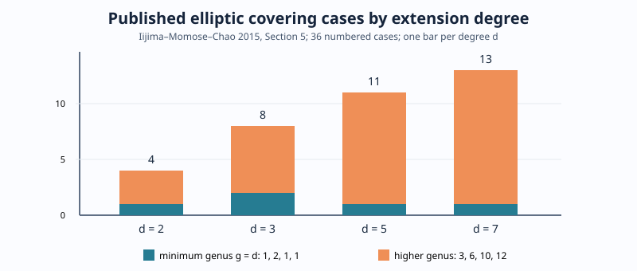
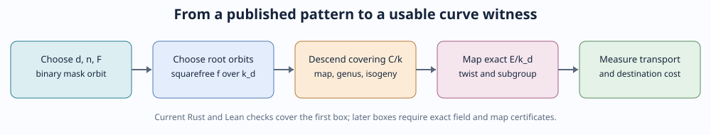

# Source-verified covering-case index — 12 October 2026

The [2015 Iijima–Momose–Chao classification](https://eprint.iacr.org/2015/805.pdf),
Section 5, distinguishes **36 numbered elliptic covering cases** in odd
characteristic at prime extension degrees 2, 3, 5, and 7. The queryable
[`case_profile`](published_cases.sqlite) index records the paper's extension
degree, binary covering rank, covering genus, and square-class option. Five
cases attain the minimum covering genus `g(C)=d`; 31 have larger genus.
These counts are published family cases, not exact curve-model counts or
measured attack outcomes.

| Degree `d` | Numbered cases | `g(C)=d` | Higher genus | Largest listed `g(C)` |
| ---: | ---: | ---: | ---: | ---: |
| 2 | 4 | 1 | 3 | 5 |
| 3 | 8 | 2 | 6 | 17 |
| 5 | 11 | 1 | 10 | 129 |
| 7 | 13 | 1 | 12 | 769 |

These values are transcribed from the paper's printed pages 17–18 and
recomputed from [`cases.csv`](cases.csv) by the SQLite query in
[`VALIDATION.md`](VALIDATION.md). In the paper `e=g(C)-d`; its five
`e=0` elliptic cases are numbers 1, 5, 6, 13, and 24. The earlier
[2013 isogeny-condition classification](https://eprint.iacr.org/2013/487.pdf)
lists 27 cases across elliptic **and genus-two and genus-three** source
curves under a narrower minimum-genus condition. These populations have
different units and overlap; their counts should never be added.
The factor-pattern skeletons for those five cases are queryable in the
[`minimum_case_recipe` view](published_cases.sqlite), with the root and
coefficient conditions left explicit in the [source table](https://eprint.iacr.org/2015/805.pdf).

The paper's Section 3.3 supplies a constructive candidate screen. For
`k=F_q`, `k_d=F_(q^d)`, and its binary representation polynomial `F` of
degree `n`, form `Fhat=(X^d+1)/F`. For each binary polynomial `a` coprime to
`F`, the mask `Phi=a Fhat mod (X^d+1)` selects a Frobenius orbit pattern of
ramification points. Rotating all `d` mask positions gives an equivalent
pattern. [`ramification_orbits.rs`](ramification_orbits.rs) replays this step
with polynomial arithmetic over `F_2` and records 27 mask orbits across the
11 listed representation factors in [`ramification_orbits.csv`](ramification_orbits.csv).
The two degree-seven cubic factors and their products are source-checked
against Section 3.1. The binary factorization identities for degrees three
and seven are proved in [`lean/PublishedCases.lean`](lean/PublishedCases.lean).

For the cubic `n=2` branch, the source polynomial is
`F=X^2+X+1`, so `Fhat=X+1` and the first mask is `011`: the selected
ramification roots are `alpha` and `alpha^q`. Paper Case 5 has
`f(x)=(x-alpha_1)(x-alpha_1^q)(x-alpha_2)(x-alpha_2^q)` and a genus-three
covering when the paper's field-of-definition and distinctness conditions
hold. The separate cubic `n=3` branch appears as Case 6. These are the two
minimum-genus branches to compare with the existing cubic weak-class census;
the trace/conductor rule alone does not provide their branch-root geometry.

For an exact representative, choose root orbits in the specified finite
extension, include every conjugate over `k_d`, complete a squarefree cubic or
quartic `f`, and choose the coefficient square class permitted by the case.
Then verify the paper's square-class relation `F(sigma)f=1` in
`k_d(x)^*/k_d(x)^{*2}`, construct the base-field covering and map, check its
genus and isogeny condition, and identify the actual elliptic model and
twist. For a selected subgroup, record map kernel, transported generator,
destination order, and complete construction and transfer costs. A mask
without these later checks remains a candidate.

The 2015 paper gives genus bounds for prime degrees 11 and 17, but its
36-case table covers degrees 2, 3, 5, and 7. A larger-degree study should
first test the mask screen and genus bounds, then record exact curve and
covering witnesses if found. The current index creates no new 192–252-bit
model classification; those exact models remain in the main database with
their existing evidence grades. The next import is the complete defining
equation and parameter-condition table for all 36 numbered cases, followed
by isomorphism-aware joins to those exact models.

An additional necessary-condition search checked
[Costa--Donepudi--Fernando--Karemaker--Springer--West, Theorem 2.8](https://arxiv.org/pdf/2002.02067).
For a cubic Weil restriction with Weil polynomial
`T^6 - t T^3 + q^3`, the theorem excludes a genus-three **hyperelliptic**
Jacobian when `t` is odd: its quadratic Weil coefficient is zero and its
cubic coefficient is odd. The existing database has **zero odd traces**
among 87,486 complete exact ordinary two-branch rows and 246,512 ordinary
cubic diagnostic rows. Hence this parity screen excludes none of those rows
and gives no discrimination among the observed higher-depth zero classes.
This is a bounded check for this corpus and this hyperelliptic theorem;
the non-hyperelliptic branch requires a different condition.

**Evidence status.** The case numbers, metadata, and formulas above are
source-attributed. SQLite row constraints and native orbit tests independently
check transcription relationships and binary arithmetic. Lean checks the two
specified polynomial identities. The 2015 structural classification is a
published theorem; this repository's Lean module has not formalized its
covering existence, genus, or completeness proof. No exact-model witness or
subgroup advantage is inferred from a case-metadata row.
