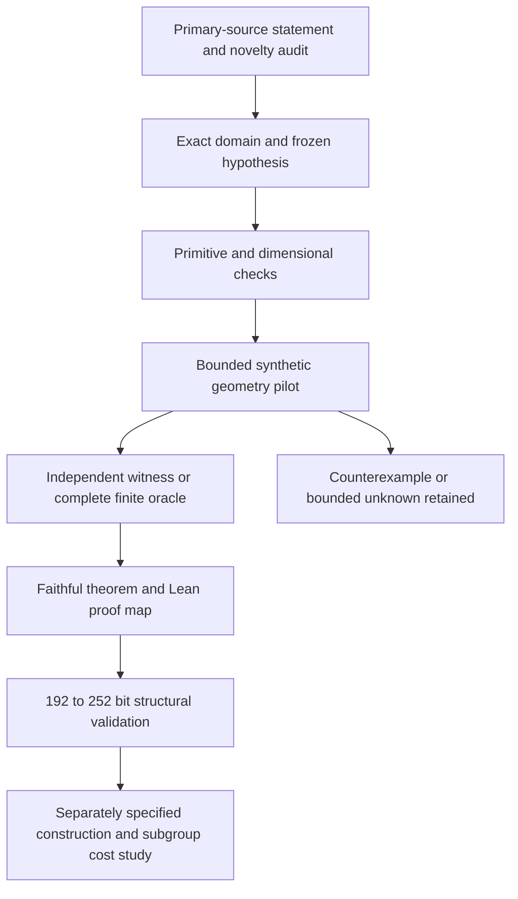

# Discovering and classifying candidate weak-curve properties

The research unit is an exact family with a declared field, geometric
condition and evidence boundary. A useful contribution can be a new
class-support theorem, a previously unmeasured intersection of known
families, a complete finite classification, a verified construction, or a
measured cost under a frozen input law. Each has its own acceptance gate.

## 1. Normalize the research question

Keep five questions as separate fields in every record:

| Question | Required evidence |
| --- | --- |
| Does the displayed model belong to a family? | Exact coefficient/root condition and all exceptional cases |
| Does its isogeny class contain a family member? | Complete family-specific oracle or an actual positive witness |
| Does a particular covering have the desired geometry? | Smoothness, genus, base field, hyperellipticity and the actual Weil-restriction map/isogeny condition |
| Can a representative be reached from the supplied synthetic source? | Verified maps and every failed/capped construction attempt |
| What cost does the selected subgroup problem have? | Exact subgroup/point specification and the repository's separate complete measurement contract |

For this conjecture phase the fifth field is unset. A structural family label
does not fill in subgroup parameters or costs. Negative membership in one
family leaves other mechanisms open.

Record the characteristic, absolute degree, relative tower, exact field
polynomial/basis, model coefficients, trace, ordinary status, curve identity
and immutable input hash. Store Frobenius conductor and actual endomorphism
conductor separately; retain bounds and unknowns. Add covering identity,
polarization and kernel data when that is the proposed property.

## 2. Audit attribution before adding a candidate

Read the relevant original theorem, including the isogeny condition and
exceptional cases. Translate it into the catalogue's model/class/cover
language. Compare a candidate statement against the general 2006 and 2013
classification tables, not only the cubic paper. Canonicalize equivalent
root configurations and twists before claiming an additional family.

Maintain three distinct labels: published family awaiting local verification,
new conjecture with novelty unresolved, and proved new statement after a
complete comparison. The literature search has already identified the
2013 classification's additional cases as an attributed backlog. Odd-prime
cover mechanisms described by Tian and the genus-3 isogenies of Smith are
also established baselines. Their intersections and conditioned profiles
can still be research questions.

## 3. Exclude disguised base changes and wrong-dimensional quotients

For every proposed primitive witness retain at least four field degrees:

1. Minimal field of j.
2. Minimal field of the displayed coefficients.
3. Minimal field admitting an isomorphic model over the ambient field.
4. Minimal field from which the ordinary isogeny class descends.

The fourth is a new catalogue obligation: it needs an actual ordinary Weil
number/base-change criterion and admissible smaller-field class, not merely
a j period. If points or a subgroup are later specified, record their field
and transport separately. These degrees need not coincide.

For a relative degree-n elliptic source, a Jacobian mapping onto the entire
n-dimensional Weil restriction must have genus at least n. Require an
actual algebraic map and sufficient factor multiplicity; a factor with a
matching trace is not a map certificate. Preserve the source's full
Frobenius polynomial and polarization.

The scaling screen in `WCQ1:smaller-genus` has a short readable check:
if `alpha^q=c*alpha`, with nonzero alpha and base-field c, then the Legendre
ratio is c, so its rational j expression is base-defined. Such a sample
cannot witness primitive j. Its corresponding Lean field lemma remains
listed explicitly in the proof map.

## 4. Freeze the pilot before generating outcomes

Use different input laws for different questions:

| Population | Appropriate question | Bias to retain |
| --- | --- | --- |
| Exact signed trace classes | Class support and class-uniform gap counts | May be restricted to t=2 mod 4; state that denominator |
| Constructed family parameters | Geometry, reconstruction and positive controls | Family-biased and affected by parameter symmetries |
| Uniform admissible j with declared twist law | Model prevalence | Does not weight classes uniformly |
| Independently sampled source models | Cost of reaching a representative | Model law and cofactor restrictions must remain explicit |

Start with exact p7 controls and the seven already certified class censuses.
Preregister the candidate statement, fields, identities, exclusions,
parameter law, seeds, test/validation split, reference and stop conditions.
The availability audit found historical cubic artifacts at p53,59,61 and
p67. Retain p53,59,61 as retrospective extensions rather than calling them
new fields. No p71,73,79 filename was found in the inspected ISO-1 archive;
these are the proposed prospective count-law panel. Check the execution
registry as well, and freeze identities and labels before testing. No
historical extension labels were examined to choose the prospective panel.

For the new geometric arms, the first implementation pilot uses at most
16 fixed synthetic models per arm, one worker, a 2 GiB cap and a 30-minute
per-cell cap. This validates recognizers and certificate semantics. It is
separate from the complete finite oracle needed to refute an existential
claim. Keep execution status, achieved coverage and mathematical status as
different columns. No pilot is launched by this document.

## 5. Prefer certificates and independent failures

Freeze each witness before independent replay. Verify field arithmetic and
point counts through an independent native/PARI path when applicable.
For a covering, verify the actual map/function-field inclusion, ramification,
smoothness, genus and base-field descent, followed by the stated isogeny
condition. A coordinate identity alone does not establish these properties.
For a quotient, verify the retained abelian factor and multiplicity.

Use explicit statuses:

- `positive_witness_verified`: one exact object meets every declared condition.
- `negative_complete_for_named_family`: complete finite oracle or proof.
- `bounded_unknown`: cap reached without a complete decision.
- `outside_domain`: a hypothesis failed.
- `infrastructure_failure`: execution failed before the mathematical check.
- `conjecture_refuted`: a logically sufficient counterexample was verified.

Retain exact zeros and every rejected candidate. The current 1,184 boundary
counterexamples supply regression controls for proposed global explanations.
For existential statements, one certified witness establishes the finite
claim; a failed finite search does not establish nonexistence. For an
asymptotic statement, separate a finite forecast from a genuine asymptotic
refutation. Family/model/class completeness is never global completeness.

## 6. Formalize proved statements as the investigation proceeds

Maintain a statement-to-Lean map with exact hypotheses. Introduce actual
finite fields, subfields, Weierstrass models, endomorphism orders, Jacobians
and polarizations where the statement uses them. Mark missing geometric
interfaces rather than encoding them as research axioms. A definition or
numerical identity does not close a geometric conjecture.

This addition builds and audits universal list-counting lemmas. The earlier
versioned proof PR supplies actual finite-field twist/descent statements.
The open conjectures keep their own proof obligations. The primitive-j
degree conjecture is an early proof candidate because its core dependency
is the finite-field anharmonic fibre and Frobenius periods; the actual
Jacobian/polarization questions have larger geometric dependencies.

Pin the compiler/dependencies, build the reported modules, audit every
reported theorem's transitive axioms, and replay compiled proofs in a fresh
kernel when available. Preserve failed build attempts and exact gaps.

## 7. Expand structural validation to 192–252-bit fields

Reuse the existing 512 frozen independent sources only under their original
law: full rational 2-torsion was built into those models. They can measure
properties conditional on that law. They cannot estimate prevalence among
arbitrary curves or odd-order source classes.

The first large-field structural panel selects up to 16 existing source IDs
per available absolute degree 6,10,14 by a deterministic input-hash ordering,
preserving exact field representations and certified traces. Freeze the
chosen IDs before testing a new property. Keep constructor-biased primitive
torus controls separate. For an odd-prime mechanism, define a new independent
input law before sampling; the current all-full-2 panel is not its baseline.

Run cheap field-period and algebraic witness checks first. Escalate to CM
support or complete class decisions only when a reproducible source-bound
method is implemented. Retain the earlier large-field unresolved class
labels, discriminant-conversion failures and route caps. A small-degree
decision polynomial does not account for the cost of obtaining its CM
factors. Record that setup separately.

For later construction measurements preserve support preparation,
recognition, unsuccessful attempts, maps, transport and destination setup as
exclusive phases. If a DLP comparison is eventually authorized, use the
repository's frozen single-target IC/rho contract, independent scalar replay
and host-isolation receipt. No timing or solving claim follows from this
conjecture catalogue.

## 8. Promotion order

Prioritize the primitive-j proof attempt, the non-hyperelliptic support test
on the 46 p7 zero classes, and the selected-CM occupancy study. The
two-tower and quotient arms follow after published-case normalization and
class-descent guards are implemented. Promote a new family only with its
own defining condition, reproducible witness or completeness boundary,
and attribution record.
