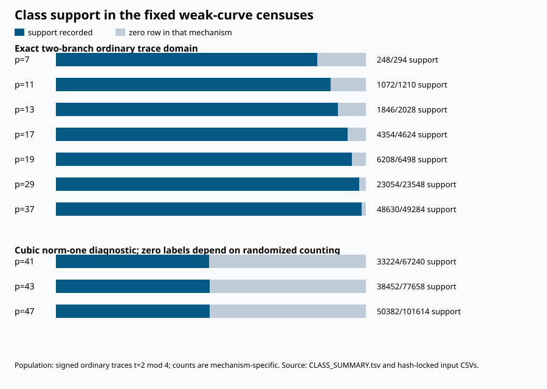
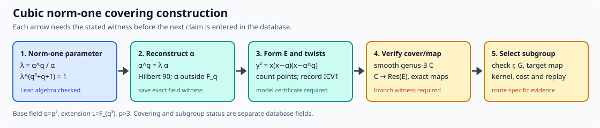

# Weak-curve database expansion: imported evidence and construction route

12 October 2026 UTC. This round produced a queryable database of
**339,740 class observations**, **814 exact models**, **21 family or
condition entries**, **12 construction recipes**, **10 theorem entries**,
**4 heuristic records** and **8 prior hypotheses**. The key algebraic
construction identity and fourth-power corollary have six new Lean proofs.
The report concerns the
fixed public synthetic corpus and the published mechanism literature.

The graph is generated from [CLASS_SUMMARY.tsv](CLASS_SUMMARY.tsv);
the [database](weak_curves.sqlite) stores its source hashes and row
lineage. The full exact ordinary two-branch domain has 87,486 rows:
85,412 positive in at least one of the two recorded hyperelliptic
branches, and 2,074 zeros in their union. The p41,p43,p47 material
has 252,254 inclusive Hasse candidate rows, of which 246,512 are
ordinary. Their positive and zero counts concern only the older
cubic norm-one representative census, with randomized point
counting. The two grades are separated in the graph and in every
database query.

| Prime | Mechanism and grade | Ordinary rows | Positive | Zero |
| ---: | --- | ---: | ---: | ---: |
| 7 | two-branch exact | 294 | 248 | 46 |
| 11 | two-branch exact | 1,210 | 1,072 | 138 |
| 13 | two-branch exact | 2,028 | 1,846 | 182 |
| 17 | two-branch exact | 4,624 | 4,354 | 270 |
| 19 | two-branch exact | 6,498 | 6,208 | 290 |
| 29 | two-branch exact | 23,548 | 23,054 | 494 |
| 37 | two-branch exact | 49,284 | 48,630 | 654 |
| 41 | cubic diagnostic | 67,240 | 33,224 | 34,016 |
| 43 | cubic diagnostic | 77,658 | 38,452 | 39,206 |
| 47 | cubic diagnostic | 101,614 | 50,382 | 51,232 |

The database import verified the seven exact trace domains and the
three inclusive diagnostic Hasse domains, checked every source hash,
confirmed the p7 oracle flags, and matched all 814 model/property
pairs by exact ICV1 identity and model hash. It also checked every
model’s field size and order against its trace. The Rust unit tests
exercise missing-domain and malformed-label rejection. A complete
reimport compares a canonical digest of all table rows, and the
summary TSV and SVG are checked against the regenerated versions.
Details and commands are in [VALIDATION.md](VALIDATION.md).

The construction route is explicit: choose a cubic norm-one
parameter lambda=alpha^q/alpha, form
E: y²=x(x-alpha)(x-alpha^q), then verify the genus-three cover and
its induced map. The group identity, q-power exponent and explicit
fourth-root theorems
build in Lean with only propext and Quot.sound in their transitive
axiom sets. The denominator-cleared algebraic identity has native
certificate [IDC1h3561e7fee541a297](cubic_identity.certificate.json),
replayed with 32 fresh checker points. The [construction guide](CONSTRUCTION.md) gives a
recorded p7 model and the subsequent subgroup and cost gates.

The literature search confirmed a concrete expansion backlog.
[Iijima–Momose–Chao](https://eprint.iacr.org/2013/487)
classify more (2,...,2) covering cases than the current local
implementation; their reported 17 additional classes include
source genera beyond elliptic curves. [Tian](https://arxiv.org/abs/2012.07173)
supplies an odd-prime polarized cubic-restriction mechanism outside
the current two-branch 2-torsion search. The
[source audit](SOURCE_AUDIT.md) records the normalization work before
either becomes a verified local model population.

The failed Swift SVG raster attempt is retained in validation as an
environment failure: the default cache path was restricted and the
retry exhausted space on the small system volume. The vector SVG
remains generated and readable; the PDF uses an independent plot
renderer from the saved TSV. No new curve enumeration or large-field
point count was launched in this round. The next research step is
to import the published Type I/II case table with exact equivalence
classes, then run a frozen complete prospective census.
