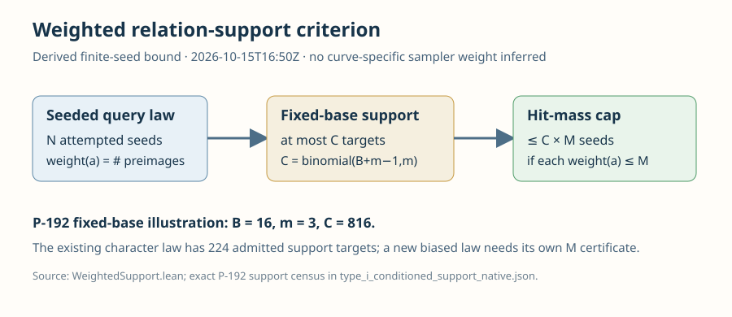

# Weighted relation support for geometry-guided curve queries

**Result.** A finite-seed nonuniform query law can place at most \(\binom{B+m-1}{m}M\) seeds on the unordered positive \(m\)-sum support of a fixed base of \(B\) usable classes, provided each accepted target class has at most \(M\) preimage seeds. The [Lean declarations](../../lean/WeightedSupport.lean) prove both the full-support and accepted-set forms, using only standard Lean foundations. This extends the WeakCurves relation-support criterion beyond uniform accepted-target sampling.

Let \(\Omega\) be a finite equally sampled seed set and \(q:\Omega\to A\) the query target map, with an optional reject state. Define \(w(a)=|q^{-1}(a)|\). The set of unordered \(m\)-sums of a fixed \(B\)-class base has size at most \(C=\binom{B+m-1}{m}\), regardless of collisions. For an accepted target set \(E\),
\[
\sum_{a\in E\cap S} w(a)\le |E\cap S|M\le CM.
\]
The first inequality uses the exact maximum-preimage hypothesis \(w(a)\le M\) for every \(a\in E\). The second is the checked image-cardinality bound. If \(|\Omega|>0\), divide by \(|\Omega|\) for a per-attempt hit bound; for a query conditioned on acceptance, divide by \(\sum_{a\in E}w(a)>0\). These are exact finite probability calculations. The theorem makes no independence or uniform-target assumption.

The [proof map](../../PROOF_MAP.md) records the Lean quantifiers, hypotheses, and bridge to a concrete curve's summation map. `lake build WeightedSupport` succeeded under Lean 4.34.1 and pinned Mathlib `d13f23b723b8a846827a245b89c10fc7d3f11612`; the theorem axiom audit reports `propext`, `Classical.choice`, and `Quot.sound`. The [new criterion text](../../criteria.json) requires the frozen seed domain, known-scalar query map, preimage cap \(M\), accepted-mass denominator, verified relation yield, and useful rank. A sampler with a large target multiplicity can have much greater hit mass than a uniform accepted-target sampler, so that multiplicity must be certified or bounded before using a probability estimate.

The P-192 Type I fixed 16-class base has \(C=816\) unordered three-sum targets, and its original character condition admits exactly 224 of them by [native enumeration](../../../p192_extension_cover_20261012/type_i_conditioned_support_native.json). The existing certified uniform accepted-target calculation gives a hit bound below \(2^{-182}\); this report does not assign an \(M\) value to another sampler. The bound is a screening criterion for proposed guided collectors. Ordinary-query relation yield, useful rank, final linear algebra, and target descent must be measured on each proposal.

Reproduce with `cd research/weak_curve_leaderboard_20261012/lean && lake build WeightedSupport && lake env leanchecker --fresh --verbose WeightedSupport && lake env lean AxiomAudit.lean`. The diagram is editable SVG; the adjacent Typst source and PDF show the same bound. The diagram shows a derived bound, with \(B=16,m=3,C=816\) as a P-192 illustration; it is not a new measurement of a sampler's concentration.
