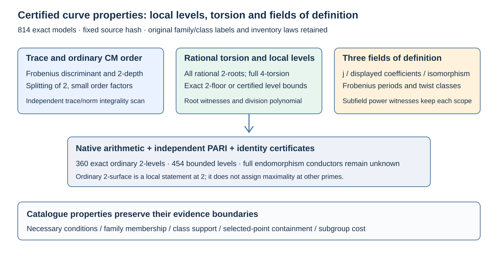
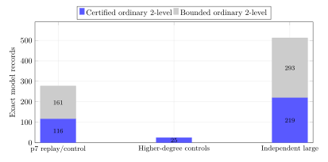

# Certified structural properties of the curve catalogue

Native arithmetic and independent PARI agree on **814 exact models**. The catalogue now certifies **360 ordinary 2-volcano levels** and bounds the remaining **454**. The 512 independent 192–252-bit sources include **219 certified 2-surface models** and **65 models with full rational 4-torsion**. Every property record retains its original family/class labels and exact model identity.

[Search the property browser](../../docs/curves/weak-families/properties.html), [canonical property records](../../docs/curves/weak-families/properties.json), [protocol](PROTOCOL.md), and [validation](VALIDATION.md).



## Inventory and field scope

The p7 inventory contains 277 route/conversion/control models; the 25 higher-degree models are constructed controls. The 512 independent large sources use the original model law, including full rational 2-torsion by construction. All 814 retained records are ordinary. These exact counts describe the frozen inventories and have no uniform-class density or sampling-error interpretation. Field sizes are 7^6 (17 bits), and 192–252 bits in degrees 6, 10 and 14. Selected subgroup orders and generators remain unspecified.

| Inventory | Models | Full 2 | Full 4 | Exact 2-level | Bounded 2-level | Proper j | Proper displayed model | Proper isomorphic model |
| --- | ---: | ---: | ---: | ---: | ---: | ---: | ---: | ---: |
| p7 replay/control | 277 | 200 | 52 | 116 | 161 | 4 | 1 | 3 |
| Higher-degree controls | 25 | 0 | 0 | 25 | 0 | 0 | 0 | 0 |
| Independent large sources | 512 | 512 | 65 | 219 | 293 | 0 | 0 | 0 |



## Certified properties

Each record contains ordinary/supersingular status, exact ambient-order valuations at 2,3,5,7,11,13, the unclassified residual cofactor, Frobenius discriminant, Frobenius conductor 2-depth, splitting of 2 in the CM field, rational nonidentity 2-point count, full rational 4-torsion, three field degrees, a twist power-class witness, and exact or bounded local endomorphism depth. Ten p7 records have a fully 13-smooth ambient order. Larger ambient cofactors are not silently treated as prime, and selected-point containment remains unspecified.

The property checks supply scoped supersingular, prime-field anomalous, ambient smoothness, model-descent and necessary genus-3 condition labels. A passed necessary condition retains that status. Existing exact p7 family labels and unresolved large-field class labels are unchanged.

## Local conductor and splitting without odd factorization

Write Delta=t^2-4Q=2^s u with u odd, Delta<0 for an ordinary model. If s is odd, v2(D_K)=3. If s is even and u=1 mod4, v2(D_K)=0; if u=3 mod4, v2(D_K)=2. Thus v2(f_pi)=(s-v2(D_K))/2. Odd squares are 1 mod8, so 2 splits when the resulting odd fundamental-discriminant residue is 1 mod8, is inert at 5 mod8, and is ramified when its 2-valuation is positive. This computes local data while full D_K and the odd conductor remain unknown.

The independent method searches for integral (pi-a)/2^k. Its trace and norm must be integers: (t-2a)/2^k and (Q-at+a^2)/2^(2k). For even t there are two candidate a residues modulo 2^k; for odd t no positive k works. The maximum k is the local conductor depth, since pi=A+f_pi omega in a maximal-order basis. PARI checks this method on every ordinary source and also checks the full fundamental discriminant for the p7-sized discriminants.

## Proposition: torsion certifies ordinary 2-levels

Let E/F_Q be ordinary in odd characteristic, with End(E)=Z+f_E O_K and s=v2(f_pi). If E has exactly one rational nonidentity 2-point, then v2(f_E)=s: the model is on the ordinary 2-volcano floor. Full rational 2-torsion gives v2(f_E)<=s-1; full rational 4-torsion gives v2(f_E)<=s-2. When a bound collapses to zero, the local level is exact. Full endomorphism conductors remain uncomputed.

Proof: choose a basis 1,omega of End(E), and write pi=a+b omega. The order index gives f_pi=f_E |b|. Full E[2] rational is equivalent to pi-1 lying in 2 End(E), because [2] is separable and an endomorphism killing E[2] factors through [2]. If b is even then Norm(pi)=Q odd forces a odd, so pi-1 lies in 2 End(E). Hence absence of full rational 2-torsion forces b odd and gives the floor equality. Full E[4] rational similarly implies pi-1 lies in 4 End(E), giving the second upper bound. The degree-2 volcano model applies because the characteristic exceeds three.

Native arithmetic obtains the rational 2-point count from the ambient order parity and cubic discriminant square class, then validates every PARI-supplied root. Full 4-torsion is certified from the root differences and -1 square class. PARI uses the sextic part of the degree-4 division polynomial and its y-coordinate square conditions independently.

## Three fields of definition

The minimal Frobenius period of j is its field degree. The joint period of a,b is the displayed model's degree. To test the smallest field admitting a K-isomorphic model, use the finite cyclic twist quotient. For generic j, normalize a0=3j/(1728-j), b0=2j/(1728-j), with twist parameter D=3b/(2a). For j=0 use b and sixth powers; for j=1728 use a and fourth powers.

For a candidate F_(p^d), put M=p^n-1, m=p^d-1 and h=gcd(twist_order,M/m). A twist parameter lies in the image of the subfield twist classes precisely when its M/h power is one: F_(p^d)^* times (K^*)^twist_order is generated by the h-th power of a cyclic generator. Each record retains all candidate-field power witnesses, including rejected smaller fields. This proves the minimal degree without providing a selected-point subgroup containment claim.

Four p7 records have j degree three. Three admit an isomorphic model over F_(7^3), while one requires F_(7^6). Only one already displays coefficients over F_(7^3).

| Exact model | j degree | Displayed coefficient degree | K-isomorphic-model degree |
| --- | ---: | ---: | ---: |
| `icv1-fp3k6-tm110-5f712c89` | 3 | 6 | 3 |
| `icv1-fp3k6-t202-39e02f24` | 3 | 6 | 6 |

## Certificates and independent replay

Thirteen portable identity records (IDC1hbe2d903bf49a14ea, IDC1hfcb76cf22432aec6, IDC1h6f49accd9dcbe782, IDC1h147787079919c710, IDC1h804e5c83abc76a76, IDC1h35630da796a98325, IDC1h84e6c7c6625fd509, IDC1hb43d551d5c10b86e, IDC1hb8686d3351c32a4e, IDC1h66444a7f2efc9508, IDC1h9f63df24babbd075, IDC1hca62343608685982, IDC1h67bd0090ad8a22e5) cover the cubic discriminant, cleared normalized-j and twist coefficients, translated Frobenius norm, and the eight unit-group index degrees used here. Each has 64 saved and 128 fresh evaluations; native expansion also verifies exact integer coefficient equality. Their formal-proof pointer remains null. The order/torsion and cyclic-group propositions have deductive proofs above.

PARI audit run 2 completes 814 rows with empty stderr under the 300-second cap. Run 1 stopped during stack-setting initialization; its zero-row receipt and executed sources remain archived. Source hashes, wrapper hashes, fixed input hash, runtime metadata and raw output are retained. Point counts are reused from the independently verified parent evidence, rather than claimed as newly recomputed here.

The previous catalogue study and two-branch evidence remain sealed. The new property browser is a sidecar; old model/family data are unchanged. Existing IC ratio and census graphs retain their values because this round adds structure, not a new paired cost.

## Reproduction

```sh
cargo test --release --locked --manifest-path research/iso1_weak_classes_20261007/report_check_runtime/Cargo.toml --bins --lib
cargo run --release --locked --manifest-path research/iso1_weak_classes_20261007/report_check_runtime/Cargo.toml --bin weak_curve_properties -- check .
```

The `emit` operation recreates fixed GP inputs. `audit` preserves a fresh run directory and refuses an existing one; archived runs are independently replayable through `replay.gp` with `WEAK_PROPERTIES_INPUTS` set to the frozen inputs. `build` rebuilds the property sidecar; `render` regenerates the browser, report and figures.

Sources: [Sutherland, ordinary/supersingular curves and endomorphism orders](https://math.mit.edu/classes/18.783/2023/LectureNotes13.pdf), [Sutherland, isogeny volcanoes](https://math.mit.edu/classes/18.783/2023/LectureNotes22.pdf), [PARI arithmetic functions](https://pari.math.u-bordeaux.fr/dochtml/html-stable/Arithmetic_functions.html), [PARI finite-field polynomial roots](https://pari.math.u-bordeaux.fr/dochtml/html/Polynomials_and_power_series.html), and [parent theorem/data](../iso1_weak_classes_20261007/two_branch_20261009/REPORT.md).
