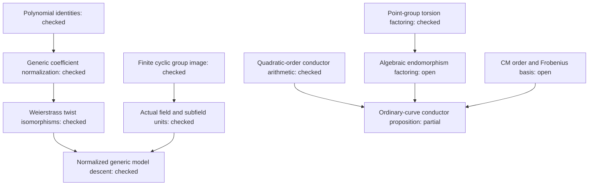

# Lean proofs for the curve property catalogue

Lean 4.34.1 checks the finite-field twist-image power test, the generic,
quartic and sextic short-model isomorphism classifications, and descent of
normalized generic models to an embedded subfield. It also checks the
quadratic-order conductor arithmetic, the point-group torsion factoring
lemma, and all 13 polynomial identities in the earlier catalogue study.

The [proof map](PROOF_MAP.md) gives the exact statement and scope of each
result. The complete ordinary-elliptic-curve conductor proposition remains
partially formalized: its arithmetic implications are checked, and the
remaining CM-order and algebraic-endomorphism bridges are explicit hypotheses
of `torsion_order_depth_bounds_of_bridges`.

The final local build, transitive axiom audit and fresh kernel replay all pass.
There are 48 explicitly declared public theorems and 71 audited declarations
including generated helpers. The [validation record](VALIDATION.md) identifies
the commands, final receipts, earlier attempts and the unrelated Rust baseline
failures. `EVIDENCE_SHA256.tsv` binds the proof sources, dependency lock and raw
receipts to the frozen numerical inventory; the native `proof_check.rs` verifies
that seal in CI.

The earlier [814-model report](../weak_curve_properties_20261010/REPORT.md),
its identity certificates, property records and evidence seal remain unchanged.
This directory is a versioned proof addition. A successful necessary filter
keeps its original meaning, and large-field class decisions retain their
original status. Numerical census and IC cost graphs are unchanged because
this addition verifies existing mathematical statements.



Run from this directory:

```sh
MATHLIB_NO_CACHE_ON_UPDATE=1 lake update
lake exe cache get Mathlib.NumberTheory.Padics.PadicVal.Basic \
  Mathlib.GroupTheory.SpecificGroups.Cyclic \
  Mathlib.AlgebraicGeometry.EllipticCurve.NormalForms \
  Mathlib.RingTheory.IntegralDomain
lake build
lake env lean AxiomAudit.lean
lake env leanchecker --fresh --verbose WeakCurveProperties
rustc --edition=2021 proof_check.rs -o /tmp/weak-curve-proof-check
/tmp/weak-curve-proof-check --check
```

`lean-toolchain` and `lake-manifest.json` pin the compiler and dependencies.
The bundled `leanchecker` in this toolchain is the successor to the external
`lean4checker`; the explicit module argument avoids the checker's package-name
inference. The fresh replay checks the compiled proof terms and imported
declarations in an empty kernel environment. The axiom audit independently
rejects dependencies outside `propext`, `Classical.choice` and `Quot.sound`.
The [Lean verification guidance](https://lean-lang.org/doc/reference/latest/ValidatingProofs/)
describes the purpose and limits of these checks.

Local build and audit attempts are retained. Setup was interrupted before a
bulk cache download so the cache could be placed on the external workspace
disk. The first selective-cache call used a path relative to the wrong root;
the subsequent module-name call completed. Early proof builds record syntax,
type and denominator-normalization errors corrected in the final sources.
Checks started before the final aggregate build completed are separately
labelled and supply no final verification receipt.

The instruction rule is added to both repositories' `AGENTS.md`: attempt a
faithful Lean theorem whenever feasible, audit actual builds and axioms,
preserve a proof map, and report concrete unfinished obligations. The dirty
cryptanalysis checkout's other changes are preserved; its publication PR
contains only the instruction addition.
