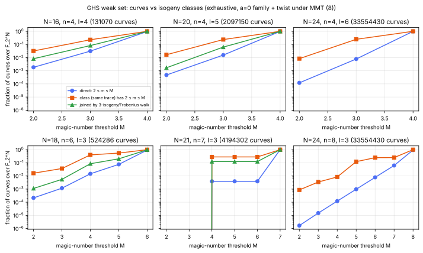
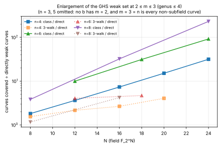
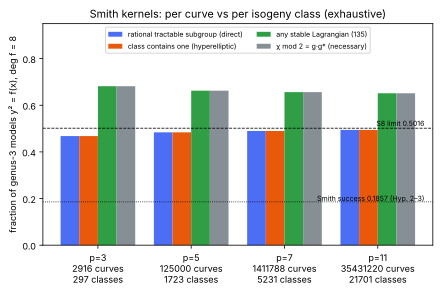
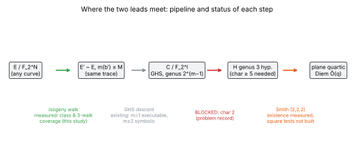

# Weak isogeny classes: GHS descent and Smith's genus-3 isogeny

Date: 2026-10-13. Run start (UTC): `20261013T0342Z`. Code: commit `f26274dda`
(`src/cryptanalysis/ghs_class_coverage.rs`, `src/cryptanalysis/smith_kernel_coverage.rs`,
`examples/weak_class_coverage.rs`). The manifests' `git_head` (`ee7d9ce1e`) is read when
the run ends. It is a data-only commit on top of `f26274dda`, so the code is identical. Host: 4-vCPU Intel Xeon
@ 2.10 GHz cloud container, no isolation. Timings are incidental and not a
performance claim. PDF: [`reports/run-20261013T0342Z/report.pdf`](reports/run-20261013T0342Z/report.pdf).

Both leads rest on one principle: the DLP transfers along an explicit isogeny,
so the weak set is a union of weak *isogeny classes*. This study asks two
exact questions on toy parameters:

1. **GHS.** For `E_b: y^2 + xy = x^3 + ax^2 + b` over `F_{2^N}`, `N = n*l`, what
   fraction of curves lie in a trace class (Tate: `F_{2^N}`-isogeny class)
   containing a curve with small magic number? How much of that is reached by
   3-isogeny walks?
2. **Smith.** For genus-3 `y^2 = f(x)`, `deg f = 8`, over `F_p`, what fraction
   of curves have a rational tractable `(Z/2)^3` kernel? How much does closing
   under the isogeny class (inside the hyperelliptic locus) add?

Every count below is **measured**: an exhaustive enumeration whose code is
covered by the tests listed under "Validation". Statements marked **derived**
follow from those counts plus a cited theorem. **Interpretation** is labelled.

## Definitions, checked against the sources

- **Magic number** (Maurer–Menezes–Teske, LMS JCM 5 (2002), eq. (5)):
  `m(b) = dim_F2 Span{(1, sqrt(b_i))}`, with `b_i = sigma^i(b)` and
  `sigma = x -> x^(2^l)`. The repository's older `ec_trapdoor::magic_number`
  uses `dim Span{sqrt(b_i)}`. That is one smaller exactly when `(x - 1)` does not
  divide `Ord_b` (MMT Theorem 5(i)), and the test `plain_orbit_undercounts`
  pins the difference. The legacy function is left unchanged in this PR; a
  separate task is suggested for fixing it. *Update 2026-10-13:* fixed;
  `ec_trapdoor::magic_number` now returns the MMT value and the plain orbit
  dimension is `ec_trapdoor::plain_orbit_dim` (see
  `docs/audits/GHS_MAGIC_NUMBER_MMT_CORRECTION_20261013.md`).
- **Twist** (`Tr a = 1`): admitted only under MMT Lemma 6 condition (8), `n`
  odd or `j_0 = 2^e`, which is equivalent to `n` odd or `Tr_{K/k}(b) != 0`. A twist
  failing (8) is counted as not covered (conservative).
- **Weak source:** `2 <= m <= M`. Subfield curves (`m = 1`) are excluded,
  following MMT, because the trace kills the large subgroup.
- **Traces** come from Kloosterman sums, `t(b) = -W(sqrt b)`, computed for all
  `b` with one Walsh–Hadamard transform. `traces_match_naive_count` checks
  them against direct point counts (both families, `N = 5..8`).
- **3-walk:** edges are the roots of `Phi_3(X, j) mod 2` (the repository's
  tabled `Phi_3`), plus Frobenius `j -> j^2`, which is free and preserves `m`.
  Distances come from a 0-1 BFS from the weak vertices. `walk3_neighbours_are_isogenous`
  checks that every edge preserves the trace.
- **Smith tractable subgroup** (Smith, J. Cryptology 22 (2009), Def. 1): a
  Galois-stable partition of the 8 Weierstrass points into 4 pairs.
  Classes are `L`-polynomials from exact counts over `F_p`, `F_{p^2}` and `F_{p^3}`.

## Lead 1: GHS weak set, per curve and per class



*Figure 1. The fraction of all `2(2^N - 1)` ordinary curves over `F_{2^N}`,
exhaustive, that is directly weak, class-covered or 3-walk-covered, against
the threshold `M`. Zero values drop off the log axis. The 3-walk was built for
`N <= 22`. Data: `data/ghs_N*.json`.*



*Figure 2. Class-covered ÷ directly weak curves at `2 <= m <= 3`, by `N`, for
`n = 4, 6, 8` (solid lines). Dotted lines show the same ratio for curves
reached by 3-isogeny walks.*

Selected rows (measured; full table: `python3 figures/tables.py`):

| N | n | l | M | curves | classes | direct | class | 3-walk | class÷direct | weak classes | median log2 √(class) | max walk steps |
|---|---|---|---|---|---|---|---|---|---|---|---|---|
| 16 | 4 | 4 | 2 | 131070 | 512 | 1.83e-03 | 3.19e-02 | 8.21e-03 | 17.4 | 15 | 4.13 | 3 |
| 16 | 4 | 4 | 3 | 131070 | 512 | 3.11e-02 | 2.29e-01 | 8.28e-02 | 7.4 | 111 | 4.00 | 4 |
| 18 | 6 | 3 | 4 | 524286 | 1024 | 1.46e-02 | 4.01e-01 | 8.53e-02 | 27.4 | 346 | 4.58 | 14 |
| 20 | 4 | 5 | 2 | 2097150 | 2048 | 4.73e-04 | 1.65e-02 | 1.68e-03 | 35.0 | 31 | 5.07 | 3 |
| 20 | 4 | 5 | 3 | 2097150 | 2048 | 1.56e-02 | 2.36e-01 | 6.32e-02 | 15.1 | 462 | 4.98 | 13 |
| 21 | 7 | 3 | 4 | 4194302 | 2896 | 3.90e-03 | 2.81e-01 | 1.25e-01 | 72.0 | 644 | 5.32 | 112 |
| 24 | 4 | 6 | 2 | 33554430 | 8192 | 1.20e-04 | 8.35e-03 | n/a | 69.5 | 63 | 6.06 | n/a |
| 24 | 4 | 6 | 3 | 33554430 | 8192 | 7.81e-03 | 2.46e-01 | n/a | 31.6 | 1969 | 5.97 | n/a |
| 24 | 6 | 4 | 4 | 33554430 | 8192 | 3.78e-03 | 5.21e-01 | n/a | 137.7 | 3699 | 6.06 | n/a |
| 24 | 8 | 3 | 3 | 33554430 | 8192 | 1.50e-05 | 3.46e-03 | n/a | 230.6 | 26 | 6.10 | n/a |
| 24 | 12 | 2 | 2 | 33554430 | 8192 | 3.58e-07 | 5.52e-04 | n/a | 1543.2 | 3 | 6.30 | n/a |

Observations (measured):

- In every `(N, n, M)` row with `n >= 4`, the class closure exceeds the
  direct weak set, by a factor of 1.8 to 1543 over these fields. For fixed
  `(n, M)` the factor grows with `N`. For `n = 4`, `M = 2` it is 8.6, 17.4, 35.0
  and 69.5 at `N = 12, 16, 20, 24`, roughly doubling per 4 bits.
- The 3-isogeny/Frobenius walk reaches part of the class closure. At
  `N = 20, n = 4, M = 3` it is 6.32e-02 against 2.36e-01. At `N = 20, n = 10`
  the walk adds almost nothing: 1.24e-05 against direct 1.14e-05, against a
  class closure of 2.88e-03. The longest recorded walk is 112 steps
  (`N = 21, n = 7, M = 4`).
- Classes have at most a few hundred members here: the median `log2 √(size)` is
  4 to 6.3.

Derived (from Tate and the counts above): the directly weak curves at a given
`(n, M)` number roughly `q^{M/n}` up to small factors (MMT Theorem 5(ii)),
while the number of classes is about `4 √q`. So once the weak count exceeds
about `√q`, a constant share of classes holds a weak member, and the class closure
stops tracking the direct fraction. The growth of class÷direct with `N` in
Figure 2 is consistent with this. That is a counting statement, not an attack cost.

Not established: the cost of building the isogeny to the weak member beyond
3-isogeny steps (vertical moves, other primes `l`, a class-group
meet-in-the-middle); the genus and Jacobian order of the GHS curve; subgroup
transfer; and any comparison with rho. Toy `N` says nothing directly about
cryptographic `N`, and MMT give the asymptotics for those.

## Lead 2: Smith kernels, per curve and per class



*Figure 3. Exhaustive genus-3 models `y^2 = f(x)` with `deg f = 8`, curve and
quadratic twist, per `p`. Bars show the direct rational-tractable-subgroup
fraction, its isogeny-class closure, any stable Lagrangian, and the necessary
condition `chi mod 2 = g·g*`. Dashed: the `S_8` Chebotarev limit 0.50159.
Dotted: Smith's success rate 0.1857. Data: `data/smith_p*.json`, `data/smith_chebotarev.json`.*

| p | curves | classes | direct tractable | class closure | any Lagrangian | χ̄ = g·g* | charpoly mismatches | violations |
|---|---|---|---|---|---|---|---|---|
| 3 | 2916 | 297 | 0.4678 | 0.4678 | 0.6818 | 0.6818 | 0 | 0 |
| 5 | 125000 | 1723 | 0.4840 | 0.4840 | 0.6626 | 0.6626 | 0 | 0 |
| 7 | 1411788 | 5231 | 0.4897 | 0.4897 | 0.6563 | 0.6563 | 0 | 0 |
| 11 | 35431220 | 21701 | 0.4943 | 0.4943 | 0.6514 | 0.6514 | 0 | 0 |

Observations (measured):

- The 135 Lagrangians of `J[2]` and the 105 of pair type are recovered. For
  each of the 22 `S_8` cycle types, the count `#S(H)` of rational tractable
  subgroups matches Smith's Lemma 1 table exactly.
  `sum_T P(T)(1 - (3/4)^{#S(H)}) = 0.185738` reproduces Smith's 18.57% (his
  eq. (12)). The `3/4` comes from Smith's Hypotheses 2 and 3, two square
  conditions with probability 1/2 each. Without them, the fraction with at
  least one rational tractable subgroup is **0.50159**.
- On every enumerated curve, `chi_pi mod 2` equals the characteristic
  polynomial of the root permutation on `J[2]`, with 0 mismatches. This
  validates the point counts against the factorisation.
- **The class closure equals the direct fraction for every `p` measured.**
  No isogeny class mixes hyperelliptic members with and without a rational
  tractable subgroup.

Derived: on `S_8`, `chi mod 2` determines whether a rational tractable
subgroup exists (finite check of the 22 cycle types,
`reproduces_smith_lemma1_and_constant`). Pair-capable types all have
`chi mod 2 ∈ {T^6+1, T^6+T^4+T^2+1}`; no other type has a tractable subgroup.
`chi mod 2` is an isogeny invariant, so **an isogeny walk inside the
hyperelliptic locus never creates a tractable subgroup**. The walk extension
can only flip Smith's two square conditions (Props. 2 and 4), which are
not invariants. Under Smith's own hypotheses that bounds the gain at
18.57% → 50.16%. Whether walks reach that ceiling, and at what cost, needs
the square tests implemented. That is an open problem:
[`problems/smith-kernel-isogeny-class-walk.md`](../../problems/smith-kernel-isogeny-class-walk.md).

Also measured: the `1+7` cycle type (one rational root, an irreducible
septic) has 2 stable non-tractable Lagrangians and no tractable one. These
are Smith's Remark 3 kernels, which the trigonal construction does not use.

## Where the leads meet



*Figure 4. Status of each step in the proposed pipeline.*

The pipeline as stated does not compose. GHS lands on curves over `F_{2^l}`,
while Smith's trigonal construction "does not apply in characteristics 2 and
3" (Smith 2009, §1). There is also a derived structural reason: an ordinary
genus-3 Jacobian in characteristic 2 has `#J[2](k̄) = 2^3`, not `2^6`.
Recorded in
[`problems/ghs-to-smith-pipeline-characteristic-mismatch.md`](../../problems/ghs-to-smith-pipeline-characteristic-mismatch.md),
with two ways to unblock it: an odd-characteristic descent onto genus-3
hyperelliptic curves (Diem 2003, not read here), or a char-2
hyperelliptic-to-quartic isogeny.

End-to-end proportion: **not computable** from this study, since the middle
link is missing. For each step separately, the measured or derived fractions
are given above.

## Validation

`cargo test --release --lib -- ghs_class_coverage smith_kernel_coverage`
runs 12 tests. They cover: traces against naive counts; MMT Theorem 5 counts
at `N = 12`; the plain-orbit undercount; agreement with `ec_trapdoor`'s
plain definition; 3-isogeny edges preserving the trace; root finding;
the Lagrangian counts 135/105; the matching criterion against the group
action; the Smith Lemma 1 table and its 0.1857 constant; the `g·g*`
necessary condition; and the `p = 3` charpoly cross-check.

## Reproduce

```sh
cargo run --release --example weak_class_coverage -- \
  --out research/weak_isogeny_classes_20261013/data \
  --ghs 8,9,10,12,14,15,16,18,20,21,22,24 --walk-max 22
cargo run --release --example weak_class_coverage -- \
  --out research/weak_isogeny_classes_20261013/data --smith 3,5,7,11
python3 research/weak_isogeny_classes_20261013/figures/plot.py   # layout only
```

## References

- M. Maurer, A. Menezes, E. Teske, *Analysis of the GHS Weil descent attack on
  the ECDLP over characteristic two finite fields of composite degree*, LMS
  JCM 5 (2002) 127–174 (eq. (5), Thm. 5, Lemma 6 read for this study).
- P. Gaudry, F. Hess, N. Smart, *Constructive and destructive facets of Weil
  descent on elliptic curves*, J. Cryptology 15 (2002).
- B. Smith, *Isogenies and the discrete logarithm problem in Jacobians of
  genus 3 hyperelliptic curves*, J. Cryptology 22 (2009), arXiv:0806.2995
  (Def. 1, Lemma 1, Props. 2 and 4, Hyps. 1–3, eq. (12) read for this study).
- C. Diem, *An index calculus algorithm for plane curves of small degree*,
  ANTS 2006; Gaudry–Thomé–Thériault–Diem, double large prime variation,
  Math. Comp. 2007 (cited for the `Õ(q)` and `Õ(q^{4/3})` costs, not re-derived).
- F. Hess, *Generalising the GHS attack on the elliptic curve discrete
  logarithm problem*, LMS JCM 7 (2004); Menezes–Teske–Weng (2004). Not read
  in this round.
