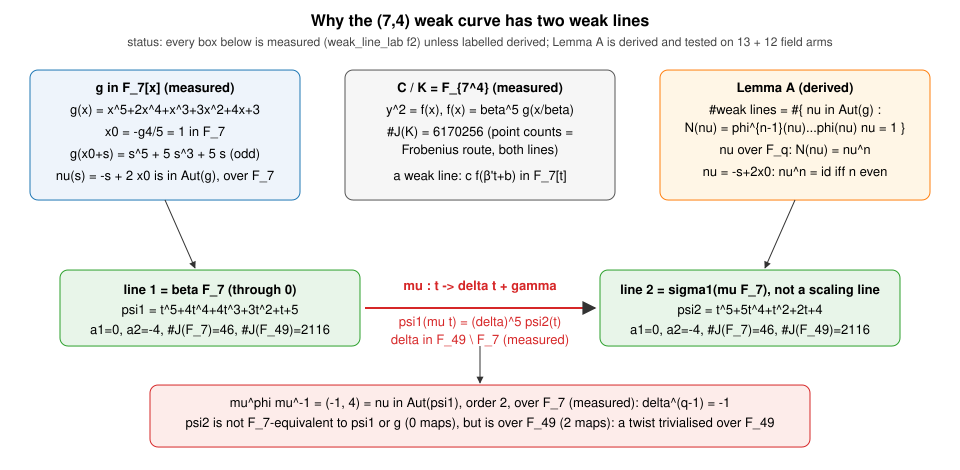
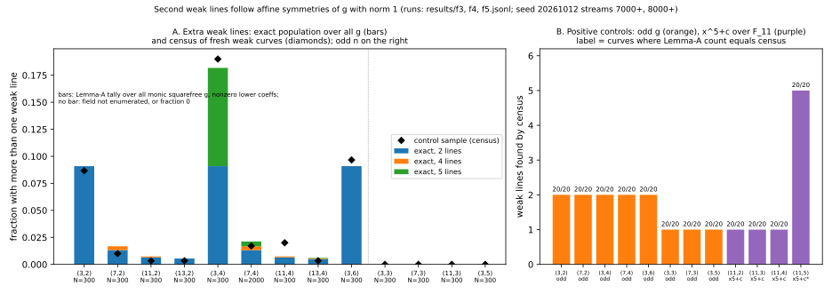

# The second weak line at (7, 4): an affine symmetry of g, acting through F_{q²}

Date 2026-10-13. Protocol: [`PROTOCOL.md`](PROTOCOL.md), frozen at commit
`81dbf9136` before any run, no amendments. Code: [`weak_line_lab.rs`](weak_line_lab.rs)
(fork of `weak_curve_lab.rs`, same field/census code). Records:
[`results/`](results/), environment in
[`results/run-20261013.env.txt`](results/run-20261013.env.txt).
Conductor: no control plane was reachable (`coord_start_work` returned 404), so
no task id.

**This answers the open item of the merged study
`research/weak_subfield_hyperelliptic_decomposition_20261012/` (#1757, README
E3: "Unexplained ... second weak line at (7, 4)").** That study's frozen
records are not edited. Structural diagnostic on toy fields; no speedup,
sub-rho or deployed-curve claim.

## Answer

The (7,4) weak curve is `f(x) = β⁵ g(x/β)` with `g ∈ F_7[x]` odd about an
`F_7`-point: `g(x0 + s) = s⁵ + 5s³ + 5s` with `x0 = 1` (measured). So
`ν(s) = −s + 2x0` is an affine symmetry of `g` defined over `F_7`, and because
`n = 4` is even, `N(ν) = ν⁴ = id`, which by Lemma A (derived below) gives
exactly one extra weak line: `σ1(μF_7)` with `μ(t) = δt + γ`, `δ ∈ F_49 \ F_7`,
`δ^{q−1} = −1`. Both H1 (affine symmetry) and H2 (quadratic subfield) hold,
as one mechanism: the second `F_7`-form is the twist of the first by the class
of `ν`, trivialised over `F_49`. H3 (coincidence with trivial `Aut(g)`) is
falsified: `Aut(g)` has order 2 (the full scan over all 2400 scalars).



## Derivation (Lemma A; derived, then tested)

Let `ψ1 ∈ F_q[t]` be monic quintic and `f = ψ1 ∘ σ1⁻¹` with `σ1` affine (the
known line; `ψ1 = g` for the E3 curve). For `μ ∈ Aff(K)`, the line
`σ1(μF_q)` is weak iff `ψ1(μt)` is, up to a scalar, in `F_q[t]`. Both
`ψ1(μt)/ζ_μ⁵` and its `φ`-conjugate `ψ1(μ^φ t)/ζ_μ^{5q}` are monic, so
weakness is equivalent to `ψ1(μ t) = ψ1(μ^φ t)·(scalar)`, i.e.
`ν := μ^φ μ⁻¹ ∈ Aut(ψ1) = {(ζ,c) : ψ1(ζs+c) = ζ⁵ψ1(s)}`. A line determines
`μ` up to right multiplication by `Aff(F_q)`, which does not change `ν`.
Iterating `μ^φ = νμ` `n` times gives the cocycle condition
`N(ν) = φ^{n−1}(ν)∘…∘φ(ν)∘ν = id`, and conversely every such `ν` is a
coboundary by Hilbert 90 for `G_a` and `G_m` (so for `Aff = G_a ⋊ G_m`).
Therefore

    #weak lines = #{ ν ∈ Aut(g) : N(ν) = id }.            (Lemma A)

Corollaries (derived): (i) there is always the line `ν = 1`; (ii) a second
line needs `Aut(g) ≠ 1`; (iii) a nontrivial `ν` fixes `∞` and permutes the
five roots, so has order 2, 4 (fixing a root) or 5; (iv) `g` odd about
`x0 ∈ F_q` gives `ν` over `F_q`, `N(ν) = ν^n`, extra line iff `n` even, with
`δ ∈ F_{q²}`. The parity step (iv) is checked in Lean:
[`lean/InvolutionNorm.lean`](lean/InvolutionNorm.lean) proves
`(−1,c)∘(−1,c) = id` and `ν^n = id ↔ n even` for affine maps over `Int`
(`lake build`, [`lean/build.log`](lean/build.log); the theorems use the
standard axioms `propext`, `Classical.choice`, `Quot.sound` via `omega` and
`simp`; no Mathlib). Lemma A itself (Hilbert 90 step) is not formalised.

## Results

### F1 reproduction (measured)

`./weak_line_lab f1` prints the E3 weak-curve record at (7,4); `cmp` against
the line recorded in `run-20261013T0404Z.jsonl` is silent: byte-identical
(`results/f1.jsonl`, `results/f1.recorded.jsonl`).

### F2 the two lines (measured; `results/f2.jsonl`)

| | line 1 | line 2 |
| --- | --- | --- |
| line | `βF_7`, contains 0 (scaling line) | not through 0 |
| monic `ψ` on the line | `t⁵+4t⁴+4t³+3t²+t+5` | `t⁵+5t⁴+t²+2t+4` |
| Frobenius `(a1, a2)` | (0, −4) | (0, −4) |
| `#J` over `F_7`, `F_49` | 46 = 2·23, 2116 | 46, 2116 |
| `#J(K)` by Frobenius vs point counts | 6170256, agrees | 6170256, agrees |

* `g = x⁵+2x⁴+x³+3x²+4x+3` over `F_7`; centred form `s⁵+5s³+5s`, so
  `Aut(g) = {id, s ↦ −s+2}` (full scan over all 2400 `ζ`; the restricted
  scan over roots of unity agrees), both with norm 1: Lemma-A count 2 = census 2.
* The K-affine map between the lines has scalar `δ ∈ F_49 \ F_7`;
  `ν = μ^φμ⁻¹ = (−1, 4)` lies in `Aut(ψ1)`, order 2, defined over `F_7`.
* `ψ2` is **not** `F_7`-equivalent to `ψ1` or `g` (0 affine maps over `F_7`), but
  there are 2 over `F_49` (the two differ by `ν`) and 2 over `K`: the second
  `F_7`-form is a twist trivialised over `F_49`, not the same form. Both forms
  have the same Frobenius data `(0, −4)`; with `a1 = 0` the quadratic twist
  already has the same L-polynomial, so equal L-polynomials do not
  distinguish them here.
* Line 2 is not the image of line 1 under `Aut` of `f`: `ν` maps `βF_7` to
  itself (`c ∈ F_7`), which is why the extra line is not an orbit effect.

### F3 control census (measured; `results/f3.jsonl`)

300 fresh weak curves per field (2000 at (7,4)), same sampler as E3.
Lemma-A count = census count on every one of the 5600 curves (12 fields
at 300, (7,4) at 2000): **0 mismatches in 13 of 13 fields**; shortcut census = exhaustive census on all
checked curves (all where `|K| ≤ 2401`, 5 at (11,4) and (13,4)); restricted
vs full `Aut` scan agree wherever both were run.

| `(q,n)` | curves | weak-line counts (curves) | with `g` odd about an `F_q`-point |
| --- | --- | --- | --- |
| (3,2) | 300 | 1: 274, 2: 26 | 26 (all 2 lines) |
| (7,2) | 300 | 1: 297, 2: 2, 4: 1 | 3 |
| (11,2) | 300 | 1: 299, 4: 1 | 1 |
| (13,2) | 300 | 1: 299, 2: 1 | 1 |
| (3,4) | 300 | 1: 243, 2: 27, 5: 30 | 27 |
| **(7,4)** | 2000 | 1: 1966, 2: 21, 4: 5, 5: 8 | 26 (21 + 5) |
| (11,4) | 300 | 1: 294, 2: 5, 4: 1 | 6 |
| (13,4) | 300 | 1: 299, 2: 1 | 1 |
| (3,6) | 300 | 1: 271, 2: 29 | 29 |
| (3,3) (7,3) (11,3) (3,5) | 300 each | all 1 | 27, 3, 2, 18, none with a second line |

So an extra weak line is not special to this `g` but is not generic either:
at (7,4) it occurs in 34 of 2000 fresh weak curves (1.7%), always with
`Aut(g) ≠ 1`. Odd `n` never gives one for an odd `g` (`ν^n ≠ id`), matching
the E3 data (every odd-n field had one line). The (3,4) and (7,4) rows
include curves with 5 lines: order-5 symmetry `ζ₅ ∈ F_{q⁴}`, norm 1 (this is the
E3b `x⁵+c` situation). Note the (11,4) sample has 6 curves with an odd `g`
against 2.2 expected from the exact rate below (one field of 13; I did not
correct for that; the Lemma-A/census agreement is exact on those curves).

### F4 exact population by `g` (measured tally of Lemma A; `results/f4.jsonl`)

Every monic squarefree `g ∈ F_q[x]` with nonzero lower coefficients
(`ζ` restricted to roots of unity of order 2, 4, 5):

| `(q,n)` | `g` | 1 line | 2 lines | 4 lines | 5 lines |
| --- | --- | --- | --- | --- | --- |
| (7,2) | 6798 | 6684 | 90 | 24 | 0 |
| (7,3) | 6798 | 6798 | 0 | 0 | 0 |
| **(7,4)** | 6798 | 6654 | 90 | 24 | 30 |
| (11,4) | 91690 | 91010 | 600 | 80 | 0 |
| (13,4) | 231036 | 229656 | 1128 | 120 | 132 |

At (7,4), 144 of 6798 `g` (2.1%) give more than one weak line; the E3 curve
is one of the 90 two-line `g` (odd `g`, an `F_7`-rational involution). Fields
(3,·), (11,·), (13,·) are in the JSONL. Under the E3 sampler at the three
even-n fields it ran (not (5,4): char 5, below), the chance of at least one
extra line was therefore roughly 20% (dominated by (3,4)); the E3 observation
needed no special explanation beyond this symmetry.

### F5 positive controls (measured; `results/f5.jsonl`)

20 constructed curves per arm; exhaustive census where `|K| ≤ 2401`, else
shortcut. Odd `g`: 2 lines at (3,2) (7,2) (3,4) (7,4) (3,6) and 1 line at
(3,3) (7,3) (3,5), all 20/20 as Lemma A predicts. `x⁵+c` over `F_11`: 1 line
at n = 2, 3, 4 (`ζ₅ ∈ F_11`, `N = ν^n ≠ id`), 20/20; supplementary arm added
after the freeze (labelled `*` in the graph): 5 lines at (11,5), 20/20,
matching E3b's (11,5) row of 5 lines.



Graph source: `results/f3.jsonl`, `f4.jsonl`, `f5.jsonl` via
[`reports/plot.py`](reports/plot.py) (layout only). Panel A: exact
population fractions (bars) and control census fractions (diamonds), seed
`20261012` streams `7000+`; panel B: positive controls.

## Scope, limits, what stays open

- Lemma A is derived here and supported by 0 mismatches in 25 field arms
  (13 control fields + 12 positive-control arms, 20 curves each) and the exact
  population tallies; it is not formalised beyond the parity step.
- Char 5 is outside Lemma A (translations are symmetries there): the E3
  (5,4) weak curve with 1 line is not covered by this study.
- E3b's `x⁵+c` counts (5 at (3,4) and (7,4)) and `x⁵+cx` count (4 at (7,4))
  are consistent with the lemma by hand (order-5 and order-4 symmetries with
  norm 1), but E3b counts only `square_ok` lines, so I did not compare the
  other rows and did not rerun them.
- The relation spans `H` of the second line were not computed; whether the
  second form changes the collapse bound is untested here. Both forms have
  `#J(F_7) = 46`, `#J(F_49) = 2116`, so the P1 bound is the same size.
- Nothing here concerns deployed curves or any speedup.

## Graphs checked and left unchanged

No canonical graph changes: this follow-up adds no ECDLP rung, no timing
(so no `benchmarks/` entry); `docs/index-calculus-scoreboard.html`,
`docs/ic/progress-timeline.json` and `docs/ic/boundary_targets.json` are
unaffected.

## Reproduce

```sh
rustc --edition 2021 -O weak_line_lab.rs
./weak_line_lab f1 | cmp - results/f1.recorded.jsonl
./weak_line_lab f2; ./weak_line_lab f3; ./weak_line_lab f4; ./weak_line_lab f5
python3 reports/plot.py                                   # layout only
typst compile --root . REPORT.typ REPORT.pdf
cd lean && lake build
```
