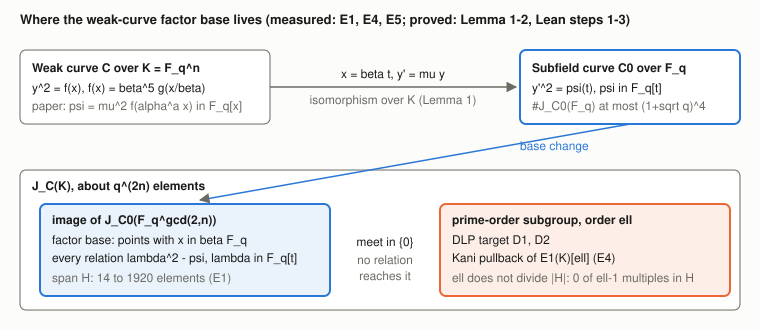
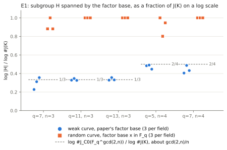
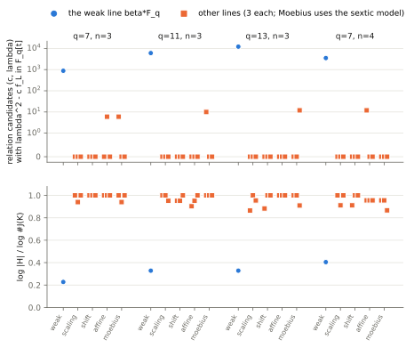

# The Bhati–Singh weak curves are subfield curves: the factor base never leaves `J_C0(F_{q^gcd(2,n)})`

2026-10-12. Conductor T-2193. **Structural stage diagnostic on toy fields.**
No speedup is claimed, no sub-rho claim, nothing about deployed curves.
Protocol frozen before the first run: [PROTOCOL.md](PROTOCOL.md), with dated
amendments at its end. Run `20261013T0404Z` (the corrected run; reported
here): [records](results/run-20261013T0404Z.jsonl),
[environment](results/run-20261013T0404Z.env.txt),
[ICV1 identities of the elliptic factors](results/run-20261013T0404Z.icv1.json),
[run report](reports/run-20261013T0404Z/run-report.pdf). The first run
`20261013T0055Z` is kept unedited ([records](results/run-20261013T0055Z.jsonl),
[run report](reports/run-20261013T0055Z/run-report.pdf)); its E4x records
appear twice (amendment 1) and its other 116 records are identical to this
run's. This report as PDF: [REPORT.pdf](REPORT.pdf).

## Question

Bhati and Singh (*A new perspective on the decomposition in the Jacobian of
small genus hyperelliptic curve*, SPACE) describe a class of genus-2 curves
over `K = F_{q^n}` on which index-calculus relations cost no polynomial
system solve. Two questions were put to it:

1. Does the relation step reach the large prime-order subgroup of `J_C(K)`?
2. If such a curve is built with a (2,2)-split Jacobian and the DLP is
   pulled back from an elliptic factor ("Kani descent"), does anything
   change? What about other factor-base lines?

## Verdict

1. **No.** On a weak curve the paper's factor base generates a subgroup `H`
   inside the image of `J_C0(F_q)` (n odd) or `J_C0(F_{q²})` (n even), where
   `C0` is a curve over `F_q`. Proved below (Lemmas 1–2, Proposition 3),
   confirmed on the paper's own printed examples (E5) and on 15 toy weak
   curves (E1). Every prime factor of `|H|` is at most `(1+√q)^4`.
2. **No.** The Kani pullback `E1(K) → J_C(K)` is a homomorphism on every
   tested pair, where the tested pairs are those that do not meet the
   fibre `u = r²` on which `φ` is not implemented (so totality of `φ` is
   not established), and its image of prime order `ℓ` meets `H` only in 0
   (E4). Lines other than the weak one span the group and give no
   candidates for free relations in 43 of 48 cases (E2); curves with
   several weak lines only reach a `(1+√q)^4`-smooth part of the group
   (E3b).

What the toy data show about the trade is a contrast, not an equivalence:
on the one weak curve per field, the weak line has 882 to 12168 relation
candidates and a collapsed span, while the 48 other lines have none on 43
and 6 to 12 on 5, with spans of index at most 8 (constant `μ`, bounded
search only; the 5 lines with candidates did not collapse).



## Derivation

Notation as in the paper: `C : y² = f(x)`, `f` monic quintic over `K`,
`K* = <α>`, `d = (q^n − 1)/(q − 1)`, twist `f~(x) = f(α^a x)`, `μ~ = α^l`,
`ψ = μ~² f~`, factor base `F~ = {(P) − (∞) : P ∈ C~(K), x(P) ∈ F_q}`.

**Lemma 1 (normal form; derived, Lean step 1, certificate
`IDC1h81f0f7e9f3a5f2da`).** The paper's condition (16), `t_0 ≡ … ≡ t_5 (mod d)`, holds for
some `a` exactly when `f(x) = β⁵ g(x/β)` with `g ∈ F_q[x]` monic and
`β = α^a`. In that case `ψ ∈ F_q[x]` and `(x, y) ↦ (x, μ~ y)` is an
isomorphism over `K` from `C~ : y² = f~(x)` to `C0 : y'² = ψ(x)`.

*Proof.* The coefficient of `x^i` in `μ~² f(α^a x)` is `α^{2l + j_i + ia}`;
it lies in `F_q` for all `i ≤ 5` (with `j_5 = 0`) iff
`f_i β^{i−5} ∈ F_q`, i.e. `f(βt) = β⁵ g(t)`. Then
`(μ~ y)² = μ~² f~(x) = ψ(x)`. ∎

**Lemma 2 (rational points; derived, Lean step 2).** Every point of the
factor base has, in the `C0` model, `x ∈ F_q` and `y'² = ψ(x) ∈ F_q`, so
`y' ∈ F_{q²} ∩ K = F_{q^e}` with `e = gcd(2, n)`. Every relation point of
`H~ = λ~² − ψ`, `λ~ ∈ F_q[x]`, has `y' = λ~(x) ∈ F_q`.

**Proposition 3 (collapse; derived, step 3 in Lean, base change of
Jacobians not formalized).** The subgroup `H ⊂ J_C(K)` generated by the
factor base lies in the image of `J_C0(F_{q^e})`. Hence `|H|` divides
`#J_C0(F_{q^e})`, and since `#J_C0(F_{q²}) = #J_C0(F_q) · #J_C0^tw(F_q)`,
every prime factor of `|H|` is at most `(1 + √q)^4`.

**Corollary.** If `D1` has prime order `ℓ > (1+√q)^4`, then `<D1> ∩ H = 0`:
no relation among factor-base elements carries information modulo `ℓ`, and
no element `a·D1 + b·D2 ≠ 0` decomposes over the factor base, by Nagao's
method or any other. If instead `ℓ ≤ (1+√q)^4`, Pollard rho in `<D1>`
already costs at most about `(1 + √q)² ≈ q` group operations, which is not
more than the paper's relation collection over a factor base of size
`O(q)`.

The paper states that the individual-logarithm step "still needs" Nagao's
decomposition. On its weak curves that step has no solutions for a target
of large prime order. The paper's experiments exhibit single relations
only; they do not compute a discrete logarithm.

The same argument covers any line `L = βF_q + b` on which `c · f(βt + b)`
has coefficients in `F_q` for some `c ∈ K*` (a "weak line"), and any union
of such lines: each contributes a subgroup of some `F_q`-form of the curve.

Lean: [lean/SubfieldCollapse.lean](lean/SubfieldCollapse.lean), toolchain
`leanprover/lean4:v4.34.1`, no Mathlib, `lake build` log in
[lean/build.log](lean/build.log). `#print axioms` reports no axioms for
`point_map`, `relation_point_rational`, `span_le_image`,
`not_in_span_of_not_in_image`.

| Report statement | Lean declaration | Status |
| --- | --- | --- |
| Lemma 1, map to `C0` | `point_map` | proved for any commutative multiplication |
| Lemma 2, relation points rational | `relation_point_rational` | proved |
| Prop. 3, span inside the image | `span_le_image` | proved for any map preserving `0, +, −` |
| Corollary, target outside the span | `not_in_span_of_not_in_image` | proved |
| `φ : J_C0(F_{q^e}) → J_C(K)` exists and sends a rational point class to `(P) − (∞)` | none | **not formalized** (Jacobians of curves are not available without Mathlib; standard base change) |
| `#J_C0(F_q) ≤ (1+√q)^4` (Weil) | none | **not formalized** |

## Measurements (run 20261013T0404Z, all exact counts)

Tool: [weak_curve_lab.rs](weak_curve_lab.rs), dependency-free Rust, Cantor
arithmetic on Mumford divisors over `F_{q^n}` by log tables; subgroups by
exact coset extension. `#J(K)` from point counts over `K` and `K²`, and for
weak curves also from `det(1 − π^n)` of the `F_q` L-polynomial: the two
agreed on all 15 weak curves and all 6 Kani curves. Group law self-test
(`#J · D = 0`, associativity, 20 random triples per curve) passed on all 30
E1 curves.

### E5: the paper's printed examples

| Example | `q` | `n` | `μ~² f~ = ψ` with `ψ` over `F_q` | points on `C~` | `μ~·y ∈ F_q` | `μ~·y = ±λ~(x)` |
| --- | --- | --- | --- | --- | --- | --- |
| 1 | 1354523531 | 7 | yes (6 of 6 coefficients) | 5 of 5 | 5 of 5 | 5 of 5 |
| 2 | 13545235267 | 4 | yes | 5 of 5 | 5 of 5 | 5 of 5 |

All ten published relation points are `F_q`-rational points of `C0`.

### E1: span of the factor base, weak against random

Three weak curves and three random curves per field. Both samplers draw
every non-leading coefficient nonzero (amendment 2), so "random" below means
"conditioned (nonzero-coefficient) random quintic". `sub` is
`#J_C0(F_q)` for `n = 3` and `#J_C0(F_{q²})` for `n = 4`.

| `(q, n)` | `#J(K)` (weak) | size of `H` (weak) | `sub` | largest prime of `#J(K)` | largest prime of size of `H` | `(1+√q)^4` | index of `H` on the 3 random curves |
| --- | --- | --- | --- | --- | --- | --- | --- |
| (7, 3) | 108892, 127413, 118528 | 14, 39, 64 | 28, 39, 64 | 3889, 13, 463 | 7, 13, 2 | 176.7 | 4, 1, 4 |
| (11, 3) | 1734208, 1856068, 1751868 | 112, 148, 108 | 112, 148, 108 | 79, 12541, 5407 | 7, 37, 3 | 347.2 | 1, 1, 1 |
| (13, 3) | 4739904, 4652073, 4928036 | 156, 237, 164 | 156, 237, 164 | 211, 727, 199 | 13, 79, 41 | 449.9 | 1, 1, 1 |
| (5, 4) | 392656, 438805, 456976 | 506, 589, 338 | 1012, 589, 676 | 97, 149, 13 | 23, 31, 13 | 109.7 | 1, 13, 2 |
| (7, 4) | 6137600, 5529600, 5831936 | 560, 1920, 836 | 2240, 3840, 3344 | 137, 5, 109 | 7, 5, 19 | 176.7 | 1, 1, 1 |

On all 15 weak curves `|H|` divides `sub`, every element of `H` has all
its `C0`-model Mumford coordinates in `F_{q^e}`, and the paper's condition
(16) holds (an `a` was found). On all 15 conditioned random curves condition (16) fails
and `H` has index 1 to 13 in `J(K)`; the three cases above index 2 have a
factor base of one point. P1 and P2 hold; the falsifier did not fire.



### E2: other factor-base lines on a weak curve

First weak curve of E1 in each field. "Candidates" counts pairs `(c, λ)`,
`c` a square, `deg λ = 2` (quintic model, affine lines) or `3` (sextic
model, Möbius lines), with `λ² − c·f_L ∈ F_q[t]`. Constant `μ` only; the
two models are not like-for-like. Each cell lists the three lines as
candidates / index of `H`.

| `(q, n)` | weak line `βF_q` | 3 scalings `β'F_q` | 3 shifts `βF_q + b` | 3 generic affine | 3 Möbius |
| --- | --- | --- | --- | --- | --- |
| (7, 3) | 882 / 7778 | 0/1, 0/2, 0/1 | 0/1, 0/1, 0/1 | 0/1, 6/1, 0/1 | 6/1, 0/2, 0/1 |
| (11, 3) | 6050 / 15484 | 0/1, 0/1, 0/2 | 0/2, 0/2, 0/1 | 0/4, 0/2, 0/1 | 10/1, 0/1, 0/1 |
| (13, 3) | 12168 / 30384 | 0/8, 0/1, 0/2 | 0/6, 0/1, 0/1 | 0/1, 0/1, 0/1 | 0/1, 0/1, 12/4 |
| (7, 4) | 3528 / 10960 | 0/1, 0/4, 0/1 | 0/4, 0/1, 0/1 | 12/2, 0/2, 0/2 | 0/2, 0/2, 0/8 |

The weak line's count equals `(q−1)² q² / 2` for `n = 3` and four times
that for `n = 4` (derived: `λ ∈ F_q[t]`, and for even `n` also
`√ε · F_q[t]` and both square classes of `c`). On the 48 other lines the
count is 0 on 43 and 6 to 12 on 5, which is one orbit under
`(c, λ) → (e²c, ±eλ)`, `e ∈ F_q*`; all 48 span `J(K)` up to index 8.



### E3: exhaustive census of weak affine lines

All `d · q^{n−1}` affine lines of each curve (the sampler of the "random
curve" column is the conditioned one of amendment 2).

| `(q, n)` | lines | weak curve | random curve | `x⁵ + c` | `x⁵ + cx` |
| --- | --- | --- | --- | --- | --- |
| (7, 3) | 2793 | 1 | 0 | 1 | 1 |
| (11, 3) | 16093 | 1 | 0 | 1 | 1 |
| (13, 3) | 30927 | 1 | 0 | 1 | 1 |
| (5, 4) | 19500 | 1 | 0 | not run (char 5) | 0 |
| (7, 4) | 137200 | 2 | 0 | 0 | 0 |
| (3, 4) | 1080 | 1 | 0 | 0 | 0 |

The one conditioned random curve drawn per field has no weak line in any of
the six fields (an observed sample of six curves, not a population
statement). For `n = 3` every sampled
`x⁵ + c` and `x⁵ + cx` is weak (derived: `gcd(5, d) = gcd(4, d) = 1`, so
`β⁵ ∈ c·F_q*` is solvable). **Unexplained:** the (7, 4) weak curve has a
second weak line that is not a scaling line; its span was not computed. A
candidate explanation is an extra affine symmetry of that `g`; not checked.

### E3b: all weak lines of automorphism-rich curves (post-hoc, supplementary)

Post-hoc supplementary experiment, added under amendment 3: it censuses
all weak affine lines, translations included, rather than the weak scaling
lines the frozen table names. At (11, 5) and (13, 4) (`q^n > 3000`) the
translation is restricted to the one value that clears the `x⁴`
coefficient. First random `c` for which at least one weak line exists
(`tries` in the records).

| curve, `(q, n)` | weak lines | Frobenius forms | per-line size of `H` | union size of `H` | `#J(K)` | largest prime, union or per line | `(1+√q)^4` |
| --- | --- | --- | --- | --- | --- | --- | --- |
| `x⁵+c`, (3, 4) | 5 | 1 | 50 ×5 | 2000 | 10000 = 2⁴·5⁴ | 5 | 55.7 |
| `x⁵+c`, (7, 4) | 5 | 1 | 1250 ×5 | 1250000 | 6250000 = 2⁴·5⁸ | 5 | 176.7 |
| `x⁵+c`, (11, 5) | 5 | 5 | 101, 176, 1, 131, 271 | 631065776 (derived: pairwise coprime, product) | 25873696816 = 2⁴·11·41·101·131·271 | 271 | 347.2 |
| `x⁵+cx`, (5, 4) | 6 | 2 | 16, 324 ×5 | 1296 | 331776 = 2¹²·3⁴ | 3 | 109.7 |
| `x⁵+cx`, (7, 4) | 4 | 1 | 1024, 512, 1024, 512 | 2048 | 5308416 = 2¹⁶·3⁴ | 2 | 176.7 |
| `x⁵+cx`, (13, 4) | 2 | 1 | 14450 ×2 | ≥ 104401250 (capped) | 835210000 = 2⁴·5⁴·17⁴ | 17 | 449.9 |

Here the union of weak lines can be a large part of `J(K)`: index 5 at
(3, 4) and (7, 4), index 41 at (11, 5). In every row the largest prime
factor of every per-line span, and of every union that was enumerated, is
below `(1+√q)^4`, and so is the largest prime factor of `#J(K)` itself:
these Jacobians split into `F_q`-sized pieces, which is what makes several
lines weak. P3 holds. For the two capped unions the bound is established
for the per-line spans and for `#J(K)`, hence for the union.

### E4: (2,2)-split weak curve and the pullback from `E1`

`C0 : y² = S(x) = x⁶ + ax⁴ + bx² + c` with a root `r ∈ F_q` moved to
infinity; `E1 : v² = u³ + au² + bu + c`, `E2 : v² = cu³ + bu² + au + 1`;
`C = ` the twist `f(x) = β⁵ ψ0(x/β)`, `β = γ²`. The map
`φ : E1(K) → J_C(K)` is the pullback along `(x, y) ↦ (x², y)`. E4 is the
frozen selection (first `(a, b, r)`, which is `S = x⁶ − 1`); E4x requires
`a, b ≥ 1` and was added after E4 was seen (supplementary). `φ` is defined
only off the fibre `u = r²` of `E1` (the fibre over the root `r` moved to
infinity); the lab implements no formula there and skips such pairs.

| run | `(q, n)` | `S` | `#J(K) = #E1(K)·#E2(K)` | `φ(P+Q) = φ(P)+φ(Q)` | `ℓ` | order of `φ(P)` | size of `H` | multiples of `φ(P)` in `H` |
| --- | --- | --- | --- | --- | --- | --- | --- | --- |
| E4 | (7, 3) | `x⁶+6` | 117936 = 364·324 | 200 of 200 | 13 | 13 | 48 = 2⁴·3 | 0 of 12 |
| E4 | (11, 3) | `x⁶+10` | 1774224 = 1332·1332 | 199 of 199 | 37 | 37 | 144 = 2⁴·3² | 0 of 36 |
| E4 | (13, 3) | `x⁶+12` | 5143824 = 2268·2268 | 200 of 200 | 7 | 7 | 144 = 2⁴·3² | 0 of 6 |
| E4x | (7, 3) | `x⁶+x⁴+x²+4` | 100440 = 310·324 | 200 of 200 | 31 | 31 | 120 = 2³·3·5 | 0 of 30 |
| E4x | (11, 3) | `x⁶+x⁴+x²+8` | 1683648 = 1332·1264 | 198 of 198 | 37 | 37 | 192 = 2⁶·3 | 0 of 36 |
| E4x | (13, 3) | `x⁶+x⁴+x²+10` | 4435236 = 2106·2106 | 200 of 200 | 13 | 13 | 324 = 2²·3⁴ | 0 of 12 |

`ℓ` is the largest prime factor of `#E1(K)`; pairs where a point maps to
the excluded fibre `u = r²` were skipped, which is why two rows test 198
or 199 pairs. `φ` is a homomorphism on the tested pairs; the test does not
establish that it extends to a homomorphism on all of `E1(K)`. On the
chosen point of order `ℓ`, `φ` is nonzero and has order `ℓ`, and the
transferred instance lies outside the factor-base span in all six cases.
P4's negative part holds on these inputs.

The elliptic factors, by ICV1 identity (model over `K`, short Weierstrass
form; `ICV1.md`; moved from the printed equations by an `F_q`-isomorphism,
orders recounted independently in
[results/run-20261013T0404Z.icv1.json](results/run-20261013T0404Z.icv1.json),
which also holds the full ICV1 strings). The orders and the slugs are the
join key to the E4/E4x records by `(exp, q, n)`; the records themselves are
unchanged. In-repo registration in `docs/curves/registry.json` is
deferred (it regenerates the covers and browser artefacts and needs
coordination); the slugs are computed and verified by
`reports/icv1_factors.py` only, so `check_curve_names.py` does not yet
find them in the registry. No EC1 representation exists because the lab
records no subgroup generator in coordinates (it stores `E1` points as
internal log-table indices).

| run | `(q, n)` | factor | `#E(K)` | ICV1 slug (prefix `icv1-` omitted until registered) |
| --- | --- | --- | --- | --- |
| E4 | (7, 3) | `E1` | 364 | `fp3k3-tm20-bef51007` |
| E4 | (7, 3) | `E2` | 324 | `fp3k3-t20-b3476bff` |
| E4 | (11, 3) | `E1` | 1332 | `fp4k3-t0-92ab3c9d` |
| E4 | (11, 3) | `E2` | 1332 | `fp4k3-t0-67d3d40c` |
| E4 | (13, 3) | `E1` | 2268 | `fp4k3-tm70-d7518a94` |
| E4 | (13, 3) | `E2` | 2268 | `fp4k3-tm70-cbe24c4e` |
| E4x | (7, 3) | `E1` | 310 | `fp3k3-t34-0f6b94b1` |
| E4x | (7, 3) | `E2` | 324 | `fp3k3-t20-d4c9c593` |
| E4x | (11, 3) | `E1` | 1332 | `fp4k3-t0-f6684909` |
| E4x | (11, 3) | `E2` | 1264 | `fp4k3-t68-e724d929` |
| E4x | (13, 3) | `E1` | 2106 | `fp4k3-t92-c1554838` |
| E4x | (13, 3) | `E2` | 2106 | `fp4k3-t92-b20414d0` |

Traces of `π^n` reachable from an `F_q`-curve, against all integer traces
in the Hasse interval over `K` (measured counts): 7 of 75 at (7, 3), 13 of
145 at (11, 3), 11 of 187 at (13, 3).

## What the Kani route cannot do (derived)

- **Compatibility.** A weak curve is a base change, so its elliptic
  factors are defined over `F_q` (or `F_{q²}`). Only elliptic curves over
  `K` isogenous to a subfield curve are reachable: at most `4√q + 1` of
  about `4√Q` Frobenius traces, `Q = q^n`, a fraction about
  `q^{−(n−1)/2}`.
- **Factor base.** Proposition 3 applies unchanged to the transferred
  instance (E4).
- **Direction.** The transfer goes from a group of size about `Q` to one
  of size about `Q²`. Rho on `E(K)` costs about `Q^{1/2}`, on `J_C(K)`
  about `Q`; genus-2 index calculus over `K` has the same exponent as rho
  (`2 − 2/g = 1` at `g = 2`).
- This is the case "Jacobian embedding plus base change" of the transfer
  conservation note `docs/ic/RESEARCH_TRANSFER_AWARE_IC_20261010.md`.

## Scope and limits

- Toy fields, `q ≤ 13`, `n ∈ {3, 4, 5}`, genus 2, odd characteristic. The
  derivation is uniform in `q`, `n`; E5 checks it at the paper's 31- and
  34-bit `q`.
- Non-weak lines were probed with constant `μ` and bounded `deg λ` only.
  The Joux–Vitse system with `deg μ ≥ 1` was not run; E2 says nothing
  about how many relations it finds there.
- The characteristic-2 variant (Section 6 of the paper) was not tested.
  The same substitution `y' = μ~ y` applies to its `μ~² f~` term; the
  paper already reports too few relations there.
- Kani splittings of degree above 2 were not built. The compatibility and
  factor-base arguments do not depend on the degree.
- Nothing here bounds the cost of the HCDLP on these curves by other
  methods. A base-changed curve over `F_{q^n}` is the classical setting
  for Weil-descent attacks; that is outside this study.
- Unresolved: the second weak line at (7, 4) in E3.

## Graphs checked and left unchanged

No canonical graph changes: `docs/index-calculus-scoreboard.html`,
`docs/ic/progress-timeline.json` and `docs/ic/boundary_targets.json` carry
measured ECDLP rungs, and this study adds none. No timing was taken, so
`benchmarks/` has no entry.

## Reproduce

```sh
rustc --edition 2021 -O weak_curve_lab.rs && ./weak_curve_lab all && ./weak_curve_lab e4x
python3 reports/plot.py results/run-20261013T0404Z.jsonl reports/run-20261013T0404Z   # layout only
python3 reports/icv1_factors.py results/run-20261013T0404Z.jsonl results/run-20261013T0404Z.icv1.json
cd lean && lake build
cargo run --release --example identity_certificate_weak_twist
```
